# ĐẶC TẢ THIẾT KẾ CƠ SỞ DỮ LIỆU TOÀN DIỆN & CHUẨN HÓA API ADMIN (DATABASE SCHEMA & ADMIN CONTRACT)
## DỰ ÁN: MLD VIỆT NAM — HỆ SINH THÁI Y TẾ, DƯỠNG SINH SPA & HỌC VIỆN ĐÀO TẠO NGHỀ
**Chuẩn hóa 100% theo toàn bộ thiết kế Figma & Toàn bộ phân hệ CRUD Quản trị Web Admin**  
**Hệ quản trị CSDL:** PostgreSQL 15+ (Hỗ trợ Supabase, AWS RDS, Docker)  
**Phiên bản tài liệu:** 4.0.0 Production Enterprise Standard  
**Ngày cập nhật:** 14/10/2026  

---

## MỤC LỤC TỔNG QUAN

1. [MA TRẬN ÁNH XẠ 12 CHỨC NĂNG CRUD ADMIN & 3 CƠ CHẾ NGHIỆP VỤ](#1-ma-trận-ánh-xạ-12-chức-năng-crud-admin--3-cơ-chế-nghiệp-vụ)
2. [SƠ ĐỒ THỰC THỂ QUAN HỆ TOÀN HỆ THỐNG (MERMAID ERD FULL)](#2-sơ-đồ-thực-thể-quan-hệ-toàn-hệ-thống-mermaid-erd-full)
3. [DANH MỤC TẤT CẢ KIỂU ENUM DỮ LIỆU (STANDARDIZED ENUMS)](#3-danh-mục-tất-cả-kiểu-enum-dữ-liệu-standardized-enums)
4. [CHI TIẾT ĐẶC TẢ TẤT CẢ CÁC BẢNG & TRƯỜNG DỮ LIỆU (53 BẢNG)](#4-chi-tiết-đặc-tả-tất-cả-các-bảng--trường-dữ-liệu-53-bảng)
   - [PHÂN HỆ 1: TÀI KHOẢN, PHÂN QUYỀN RBAC (AUTH, ROLES & PERMISSIONS)](#phân-hệ-1-tài-khoản-phân-quyền-rbac-auth-roles--permissions)
   - [PHÂN HỆ 2: CƠ SỞ, CHI NHÁNH, PHÒNG DỊCH VỤ & GIƯỜNG (FACILITIES)](#phân-hệ-2-cơ-sở-chi-nhánh-phòng-dịch-vụ--giường-facilities)
   - [PHÂN HỆ 3: NHÂN SỰ, KỸ THUẬT VIÊN, CA TRỰC & NGHỈ PHÉP (WORKFORCE)](#phân-hệ-3-nhân-sự-kỹ-thuật-viên-ca-trực--nghỉ-phép-workforce)
   - [PHÂN HỆ 4: DỊCH VỤ SPA & ĐƠN ĐẶT ĐA DỊCH VỤ (SERVICES CATALOG)](#phân-hệ-4-dịch-vụ-spa--đơn-đặt-đa-dịch-vụ-services-catalog)
   - [PHÂN HỆ 5: ĐẶT LỊCH, CHECK-IN, CHECK-OUT & ĐIỀU PHỐI (RESERVATIONS)](#phân-hệ-5-đặt-lịch-check-in-check-out--điều-phối-reservations)
   - [PHÂN HỆ 6: GÓI LIỆU TRÌNH, TIẾN ĐỘ ĐIỀU TRỊ & SỨC KHỎE (TREATMENTS)](#phân-hệ-6-gói-liệu-trình-tiến-độ-điều-trị--sức-khỏe-treatments)
   - [PHÂN HỆ 7: THĂNG HẠNG HỘI VIÊN, ĐIỂM THƯỞNG & QUY CÁCH VOUCHER (LOYALTY RULES)](#phân-hệ-7-thăng-hạng-hội-viên-điểm-thưởng--quy-cách-voucher-loyalty-rules)
   - [PHÂN HỆ 8: HỌC VIỆN LMS, ĐIỂM DANH & CHỨNG CHỈ ĐIỆN TỬ (ACADEMY OPERATIONS)](#phân-hệ-8-học-viện-lms-điểm-danh--chứng-chỉ-điện-tử-academy-operations)
   - [PHÂN HỆ 9: THU HỌC PHÍ, ĐẶT CỌC, THU NGÂN POS & DOANH THU (FINANCIALS)](#phân-hệ-9-thu-học-phí-đặt-cọc-thu-ngân-pos--doanh-thu-financials)
5. [QUY TẮC ĐỒNG BỘ DỮ LIỆU & CHUẨN API CHO DEVELOPER ADMIN (DATA CONTRACTS)](#5-quy-tắc-đồng-bộ-dữ-liệu--chuẩn-api-cho-developer-admin-data-contracts)

---

## 1. MA TRẬN ÁNH XẠ 12 CHỨC NĂNG CRUD ADMIN & 3 CƠ CHẾ NGHIỆP VỤ

Để phục vụ lập trình viên xây dựng **Web Admin Portal** và **Backend API**, ma trận dưới đây chỉ rõ chính xác bảng và cột tương ứng:

| STT | Chức năng Admin yêu cầu | Bảng CSDL phụ trách | Các trường dữ liệu cốt lõi |
| :---: | :--- | :--- | :--- |
| **1** | **Quản lý dịch vụ** | `service_categories`, `services` | `id`, `category_id`, `name`, `slug`, `duration_minutes`, `price`, `discount_price`, `steps` (Quy trình), `benefits`, `is_featured`, `is_active` |
| **2** | **Quản lý check-in / check-out khách hàng** | `bookings`, `branch_rooms` | `checked_in_at`, `checked_in_by_id`, `service_started_at`, `checked_out_at`, `checked_out_by_id`, `assigned_room_id`, `assigned_bed_number`, `actual_duration_minutes`, `checkin_notes` |
| **3** | **Quản lý tài khoản** | `users`, `user_settings`, `audit_logs` | `id`, `phone`, `email`, `full_name`, `role`, `membership_tier`, `is_active`, `locked_reason`, `locked_at`, `password_hash` |
| **4** | **Quản lý nhân viên & ca trực** | `staff_profiles`, `technicians`, `technician_shifts`, `staff_leaves` | `employee_code`, `department`, `position`, `employment_type`, `base_salary`, `commission_rate`, `shift_date`, `assigned_room_id`, `leave_status` |
| **5** | **Quản lý voucher & Quy cách nhận** | `coupons`, `voucher_distribution_rules`, `user_vouchers` | `code`, `discount_percent`, `discount_amount`, `max_discount`, `min_order_amount`, `trigger_event`, `target_tier`, `valid_days_after_claim`, `status` |
| **6** | **Quản lý phân quyền (RBAC)** | `roles`, `permissions`, `role_permissions`, `user_roles` | `roles.code`, `permissions.code`, `permissions.module`, `user_roles.branch_id` (Phân quyền theo từng chi nhánh hoặc toàn hệ thống) |
| **7** | **Quản lý & Cập nhật liệu trình điều trị** | `treatment_packages`, `user_packages`, `treatment_journal` | `total_sessions`, `completed_sessions`, `session_number`, `condition_before`, `condition_after`, `treatment_notes`, `before_photos`, `after_photos`, `customer_signature_url` |
| **8** | **Quản lý đào tạo & Điểm danh** | `course_batches`, `batch_schedules`, `student_attendance` | `batch_code`, `schedule_text`, `session_date`, `is_practice_lab`, `status` ('PRESENT', 'ABSENT', 'LATE', 'EXCUSED'), `check_in_time`, `marked_by_id` |
| **9** | **Quản lý chứng chỉ điện tử & Tra cứu QR** | `certificate_templates`, `student_certificates` | `certificate_code`, `qr_verification_code`, `student_name`, `course_title`, `final_grade`, `issue_date`, `certificate_pdf_url`, `status` ('ISSUED', 'REVOKED') |
| **10**| **Quản lý khóa học, bài học & đề kiểm tra**| `courses`, `course_chapters`, `course_lessons`, `course_quizzes`, `quiz_questions`, `quiz_submissions` | `tuition_fee`, `deposit_amount`, `lesson_type`, `video_url`, `attachments`, `options`, `correct_option`, `score`, `passed`, `instructor_feedback` |
| **11**| **Quản lý cẩm nang chăm sóc tại nhà** | `home_care_guidelines` | `title`, `slug`, `category`, `read_time_minutes`, `summary`, `content`, `steps` (JSONB các bước), `image_url`, `is_featured`, `is_published` |
| **12**| **Quản lý thu học phí, đặt cọc & trả góp**| `tuition_transactions` | `transaction_code`, `enrollment_id`, `transaction_type` ('DEPOSIT', 'FULL_PAYMENT', 'INSTALLMENT_1', 'REMAINING_BALANCE'), `amount`, `payment_method`, `due_date`, `receipt_pdf_url` |
| **13**| **Cơ chế thăng hạng hội viên** | `membership_tier_rules`, Trigger `process_invoice_paid_complete` | Cấu hình mốc chi tiêu `min_accumulated_spent` (Standard 0đ, Silver 5tr, Gold 15tr, Platinum 30tr, Diamond 60tr), tự động thăng hạng khi hóa đơn PAID |
| **14**| **Cơ chế nhận & sử dụng điểm tích lũy** | `loyalty_point_settings`, `point_transactions` | Tỷ lệ tích lũy (theo % hạng hội viên), quy đổi (1 điểm = 100đ), trần sử dụng tối đa (max 30% hóa đơn), hạn dùng 12 tháng |
| **15**| **Quy cách nhận voucher** | `voucher_distribution_rules`, `user_vouchers` | 8 sự kiện phát hành voucher tự động: `ON_SIGNUP`, `ON_BIRTHDAY`, `ON_TIER_UPGRADE`, `ON_FIRST_BOOKING`, `REFERRAL_INVITER`, `REFERRAL_INVITEE`, `MANUAL_BY_ADMIN` |

---

## 2. SƠ ĐỒ THỰC THỂ QUAN HỆ TOÀN HỆ THỐNG (MERMAID ERD FULL)

```mermaid
erDiagram
    USERS ||--o{ USER_ROLES : has
    ROLES ||--o{ USER_ROLES : assigned_to
    ROLES ||--o{ ROLE_PERMISSIONS : contains
    PERMISSIONS ||--o{ ROLE_PERMISSIONS : grants

    USERS ||--o| STAFF_PROFILES : employs_as
    BRANCHES ||--o{ STAFF_PROFILES : branch_staff
    STAFF_PROFILES ||--o| TECHNICIANS : is_therapist
    STAFF_PROFILES ||--o{ STAFF_LEAVES : applies_for

    BRANCHES ||--o{ BRANCH_ROOMS : has_rooms
    BRANCH_ROOMS ||--o{ BOOKINGS : hosts_booking
    BRANCH_ROOMS ||--o{ BATCH_SCHEDULES : hosts_class_lab

    USERS ||--o{ BOOKINGS : customer
    BOOKINGS ||--o{ BOOKING_ITEMS : items
    SERVICES ||--o{ BOOKING_ITEMS : line_service
    COUPONS ||--o{ BOOKINGS : applied_coupon

    USERS ||--o{ USER_PACKAGES : buys
    TREATMENT_PACKAGES ||--o{ USER_PACKAGES : template
    USER_PACKAGES ||--o{ TREATMENT_JOURNAL : logs_sessions

    COURSES ||--o{ COURSE_CHAPTERS : contains
    COURSE_CHAPTERS ||--o{ COURSE_LESSONS : lessons
    COURSES ||--o{ COURSE_QUIZZES : tests
    COURSE_QUIZZES ||--o{ QUIZ_QUESTIONS : questions
    COURSE_ENROLLMENTS ||--o{ QUIZ_SUBMISSIONS : takes_test

    COURSES ||--o{ COURSE_BATCHES : runs
    COURSE_BATCHES ||--o{ BATCH_SCHEDULES : timetables
    COURSE_BATCHES ||--o{ COURSE_ENROLLMENTS : admits
    COURSE_ENROLLMENTS ||--o{ STUDENT_ATTENDANCE : attendance
    COURSE_ENROLLMENTS ||--o{ TUITION_TRANSACTIONS : pays_tuition
    COURSE_ENROLLMENTS ||--o| STUDENT_CERTIFICATES : certified

    COUPONS ||--o{ VOUCHER_DISTRIBUTION_RULES : rules
    USERS ||--o{ USER_VOUCHERS : wallet
    COUPONS ||--o{ USER_VOUCHERS : voucher_spec

    USERS ||--o{ INVOICES : billed_customer
    BRANCHES ||--o{ INVOICES : billed_branch
    INVOICES ||--o{ INVOICE_ITEMS : breakdown
    USERS ||--o{ POINT_TRANSACTIONS : points_ledger
```



---

## 3. DANH MỤC TẤT CẢ KIỂU ENUM DỮ LIỆU (STANDARDIZED ENUMS)

Tất cả lập trình viên Backend và Frontend Admin **bắt buộc dùng đúng chính xác giá trị viết hoa** dưới đây:

1. **`user_role`**: `'CUSTOMER'`, `'STUDENT'`, `'TECHNICIAN'`, `'INSTRUCTOR'`, `'CASHIER'`, `'RECEPTIONIST'`, `'BRANCH_MANAGER'`, `'ADMIN'`, `'SUPER_ADMIN'`
2. **`purpose_interest`**: `'BEAUTY_SPA'`, `'ACADEMY'`, `'BOTH'`
3. **`member_tier`**: `'STANDARD'`, `'SILVER'`, `'GOLD'`, `'PLATINUM'`, `'DIAMOND'`
4. **`room_type`**: `'VIP_ROOM'`, `'MASSAGE_ROOM'`, `'HEAD_SPA_ROOM'`, `'SKINCARE_ROOM'`, `'ACADEMY_CLASSROOM'`, `'PRACTICE_LAB'`
5. **`slot_status`**: `'AVAILABLE'`, `'HOLD'`, `'BOOKED'`, `'BLOCKED'`
6. **`booking_status`**: `'PENDING'`, `'CONFIRMED'`, `'CHECKED_IN'`, `'IN_SERVICE'`, `'COMPLETED'`, `'CANCELLED'`, `'NO_SHOW'`
7. **`package_status`**: `'ACTIVE'`, `'COMPLETED'`, `'EXPIRED'`, `'CANCELLED'`, `'PAUSED'`
8. **`course_level`**: `'BEGINNER'`, `'INTERMEDIATE'`, `'ADVANCED'`, `'MASTER'`
9. **`batch_status`**: `'UPCOMING'`, `'OPEN_FOR_ENROLLMENT'`, `'IN_PROGRESS'`, `'COMPLETED'`, `'CANCELLED'`
10. **`enrollment_status`**: `'CONSULTING'`, `'DEPOSITED'`, `'ENROLLED'`, `'STUDYING'`, `'GRADUATED'`, `'DROPPED'`
11. **`lesson_type`**: `'VIDEO'`, `'READING_DOC'`, `'PRACTICE_GUIDE'`, `'QUIZ'`
12. **`attendance_status`**: `'PRESENT'`, `'ABSENT'`, `'LATE'`, `'EXCUSED'`
13. **`payment_status`**: `'UNPAID'`, `'PENDING'`, `'PARTIAL'`, `'PAID'`, `'REFUNDED'`, `'FAILED'`
14. **`payment_method`**: `'CASH_AT_SPA'`, `'VNPAY'`, `'MOMO'`, `'BANK_TRANSFER'`, `'MEMBERSHIP_WALLET'`, `'SPLIT_PAYMENT'`
15. **`voucher_status`**: `'AVAILABLE'`, `'USED'`, `'EXPIRED'`
16. **`voucher_distribution_trigger`**: `'ON_SIGNUP'`, `'ON_BIRTHDAY'`, `'ON_TIER_UPGRADE'`, `'ON_FIRST_BOOKING'`, `'REFERRAL_INVITER'`, `'REFERRAL_INVITEE'`, `'MANUAL_BY_ADMIN'`, `'PUBLIC_CLAIM'`
17. **`certificate_status`**: `'DRAFT'`, `'ISSUED'`, `'REVOKED'`
18. **`tuition_trans_type`**: `'DEPOSIT'`, `'FULL_PAYMENT'`, `'INSTALLMENT_1'`, `'INSTALLMENT_2'`, `'REMAINING_BALANCE'`, `'REFUND'`
19. **`staff_department`**: `'RECEPTION'`, `'CASHIER'`, `'THERAPY_MASSAGE'`, `'SKINCARE'`, `'ACADEMY_TRAINING'`, `'CUSTOMER_SERVICE'`, `'ADMINISTRATION'`
20. **`employment_type`**: `'FULL_TIME'`, `'PART_TIME'`, `'PROBATION'`, `'INTERN'`
21. **`leave_status`**: `'PENDING'`, `'APPROVED'`, `'REJECTED'`, `'CANCELLED'`

---

## 4. CHI TIẾT ĐẶC TẢ TẤT CẢ CÁC BẢNG & TRƯỜNG DỮ LIỆU (53 BẢNG)

### PHÂN HỆ 1: TÀI KHOẢN, PHÂN QUYỀN RBAC (AUTH, ROLES & PERMISSIONS)

#### 1. Bảng `users` (Hồ sơ người dùng & Tài khoản đăng nhập)
* **Mục đích:** Quản lý toàn bộ khách hàng, học viên, nhân viên, bác sĩ, giảng viên và quản trị viên.

| Tên cột | Kiểu dữ liệu | Ràng buộc | Mặc định | Ý nghĩa & Nghiệp vụ Admin |
| :--- | :--- | :--- | :--- | :--- |
| `id` | `UUID` | `PRIMARY KEY` | `gen_random_uuid()` | Định danh người dùng |
| `phone` | `VARCHAR(20)` | `UNIQUE, NOT NULL` | | SĐT đăng nhập OTP (A03, A04) |
| `email` | `VARCHAR(255)` | `UNIQUE` | `NULL` | Hòm thư điện tử |
| `password_hash` | `VARCHAR(255)` | | `NULL` | Mật khẩu mã hóa Bcrypt (Admin/Staff) |
| `full_name` | `VARCHAR(150)` | `NOT NULL` | | Họ và tên đầy đủ |
| `avatar_url` | `TEXT` | | `NULL` | Đường dẫn ảnh chân dung |
| `gender` | `VARCHAR(10)` | `CHECK IN ('MALE','FEMALE','OTHER')` | `'OTHER'` | Giới tính |
| `date_of_birth` | `DATE` | | `NULL` | Ngày sinh (tự động kích hoạt voucher sinh nhật) |
| `address` | `TEXT` | | `NULL` | Địa chỉ cư trú |
| `emergency_contact_name` | `VARCHAR(150)` | | `NULL` | Tên người thân liên hệ khẩn cấp |
| `emergency_contact_phone`| `VARCHAR(20)` | | `NULL` | SĐT người thân khẩn cấp |
| `purpose` | `purpose_interest` | `NOT NULL` | `'BEAUTY_SPA'` | Nhu cầu quan tâm chọn tại A06 |
| `role` | `user_role` | `NOT NULL` | `'CUSTOMER'` | Phân loại vai trò cấp 1 |
| `membership_tier` | `member_tier` | `NOT NULL` | `'STANDARD'` | Hạng hội viên MLD Loyalty |
| `reward_points` | `INT` | `CHECK (reward_points >= 0)` | `0` | Số điểm thưởng hiện có |
| `total_spent` | `NUMERIC(14,2)`| `CHECK (total_spent >= 0)` | `0.00` | Tổng tiền chi tiêu tích lũy toàn hệ thống |
| `referral_code` | `VARCHAR(20)` | `UNIQUE, NOT NULL` | | Mã giới thiệu cá nhân |
| `referred_by_id` | `UUID` | `REFERENCES users(id)` | `NULL` | Người đã giới thiệu |
| `is_active` | `BOOLEAN` | `NOT NULL` | `TRUE` | Trạng thái hoạt động (Admin bật/tắt) |
| `locked_reason` | `TEXT` | | `NULL` | Lý do Admin khóa tài khoản |
| `locked_at` | `TIMESTAMPTZ` | | `NULL` | Thời điểm khóa tài khoản |
| `fcm_device_token`| `TEXT` | | `NULL` | Token Firebase Push Notification |
| `created_at` | `TIMESTAMPTZ` | `NOT NULL` | `CURRENT_TIMESTAMP` | Ngày tạo |
| `updated_at` | `TIMESTAMPTZ` | `NOT NULL` | `CURRENT_TIMESTAMP` | Ngày cập nhật |

#### 2. Bảng `roles` (Vai trò quản trị)
* Các trường: `id` (UUID PK), `code` (VARCHAR(50) UNIQUE NOT NULL, VD: 'SUPER_ADMIN', 'BRANCH_MANAGER', 'RECEPTIONIST', 'CASHIER'), `name` (VARCHAR(100) NOT NULL), `description` (TEXT), `is_system` (BOOLEAN DEFAULT FALSE), `created_at` (TIMESTAMPTZ).

#### 3. Bảng `permissions` (Quyền hạn chi tiết)
* Các trường: `id` (UUID PK), `code` (VARCHAR(100) UNIQUE NOT NULL, VD: 'services.create', 'services.update', 'bookings.checkin', 'bookings.checkout', 'invoices.create', 'courses.manage'), `module` (VARCHAR(50) NOT NULL), `name` (VARCHAR(150) NOT NULL), `description` (TEXT), `created_at` (TIMESTAMPTZ).

#### 4. Bảng `role_permissions` (Gán quyền cho vai trò)
* Khóa chính kết hợp: `(role_id, permission_id)`.

#### 5. Bảng `user_roles` (Gán vai trò người dùng theo phạm vi chi nhánh)
* Các trường: `id` (UUID PK), `user_id` (FK `users.id`), `role_id` (FK `roles.id`), `branch_id` (FK `branches.id`, NULL nghĩa là áp dụng trên toàn chuỗi), `granted_by` (FK `users.id`), `created_at` (TIMESTAMPTZ).

---

### PHÂN HỆ 2: CƠ SỞ, CHI NHÁNH, PHÒNG DỊCH VỤ & GIƯỜNG (FACILITIES)

#### 6. Bảng `branches` (Danh sách chi nhánh / Cơ sở Spa & Học viện)
* Các trường: `id` (UUID PK), `name` (VARCHAR 200), `code` (VARCHAR 50 UNIQUE, VD: 'MLD-Q3'), `phone` (VARCHAR 20), `address` (TEXT), `district` (VARCHAR 100), `city` (VARCHAR 100 DEFAULT 'TP. Hồ Chí Minh'), `latitude` (NUMERIC 10,7), `longitude` (NUMERIC 10,7), `opening_time` (TIME DEFAULT '08:30:00'), `closing_time` (TIME DEFAULT '20:30:00'), `image_url` (TEXT), `gallery_urls` (JSONB), `amenities` (JSONB), `is_active` (BOOLEAN DEFAULT TRUE), `created_at`, `updated_at`.

#### 7. Bảng `branch_rooms` (Phòng dịch vụ trị liệu & Phòng lab thực hành)
* Các trường: `id` (UUID PK), `branch_id` (FK `branches.id`), `name` (VARCHAR 100, VD: 'Phòng VIP 01 - Sen Vàng'), `room_type` (`room_type` DEFAULT 'MASSAGE_ROOM'), `bed_capacity` (INT DEFAULT 2), `is_available` (BOOLEAN DEFAULT TRUE), `created_at` (TIMESTAMPTZ).

---

### PHÂN HỆ 3: NHÂN SỰ, KỸ THUẬT VIÊN, CA TRỰC & NGHỈ PHÉP (WORKFORCE)

#### 8. Bảng `staff_profiles` (Hồ sơ nhân sự toàn cơ sở)
* **Ý nghĩa:** Quản lý hành chính nhân sự toàn chuỗi (Lễ tân, Thu ngân, Chuyên viên, Giảng viên).

| Tên cột | Kiểu dữ liệu | Ràng buộc | Mặc định | Ý nghĩa & Nghiệp vụ Admin |
| :--- | :--- | :--- | :--- | :--- |
| `id` | `UUID` | `PRIMARY KEY` | `gen_random_uuid()` | ID hồ sơ nhân sự |
| `user_id` | `UUID` | `UNIQUE, NOT NULL, REFERENCES users(id)` | | Liên kết tài khoản đăng nhập |
| `branch_id` | `UUID` | `NOT NULL, REFERENCES branches(id)` | | Cơ sở làm việc chính |
| `employee_code` | `VARCHAR(50)` | `UNIQUE, NOT NULL` | | Mã nhân viên (VD: 'NV-MLD-0012') |
| `department` | `staff_department` | `NOT NULL` | `'RECEPTION'` | Phòng ban làm việc |
| `position` | `VARCHAR(100)` | `NOT NULL` | | Chức danh chuyên môn |
| `employment_type`| `employment_type` | `NOT NULL` | `'FULL_TIME'` | Toàn thời gian, bán thời gian, thử việc |
| `base_salary` | `NUMERIC(12,2)` | `NOT NULL` | `0.00` | Lương cứng cơ bản |
| `commission_rate`| `NUMERIC(5,2)` | `NOT NULL` | `0.00` | Tỷ lệ hoa hồng dịch vụ (%) |
| `hire_date` | `DATE` | `NOT NULL` | `CURRENT_DATE` | Ngày bắt đầu làm việc |
| `resignation_date`| `DATE` | | `NULL` | Ngày nghỉ việc (nếu có) |
| `id_card_number` | `VARCHAR(30)` | | `NULL` | Số CCCD/CMND |
| `bank_account_number`| `VARCHAR(50)`| | `NULL` | Số tài khoản ngân hàng nhận lương |
| `bank_name` | `VARCHAR(100)` | | `NULL` | Tên ngân hàng thụ hưởng |
| `is_active` | `BOOLEAN` | `NOT NULL` | `TRUE` | Trạng thái đang công tác |
| `created_at` | `TIMESTAMPTZ` | `NOT NULL` | `CURRENT_TIMESTAMP` | Ngày tạo |
| `updated_at` | `TIMESTAMPTZ` | `NOT NULL` | `CURRENT_TIMESTAMP` | Ngày sửa |

#### 9. Bảng `technicians` (Hồ sơ Kỹ thuật viên / Chuyên viên Spa)
* Các trường: `id` (UUID PK), `user_id` (FK `users.id`), `branch_id` (FK `branches.id`), `staff_profile_id` (FK `staff_profiles.id`), `full_name` (VARCHAR 150), `title` (VARCHAR 100), `avatar_url` (TEXT), `experience_years` (INT DEFAULT 3), `rating_avg` (NUMERIC(3,2) DEFAULT 5.00), `review_count` (INT DEFAULT 0), `specialties` (JSONB), `bio` (TEXT), `is_active` (BOOLEAN DEFAULT TRUE), `created_at`, `updated_at`.

#### 10. Bảng `technician_shifts` (Phân ca trực và phân bổ phòng dịch vụ W05)
* Các trường: `id` (UUID PK), `technician_id` (FK `technicians.id`), `branch_id` (FK `branches.id`), `assigned_room_id` (FK `branch_rooms.id`), `shift_date` (DATE NOT NULL), `start_time` (TIME NOT NULL), `end_time` (TIME NOT NULL), `is_cancelled` (BOOLEAN DEFAULT FALSE), `created_at`.

#### 11. Bảng `staff_leaves` (Đơn xin nghỉ phép nhân viên)
* Các trường: `id` (UUID PK), `staff_id` (FK `staff_profiles.id`), `leave_type` (VARCHAR 50 DEFAULT 'ANNUAL'), `start_date` (DATE NOT NULL), `end_date` (DATE NOT NULL), `reason` (TEXT NOT NULL), `status` (`leave_status` DEFAULT 'PENDING'), `approved_by` (FK `users.id`), `approved_at` (TIMESTAMPTZ), `created_at`.

#### 12. Bảng `technician_slots` (Lưới slot nhận khách thời gian thực với khóa 10 phút)
* Ràng buộc: `UNIQUE (technician_id, slot_date, start_time)`.
* Các trường: `id` (UUID PK), `technician_id` (FK `technicians.id`), `branch_id` (FK `branches.id`), `slot_date` (DATE), `start_time` (TIME), `end_time` (TIME), `status` (`slot_status` DEFAULT 'AVAILABLE'), `held_by_user_id` (FK `users.id`), `hold_expires_at` (TIMESTAMPTZ), `created_at`.

---

### PHÂN HỆ 4: DỊCH VỤ SPA & ĐƠN ĐẶT ĐA DỊCH VỤ (SERVICES CATALOG)

#### 13. Bảng `service_categories` & Bảng 14: `services`
* Cung cấp toàn bộ CRUD cho Admin quản lý danh mục và dịch vụ Spa: Giá gốc, giá khuyến mãi, thời lượng phút, hình ảnh, quy trình các bước (`steps` JSONB), lợi ích (`benefits` JSONB), bật/tắt khả dụng `is_active`.

---

### PHÂN HỆ 5: ĐẶT LỊCH, CHECK-IN, CHECK-OUT & ĐIỀU PHỐI (RESERVATIONS)

#### 15. Bảng `bookings` (Quản lý vòng đời lịch hẹn & Check-in / Check-out)
* **Ý nghĩa:** Tiếp đón khách tại quầy W07, quét mã QR check-in, ghi nhận giờ bắt đầu, điều phối phòng & giường, và giờ check-out.

| Tên cột | Kiểu dữ liệu | Ràng buộc | Mặc định | Ý nghĩa & Nghiệp vụ Admin |
| :--- | :--- | :--- | :--- | :--- |
| `id` | `UUID` | `PRIMARY KEY` | `gen_random_uuid()` | ID đơn đặt |
| `booking_code` | `VARCHAR(30)` | `UNIQUE, NOT NULL` | | Mã vé hẹn độc nhất (VD: 'MLD-20261014-88991') |
| `customer_id` | `UUID` | `NOT NULL, REFERENCES users(id)` | | Khách hàng đặt |
| `branch_id` | `UUID` | `NOT NULL, REFERENCES branches(id)` | | Chi nhánh tiếp nhận |
| `assigned_room_id` | `UUID` | `REFERENCES branch_rooms(id)` | `NULL` | Phòng dịch vụ được lễ tân xếp |
| `assigned_bed_number`| `VARCHAR(30)`| | `NULL` | Số giường cụ thể trong phòng (Giường 01, 02) |
| `technician_id` | `UUID` | `REFERENCES technicians(id)` | `NULL` | KTV được chỉ định |
| `booking_date` | `DATE` | `NOT NULL` | | Ngày hẹn dự kiến |
| `start_time` | `TIME` | `NOT NULL` | | Giờ bắt đầu hẹn |
| `end_time` | `TIME` | `NOT NULL` | | Giờ kết thúc dự kiến |
| `status` | `booking_status` | `NOT NULL` | `'PENDING'` | Trạng thái (PENDING, CONFIRMED, CHECKED_IN, IN_SERVICE, COMPLETED, CANCELLED) |
| `payment_status` | `payment_status` | `NOT NULL` | `'UNPAID'` | Trạng thái thanh toán |
| `payment_method` | `payment_method` | `NOT NULL` | `'CASH_AT_SPA'` | Phương thức thanh toán |
| `base_total` | `NUMERIC(12,2)` | `NOT NULL` | | Tổng tiền gốc các dịch vụ |
| `coupon_id` | `UUID` | `REFERENCES coupons(id)` | `NULL` | Mã giảm giá áp dụng |
| `discount_amount`| `NUMERIC(12,2)` | `NOT NULL` | `0.00` | Tiền giảm từ voucher |
| `points_used` | `INT` | `NOT NULL` | `0` | Số điểm Loyalty khách dùng |
| `points_discount`| `NUMERIC(12,2)` | `NOT NULL` | `0.00` | Tiền trừ quy đổi từ điểm |
| `final_price` | `NUMERIC(12,2)` | `NOT NULL` | | Tiền thực thu cuối cùng |
| `booked_for_name`| `VARCHAR(150)` | | `NULL` | Họ tên người nhận dịch vụ (nếu đặt hộ) |
| `booked_for_phone`| `VARCHAR(20)` | | `NULL` | SĐT người nhận dịch vụ |
| `special_notes` | `TEXT` | | `NULL` | Ghi chú sức khỏe ban đầu của khách |
| `qr_code_hash` | `VARCHAR(255)` | `UNIQUE, NOT NULL` | | Chuỗi mã hóa QR vé hẹn |
| **`checked_in_at`** | `TIMESTAMPTZ` | | `NULL` | **Thời điểm quét mã QR check-in tại quầy** |
| **`checked_in_by_id`**| `UUID` | `REFERENCES users(id)` | `NULL` | **Nhân viên lễ tân thực hiện check-in** |
| **`service_started_at`**| `TIMESTAMPTZ`| | `NULL` | **Thời điểm bắt đầu vào phòng làm dịch vụ** |
| **`checked_out_at`** | `TIMESTAMPTZ` | | `NULL` | **Thời điểm làm xong và ra quầy thanh toán** |
| **`checked_out_by_id`**| `UUID`| `REFERENCES users(id)` | `NULL` | **Nhân viên thu ngân thực hiện check-out** |
| **`actual_duration_minutes`**| `INT`| | `NULL` | **Thời gian thực tế khách sử dụng dịch vụ** |
| **`checkin_notes`** | `TEXT` | | `NULL` | **Ghi chú lúc tiếp đón của lễ tân** |
| `cancellation_reason`| `TEXT` | | `NULL` | Lý do hủy lịch |
| `cancelled_by_id` | `UUID` | `REFERENCES users(id)` | `NULL` | Người bấm hủy |
| `created_at` | `TIMESTAMPTZ` | `NOT NULL` | `CURRENT_TIMESTAMP` | Ngày tạo đơn |
| `updated_at` | `TIMESTAMPTZ` | `NOT NULL` | `CURRENT_TIMESTAMP` | Ngày sửa |

#### 16. Bảng `booking_items` (Giỏ dịch vụ đa năng Multi-Service)
* Các trường: `id` (UUID PK), `booking_id` (FK `bookings.id`), `service_id` (FK `services.id`), `technician_id` (FK `technicians.id`), `duration_minutes` (INT), `price` (NUMERIC 12,2).

---

### PHÂN HỆ 6: GÓI LIỆU TRÌNH, TIẾN ĐỘ ĐIỀU TRỊ & SỨC KHỎE (TREATMENTS)

#### 17. Bảng `treatment_packages` & Bảng 18: `user_packages`
* Cấu hình gói liệu trình nhiều buổi (5 buổi, 10 buổi) và theo dõi số buổi đã làm `completed_sessions` của từng khách hàng.

#### 19. Bảng `treatment_journal` (Sổ cập nhật tiến độ điều trị từng buổi)
* **Ý nghĩa:** Chuyên viên trị liệu và Admin cập nhật kết quả từng buổi điều trị (D03, W04, W06).
* Các trường: `id` (UUID PK), `user_package_id` (FK `user_packages.id`), `booking_id` (FK `bookings.id`), `customer_id` (FK `users.id`), `technician_id` (FK `technicians.id`), `assigned_room_id` (FK `branch_rooms.id`), `session_number` (INT), `session_date` (DATE), `condition_before` (TEXT), `condition_after` (TEXT), `treatment_notes` (TEXT), `before_photos` (JSONB), `after_photos` (JSONB), `specialist_advice` (TEXT), `customer_signature_url` (TEXT), `created_at`.

#### 20. Bảng `consultation_surveys` (Khảo sát tiền dịch vụ D04)
* Vùng đau (`focus_areas`), lực bấm (`pressure_pref`), da nhạy cảm, dị ứng tinh dầu, bệnh nền.

#### 21. Bảng `home_care_guidelines` (Cẩm nang chăm sóc tại nhà D06)
* Tiêu đề, danh mục, thời lượng đọc, tóm tắt, nội dung, các bước thực hiện (`steps` JSONB), ảnh, tác giả, trạng thái xuất bản `is_published`.

---

### PHÂN HỆ 7: THĂNG HẠNG HỘI VIÊN, ĐIỂM THƯỞNG & QUY CÁCH VOUCHER (LOYALTY RULES)

#### 22. Bảng `membership_tier_rules` (Cấu hình cơ chế thăng hạng & Quyền lợi hội viên)
* **Khóa chính:** `tier` (`member_tier`)
* **Ý nghĩa:** Bảng động cho phép Admin điều chỉnh mốc chi tiêu, tỷ lệ tích điểm và quyền lợi của từng hạng hội viên mà không cần sửa code!

| Tên cột | Kiểu dữ liệu | Ràng buộc | Mặc định | Ý nghĩa & Nghiệp vụ Admin |
| :--- | :--- | :--- | :--- | :--- |
| `tier` | `member_tier` | `PRIMARY KEY` | | 'STANDARD', 'SILVER', 'GOLD', 'PLATINUM', 'DIAMOND' |
| `min_accumulated_spent`| `NUMERIC(14,2)`| `NOT NULL` | | Mốc tổng chi tiêu tích lũy tối thiểu để đạt hạng |
| `point_earning_rate` | `NUMERIC(5,2)` | `NOT NULL` | | Tỷ lệ tích lũy điểm thưởng % trên giá trị đơn hàng |
| `discount_service_percent`| `NUMERIC(5,2)`| `NOT NULL`| `0.00` | Chiết khấu giảm trực tiếp dịch vụ lẻ (%) |
| `free_head_spa_sessions`| `INT` | `NOT NULL` | `0` | Số buổi gội đầu dưỡng sinh tặng miễn phí trong năm |
| `birthday_voucher_id` | `UUID` | `REFERENCES coupons(id)` | `NULL` | Voucher tự động tặng ngày sinh nhật |
| `priority_booking` | `BOOLEAN` | `NOT NULL` | `FALSE` | Đặc quyền ưu tiên giữ lịch và chọn phòng VIP |
| `description` | `TEXT` | | `NULL` | Mô tả chi tiết quyền lợi hiển thị trên app F03 |
| `updated_at` | `TIMESTAMPTZ` | `NOT NULL` | `CURRENT_TIMESTAMP` | Ngày cập nhật cấu hình |

#### 23. Bảng `loyalty_point_settings` (Cấu hình tỷ lệ tích & sử dụng điểm thưởng)
* `id` (INT PK DEFAULT 1).
* `earn_amount_per_point`: Số tiền tương ứng 1 điểm thưởng (Mặc định: 10.000 VNĐ).
* `redeem_value_per_point`: Giá trị quy đổi khi cấn trừ (Mặc định: 1 điểm = 100 VNĐ tiền mặt).
* `max_redeem_percent_per_order`: Tỷ lệ tối đa tiền được cấn trừ bằng điểm trên 1 hóa đơn (Mặc định: 30.00%, tránh trường hợp khách cấn trừ 100% đơn hàng).
* `point_expiry_months`: Thời hạn điểm hết hạn (Mặc định: 12 tháng).

#### 24. Bảng `voucher_distribution_rules` (Quy cách nhận và kích hoạt voucher)
* **Ý nghĩa:** Cấu hình 8 kịch bản tự động cấp phát voucher cho khách hàng.

| Tên cột | Kiểu dữ liệu | Ràng buộc | Mặc định | Ý nghĩa & Nghiệp vụ Admin |
| :--- | :--- | :--- | :--- | :--- |
| `id` | `UUID` | `PRIMARY KEY` | `gen_random_uuid()` | ID quy tắc |
| `coupon_id` | `UUID` | `NOT NULL, REFERENCES coupons(id) ON DELETE CASCADE`| | Loại voucher được tặng |
| `trigger_event` | `voucher_distribution_trigger` | `NOT NULL` | | Sự kiện kích hoạt (Xem danh mục Enum) |
| `target_tier` | `member_tier` | | `NULL` | Hạng hội viên mục tiêu (nếu áp dụng cho hạng) |
| `is_auto_grant` | `BOOLEAN` | `NOT NULL` | `TRUE` | Tự động đẩy thẳng vào ví voucher của khách |
| `notify_user` | `BOOLEAN` | `NOT NULL` | `TRUE` | Bắn Push Notification báo nhận voucher thành công |
| `valid_days_after_claim`| `INT` | `NOT NULL` | `30` | Hạn dùng (ngày) kể từ lúc nhận vào ví |
| `description` | `VARCHAR(255)` | `NOT NULL` | | Diễn giải quy tắc |
| `is_active` | `BOOLEAN` | `NOT NULL` | `TRUE` | Kích hoạt quy tắc |

#### 25. Bảng `user_vouchers` (Ví Voucher cá nhân của khách hàng F05)
* Các trường: `id` (UUID PK), `user_id` (FK `users.id`), `coupon_id` (FK `coupons.id`), `source_trigger` (`voucher_distribution_trigger` DEFAULT 'PUBLIC_CLAIM'), `status` (`voucher_status` DEFAULT 'AVAILABLE'), `claimed_at`, `expires_at`, `used_at`, `used_in_booking_id`, `used_in_invoice_id`.

---

### PHÂN HỆ 8: HỌC VIỆN LMS, ĐIỂM DANH & CHỨNG CHỈ ĐIỆN TỬ (ACADEMY OPERATIONS)

#### 26. Bảng `courses`, Bảng 27: `course_chapters`, Bảng 28: `course_lessons`
* Quản lý trọn vẹn khóa học nghề Spa: Học phí chính thức `tuition_fee`, Tiền cọc giữ chỗ `deposit_amount`, Video stream, Bài đọc PDF, Checklist thực hành.

#### 29. Bảng `course_quizzes`, Bảng 30: `quiz_questions`, Bảng 31: `quiz_submissions`
* Ngân hàng đề thi trắc nghiệm (E10), câu hỏi A/B/C/D, chấm điểm tự động và nhận xét bài nộp của giảng viên.

#### 32. Bảng `course_batches` & Bảng 33: `batch_schedules`
* Lớp học theo đợt khai giảng và thời khóa biểu từng buổi học tại phòng thực hành lâm sàng.

#### 34. Bảng `student_attendance` (Sổ điểm danh học viên từng buổi)
* Ràng buộc: `UNIQUE (schedule_id, enrollment_id)`.
* Các trường: `id` (UUID PK), `schedule_id` (FK `batch_schedules.id`), `enrollment_id` (FK `course_enrollments.id`), `status` (`attendance_status` DEFAULT 'PRESENT'), `check_in_time` (TIMESTAMPTZ), `notes` (TEXT), `marked_by_id` (FK `users.id`).

#### 35. Bảng `certificate_templates` (Mẫu phôi chứng chỉ nghề)
* Các trường: `id` (UUID PK), `name` (VARCHAR 200), `code` (VARCHAR 50 UNIQUE), `background_image_url` (TEXT), `title_text` (VARCHAR 255 DEFAULT 'CHỨNG CHỈ TỐT NGHIỆP'), `signer_name` (VARCHAR 150), `signer_title` (VARCHAR 150), `signature_image_url` (TEXT), `seal_image_url` (TEXT), `is_active` (BOOLEAN).

#### 36. Bảng `student_certificates` (Chứng chỉ điện tử & Tra cứu trực tuyến QR)
* **Ý nghĩa:** Cấp bằng tốt nghiệp điện tử, có mã tra cứu công khai và mã QR chống làm giả bằng.

| Tên cột | Kiểu dữ liệu | Ràng buộc | Mặc định | Ý nghĩa & Nghiệp vụ Admin |
| :--- | :--- | :--- | :--- | :--- |
| `id` | `UUID` | `PRIMARY KEY` | `gen_random_uuid()` | ID chứng chỉ |
| `enrollment_id` | `UUID` | `NOT NULL, REFERENCES course_enrollments(id)` | | Hồ sơ học viên |
| `student_id` | `UUID` | `NOT NULL, REFERENCES users(id)` | | Học viên được cấp bằng |
| `course_id` | `UUID` | `NOT NULL, REFERENCES courses(id)` | | Khóa đào tạo |
| `template_id` | `UUID` | `REFERENCES certificate_templates(id)` | | Mẫu phôi sử dụng |
| `certificate_code` | `VARCHAR(50)` | `UNIQUE, NOT NULL` | | Mã số bằng duy nhất (VD: 'CERT-MLD-2026-00892') |
| `qr_verification_code`| `VARCHAR(255)`| `UNIQUE, NOT NULL` | | Mã hash tra cứu online công khai |
| `student_name` | `VARCHAR(150)` | `NOT NULL` | | Họ tên học viên in trên bằng |
| `course_title` | `VARCHAR(250)` | `NOT NULL` | | Tên khóa đào tạo in trên bằng |
| `issue_date` | `DATE` | `NOT NULL` | `CURRENT_DATE` | Ngày ký cấp bằng |
| `theory_score` | `NUMERIC(4,2)` | `NOT NULL` | | Điểm lý thuyết |
| `practical_score`| `NUMERIC(4,2)` | `NOT NULL` | | Điểm thực hành |
| `final_grade` | `VARCHAR(50)` | `NOT NULL` | `'GIỎI'` | Xếp loại tốt nghiệp ('XUẤT SẮC', 'GIỎI', 'KHÁ') |
| `certificate_pdf_url`| `TEXT` | | `NULL` | File PDF bằng độ phân giải cao in ấn |
| `status` | `certificate_status` | `NOT NULL` | `'ISSUED'` | ISSUED (Hợp lệ), REVOKED (Bị thu hồi) |
| `revoked_at` | `TIMESTAMPTZ` | | `NULL` | Thời điểm thu hồi |
| `revocation_reason`| `TEXT` | | `NULL` | Lý do thu hồi chứng chỉ |
| `created_at` | `TIMESTAMPTZ` | `NOT NULL` | `CURRENT_TIMESTAMP` | Ngày tạo |

---

### PHÂN HỆ 9: THU HỌC PHÍ, ĐẶT CỌC, THU NGÂN POS & DOANH THU (FINANCIALS)

#### 37. Bảng `tuition_transactions` (Quản lý thu học phí, đặt cọc & trả góp học viện)
* **Ý nghĩa:** Quản lý phễu thanh toán của học viên đào tạo nghề (E05, E06, W08).

| Tên cột | Kiểu dữ liệu | Ràng buộc | Mặc định | Ý nghĩa & Nghiệp vụ Admin |
| :--- | :--- | :--- | :--- | :--- |
| `id` | `UUID` | `PRIMARY KEY` | `gen_random_uuid()` | ID giao dịch học phí |
| `transaction_code` | `VARCHAR(50)` | `UNIQUE, NOT NULL` | | Mã biên lai (VD: 'TUITION-202610-0012') |
| `enrollment_id` | `UUID` | `NOT NULL, REFERENCES course_enrollments(id)` | | Hồ sơ tuyển sinh |
| `student_id` | `UUID` | `NOT NULL, REFERENCES users(id)` | | Học viên đóng tiền |
| `course_id` | `UUID` | `NOT NULL, REFERENCES courses(id)` | | Khóa học |
| `branch_id` | `UUID` | `NOT NULL, REFERENCES branches(id)` | | Chi nhánh tiếp nhận |
| `cashier_id` | `UUID` | `REFERENCES users(id)` | `NULL` | Cán bộ tuyển sinh / Thu ngân thu tiền |
| `transaction_type`| `tuition_trans_type` | `NOT NULL` | `'DEPOSIT'` | DEPOSIT (Cọc 2tr), FULL_PAYMENT, INSTALLMENT_1, REMAINING_BALANCE |
| `amount` | `NUMERIC(12,2)` | `CHECK (amount > 0), NOT NULL` | | Số tiền đóng |
| `payment_method` | `payment_method` | `NOT NULL` | `'BANK_TRANSFER'`| Chuyển khoản, tiền mặt, thẻ POS |
| `payment_status` | `payment_status` | `NOT NULL` | `'PAID'` | PAID, PENDING, REFUNDED |
| `receipt_number` | `VARCHAR(50)` | | `NULL` | Số phiếu thu kế toán |
| `receipt_pdf_url` | `TEXT` | | `NULL` | Link tải phiếu thu PDF |
| `due_date` | `DATE` | | `NULL` | Hạn chót đóng phần còn lại |
| `notes` | `TEXT` | | `NULL` | Ghi chú |
| `paid_at` | `TIMESTAMPTZ` | `NOT NULL` | `CURRENT_TIMESTAMP` | Thời điểm nộp tiền |

#### 38. Bảng `invoices` & Bảng 39: `invoice_items`
* Quản lý hóa đơn biên nhận quầy POS (W07, F06, W12), mã hóa đơn `SPA-DEMO-000128`, chia tách thanh toán, xuất hóa đơn VAT và in phiếu thu.

---

## 5. QUY TẮC ĐỒNG BỘ DỮ LIỆU & CHUẨN API CHO DEVELOPER ADMIN (DATA CONTRACTS)

Để tránh trường hợp gọi API sai lệch giữa **Admin Web Frontend** và **NestJS Backend**:

### 5.1. Quy ước đặt tên (Naming Conventions)
1. **Tên bảng & Tên cột CSDL:** 100% sử dụng **`snake_case`** bằng tiếng Anh (VD: `booking_code`, `checked_in_at`, `assigned_room_id`).
2. **Payload JSON Request & Response API:** 100% sử dụng **`camelCase`** (NestJS Transform Interceptor tự động chuyển đổi hoặc dùng đúng camelCase):
   * `booking_code` $\rightarrow$ `bookingCode`
   * `checked_in_at` $\rightarrow$ `checkedInAt`
   * `assigned_room_id` $\rightarrow$ `assignedRoomId`
   * `membership_tier` $\rightarrow$ `membershipTier`
3. **Định dạng dữ liệu ngày giờ:** 100% chuẩn **ISO-8601 UTC** (`YYYY-MM-DDTHH:mm:ss.sssZ`). Ví dụ: `2026-10-14T08:30:00.000Z`.
4. **Tiền tệ:** Luôn trả về dạng số thực (`number`), không gắn ký tự tiền tệ (`đ` hay `VND`) ở backend. Ví dụ: `1500000.00`.

### 5.2. Chuẩn hóa Payload các API Admin trọng yếu

#### API Check-in khách hàng (`POST /api/v1/admin/bookings/:id/checkin`):
```json
{
  "assignedRoomId": "c1a2b3c4-0000-0000-0000-000000000001",
  "assignedBedNumber": "Giường 02",
  "technicianId": "t1a2b3c4-0000-0000-0000-000000000002",
  "checkinNotes": "Khách đau mỏi vai gáy nhiều, đề nghị KTV đi bài chuyên sâu."
}
```

#### API Check-out khách hàng (`POST /api/v1/admin/bookings/:id/checkout`):
```json
{
  "actualDurationMinutes": 75,
  "paymentMethod": "MOMO",
  "pointsUsed": 200,
  "discountAmount": 50000.00,
  "notes": "Khách hài lòng, thanh toán xong tại quầy."
}
```

#### API Cập nhật buổi liệu trình (`POST /api/v1/admin/treatment-journal`):
```json
{
  "userPackageId": "p1a2b3c4-0000-0000-0000-000000000001",
  "sessionNumber": 3,
  "technicianId": "t1a2b3c4-0000-0000-0000-000000000002",
  "assignedRoomId": "c1a2b3c4-0000-0000-0000-000000000001",
  "conditionBefore": "Khối cơ thang còn co cứng nhẹ.",
  "conditionAfter": "Biên độ xoay cổ tăng 30%, kinh lạc thông suốt.",
  "treatmentNotes": "Đi đá nóng bazan 20 phút và tinh dầu ngải cứu.",
  "beforePhotos": ["https://cdn.mld.vn/journal/before_s3.jpg"],
  "afterPhotos": ["https://cdn.mld.vn/journal/after_s3.jpg"],
  "specialistAdvice": "Uống 500ml nước ấm và tránh gió lạnh tối nay."
}
```

#### API Cấp chứng chỉ điện tử (`POST /api/v1/admin/certificates/issue`):
```json
{
  "enrollmentId": "e1a2b3c4-0000-0000-0000-000000000001",
  "templateId": "tmpl-spa-pro-01",
  "theoryScore": 8.5,
  "practicalScore": 9.0,
  "finalGrade": "GIỎI",
  "signerName": "ThS. Nguyễn Thu Hà",
  "signerTitle": "Hiệu trưởng Học viện MLD Vietnam"
}
```
Response trả về mã tra cứu công khai `qrVerificationCode` và URL tra cứu: `https://mld.vn/verify-certificate?code=CERT-MLD-2026-00892`.
