# ĐẶC TẢ THIẾT KẾ CƠ SỞ DỮ LIỆU TOÀN DIỆN (DATABASE SCHEMA SPECIFICATION)
## DỰ ÁN: MLD VIỆT NAM — HỆ SINH THÁI Y TẾ, DƯỠNG SINH SPA & HỌC VIỆN ĐÀO TẠO NGHỀ
**Chuẩn hóa 100% theo toàn bộ thiết kế Figma (File Key: `ctH76PAiMBTQLJE0BxNjOI`) & Hiện trạng dự án (80%)**  
**Hệ quản trị CSDL:** PostgreSQL 15+ (Tương thích hoàn toàn Supabase, AWS RDS, Docker)  
**Phiên bản tài liệu:** 3.5.0 Production Standard  
**Ngày phát hành:** 14/10/2026  

---

## MỤC LỤC TỔNG QUAN

1. [TỔNG QUAN PHÂN TÍCH FIGMA & HIỆN TRẠNG 80% DỰ ÁN](#1-tổng-quan-phân-tích-figma--hiện-trạng-80-dự-án)
2. [SƠ ĐỒ QUAN HỆ THỰC THỂ (MERMAID ERD HỆ THỐNG)](#2-sơ-đồ-quan-hệ-thực-thể-mermaid-erd-hệ-thống)
3. [DANH MỤC KIỂU DỮ LIỆU ĐẶC BIỆT (CUSTOM ENUMS)](#3-danh-mục-kiểu-dữ-liệu-đặc-biệt-custom-enums)
4. [CHI TIẾT 9 PHÂN HỆ CSDL VÀ TẤT CẢ CÁC BẢNG (TABLES & COLUMNS)](#4-chi-tiết-9-phân-hệ-csdl-và-tất-cả-các-bảng-tables--columns)
   - [PHÂN HỆ 1: TÀI KHOẢN, PHÂN QUYỀN & THIẾT LẬP (AUTH & USERS)](#phân-hệ-1-tài-khoản-phân-quyền--thiết-lập-auth--users)
   - [PHÂN HỆ 2: CƠ SỞ CHI NHÁNH, PHÒNG TRỊ LIỆU & GIƯỜNG (BRANCHES & FACILITIES)](#phân-hệ-2-cơ-sở-chi-nhánh-phòng-trị-liệu--giường-branches--facilities)
   - [PHÂN HỆ 3: ĐỘI NGŨ CHUYÊN GIA, CA TRỰC & NGHỈ PHÉP (SPECIALISTS & SCHEDULES)](#phân-hệ-3-đội-ngũ-chuyên-gia-ca-trực--nghỉ-phép-specialists--schedules)
   - [PHÂN HỆ 4: DANH MỤC DỊCH VỤ DƯỠNG SINH SPA (SERVICES CATALOG)](#phân-hệ-4-danh-mục-dịch-vụ-dưỡng-sinh-spa-services-catalog)
   - [PHÂN HỆ 5: ĐẶT LỊCH, GIỮ CHỖ & VÉ HẸN CHECK-IN (BOOKINGS & RESERVATIONS)](#phân-hệ-5-đặt-lịch-giữ-chỗ--vé-hẹn-check-in-bookings--reservations)
   - [PHÂN HỆ 6: GÓI LIỆU TRÌNH, NHẬT KÝ & CHĂM SÓC (TREATMENT & CARE JOURNAL)](#phân-hệ-6-gói-liệu-trình-nhật-ký--chăm-sóc-treatment--care-journal)
   - [PHÂN HỆ 7: HỘI VIÊN, TÍCH ĐIỂM, VOUCHER & GIỚI THIỆU (LOYALTY & PROMOTIONS)](#phân-hệ-7-hội-viên-tích-điểm-voucher--giới-thiệu-loyalty--promotions)
   - [PHÂN HỆ 8: HỌC VIỆN ĐÀO TẠO NGHỀ SPA & Y KHOA (ACADEMY LMS & OPERATIONS)](#phân-hệ-8-học-viện-đào-tạo-nghề-spa--y-khoa-academy-lms--operations)
   - [PHÂN HỆ 9: THU NGÂN POS, HÓA ĐƠN & BÁO CÁO DOANH THU (CASHIER & FINANCIAL REPORTS)](#phân-hệ-9-thu-ngân-pos-hóa-đơn--báo-cáo-doanh-thu-cashier--financial-reports)
5. [CÁC QUY TẮC RÀNG BUỘC TOÀN VẸN & TRIGGER TỰ ĐỘNG](#5-các-quy-tắc-ràng-buộc-toàn-vẹn--trigger-tự-động)
6. [CHIẾN LƯỢC ĐÁNH INDEX TỐI ƯU TRUY VẤN VÀ CHỐNG TRANH CHẤP LỊCH](#6-chiến-lược-đánh-index-tối-ưu-truy-vấn-và-chống-tranh-chấp-lịch)

---

## 1. TỔNG QUAN PHÂN TÍCH FIGMA & HIỆN TRẠNG 80% DỰ ÁN

### 1.1. Phạm vi toàn bộ Figma (`ctH76PAiMBTQLJE0BxNjOI`)
Thiết kế Figma gồm **7 Nhóm nghiệp vụ (Groups)** lớn với tổng cộng 38 màn hình chính và hơn 50 biến thể mở rộng:
1. **GROUP A (Onboarding & Auth - A01 đến A06):** Màn hình khởi động, 3 bước giới thiệu, Đăng nhập SĐT/OTP, Thiết lập hồ sơ cá nhân, Chọn nhu cầu/sở thích (Spa / Academy / Cả hai).
2. **GROUP B (Home & Discovery - B01 đến B08):** Trang chủ cá nhân hóa, Bộ lọc dịch vụ, Chi tiết dịch vụ (quy trình, lợi ích), Danh sách cơ sở/chi nhánh, Chi tiết phòng khám/Spa, Danh sách Kỹ thuật viên (KTV), Hồ sơ năng lực KTV.
3. **GROUP C (Booking & Payment - C01 đến C10 + Thư viện thành phần mở rộng):** Luồng chọn đơn/đa dịch vụ (`MultiServiceSelector`), Chọn chi nhánh, Chọn KTV, Lưới khung giờ (Time slots) với **khóa giữ chỗ 10 phút (Hold Slot)**, Tùy chọn đặt cho bản thân/người thân, Nhập mã giảm giá, Khấu trừ điểm MLD Loyalty, Cổng thanh toán (VNPAY, MoMo, Tiền mặt, Ví MLD), Vé hẹn điện tử kèm QR check-in, Đổi lịch hẹn (Reschedule), Hủy lịch kèm lý do hoàn tiền.
4. **GROUP D (Treatment & Customer Care - D01 đến D08):** Gói liệu trình nhiều buổi của tôi, Chi tiết phác đồ điều trị, Nhật ký phục hồi (Timeline ảnh trước/sau), Khảo sát sàng lọc tiền dịch vụ (Dị ứng, vùng đau, lực massage), Đánh giá 5 sao dịch vụ & KTV, Cẩm nang tự chăm sóc tại nhà, Trung tâm hỗ trợ/Ticket CSKH, Thông báo nhắc lịch tự động.
5. **GROUP E (Vocational Training Academy - E01 đến E12):** Trang chủ học viện, Danh mục khóa học nghề theo cấp độ, Chi tiết khóa học (Lý thuyết + Thực hành), Hồ sơ Master Trainer, Đăng ký & đặt cọc học phí, Chi tiết lớp học theo đợt khai giảng, Học bài qua Video & Đọc tài liệu PDF, Làm bài thi trắc nghiệm (Quiz Assessment) có đồng hồ đếm giờ & chấm điểm, Lịch học thực hành lâm sàng, Bảng điểm 4 chiều (Lý thuyết, Thực hành, Chuyên cần, Thái độ) và Cấp chứng chỉ nghề.
6. **GROUP F (Membership & Profile - F01 đến F08):** Bảng thông tin tài khoản, Chỉnh sửa hồ sơ, Thẻ hội viên ảo 5 hạng (Standard, Silver, Gold, Platinum, Diamond), Lịch sử biến động điểm thưởng, Ví Voucher cá nhân, Lịch sử hóa đơn thanh toán PDF, Chương trình giới thiệu bạn bè nhận thưởng 2 chiều, Cài đặt bảo mật vân tay/FaceID và ngôn ngữ.
7. **GROUP W (Web Admin Operations - W01 đến W12):** Cổng quản trị web 1600px: W01 Dashboard KPI thời gian thực, W02 Quản lý chi nhánh & Phòng trị liệu, W03 CRM khách hàng 360 độ, W04 Bệnh án & chi tiết khách hàng, W05 Điều phối ca trực KTV & phòng, W06 Cấu hình gói liệu trình, W07 Thu ngân POS & Quét mã QR, W08 Phễu tuyển sinh học viện, W09 Quản lý giảng viên, W10 Quản lý học viên & chuyên cần, W11 Vận hành lớp & phòng thực hành, W12 Báo cáo tài chính doanh thu đa chiều.

### 1.2. Đánh giá hiện trạng codebase (80%)
- **Mobile Client:** Đã hoàn thiện 100% giao diện và Bloc cho Group A, B, C, D, F.
- **Backend Core:** Đã xây dựng các Module NestJS: Auth, Doctors, Specialities, Appointments, Treatment, Membership, Database (Supabase + Redis).
- **Hiện trạng Migration DB:** Đã có `001_mld_vietnam_schema.sql` (19 bảng cơ bản) và `003_group_d_treatment_and_care.sql` (4 bảng mở rộng).
- **Khoảng trống để đạt chuẩn 100% Logic Figma:**
  1. Thiếu chi tiết hóa phân hệ **Học viện đào tạo (Group E / W08 - W11)**: Chưa có bảng cấu trúc chương trình học (`course_chapters`), bài học video/tài liệu (`course_lessons`), tiến độ học tập (`user_lesson_progress`), bộ câu hỏi trắc nghiệm (`course_quizzes`, `quiz_questions`, `quiz_submissions`), lịch học từng buổi (`batch_schedules`), điểm danh (`student_attendance`), và bảng điểm chứng chỉ (`student_academic_records`).
  2. Thiếu cấu trúc **Phòng dịch vụ & Giường bệnh (W02, W05)**: Để quản trị Web Admin xếp phòng và điều phối KTV.
  3. Thiếu bảng **Chi tiết dịch vụ trong lịch hẹn (`booking_items`)**: Figma C01 và Nhóm C mở rộng cho phép khách chọn nhiều dịch vụ cùng một lần đặt (ví dụ: Chăm sóc da + Gội đầu dưỡng sinh).
  4. Thiếu hệ thống **Hóa đơn & Thu ngân POS (`invoices`, `invoice_items`)**: Phục vụ màn hình W07 (Cashier) và F06 (Payment History).
  5. Thiếu bảng **Ví Voucher cá nhân (`user_vouchers`)**: Phục vụ màn hình F05 (My Vouchers).
  6. Thiếu bảng **Quản lý ca trực & Nghỉ phép KTV (`technician_shifts`, `technician_leaves`)**: Phục vụ màn hình W05.

---

## 2. SƠ ĐỒ QUAN HỆ THỰC THỂ (MERMAID ERD HỆ THỐNG)

```mermaid
erDiagram
    USERS ||--o{ BOOKINGS : places
    USERS ||--o{ USER_PACKAGES : owns
    USERS ||--o{ COURSE_ENROLLMENTS : studies
    USERS ||--o{ POINT_TRANSACTIONS : logs
    USERS ||--o{ USER_VOUCHERS : holds
    USERS ||--o{ REVIEWS : writes
    USERS ||--o{ SUPPORT_TICKETS : submits
    USERS ||--o{ INVOICES : pays

    BRANCHES ||--o{ BRANCH_ROOMS : contains
    BRANCHES ||--o{ TECHNICIANS : employs
    BRANCHES ||--o{ BOOKINGS : hosts
    BRANCHES ||--o{ COURSE_BATCHES : hosts_class
    BRANCHES ||--o{ INVOICES : generates

    BRANCH_ROOMS ||--o{ BOOKINGS : assigned_room
    BRANCH_ROOMS ||--o{ BATCH_SCHEDULES : assigned_lab

    TECHNICIANS ||--o{ TECHNICIAN_SLOTS : offers
    TECHNICIANS ||--o{ TECHNICIAN_SHIFTS : scheduled
    TECHNICIANS ||--o{ TECHNICIAN_LEAVES : requests
    TECHNICIANS ||--o{ BOOKINGS : serves
    TECHNICIANS ||--o{ TREATMENT_JOURNAL : treats

    SERVICE_CATEGORIES ||--o{ SERVICES : categorizes
    SERVICES ||--o{ BOOKING_ITEMS : included_in
    SERVICES ||--o{ TREATMENT_PACKAGES : bundles

    BOOKINGS ||--o{ BOOKING_ITEMS : contains
    BOOKINGS ||--o{ CONSULTATION_SURVEYS : answers
    BOOKINGS ||--o| REVIEWS : receives
    BOOKINGS ||--o| INVOICES : billed_by

    TREATMENT_PACKAGES ||--o{ USER_PACKAGES : instantiates
    USER_PACKAGES ||--o{ TREATMENT_JOURNAL : records_sessions

    COURSES ||--o{ COURSE_CHAPTERS : contains
    COURSE_CHAPTERS ||--o{ COURSE_LESSONS : consists_of
    COURSE_LESSONS ||--o{ USER_LESSON_PROGRESS : tracks
    COURSES ||--o{ COURSE_QUIZZES : assesses
    COURSE_QUIZZES ||--o{ QUIZ_QUESTIONS : contains
    COURSE_QUIZZES ||--o{ QUIZ_SUBMISSIONS : evaluated
    
    INSTRUCTORS ||--o{ COURSES : teaches
    INSTRUCTORS ||--o{ COURSE_BATCHES : leads
    
    COURSES ||--o{ COURSE_BATCHES : offers_batch
    COURSE_BATCHES ||--o{ BATCH_SCHEDULES : schedules
    COURSE_BATCHES ||--o{ COURSE_ENROLLMENTS : enrolls
    COURSE_ENROLLMENTS ||--o{ STUDENT_ATTENDANCE : attends
    COURSE_ENROLLMENTS ||--o| STUDENT_ACADEMIC_RECORDS : graduates
```

---

## 3. DANH MỤC KIỂU DỮ LIỆU ĐẶC BIỆT (CUSTOM ENUMS)

| Tên Enum | Giá trị Enum | Giải thích nghiệp vụ |
| :--- | :--- | :--- |
| `user_role` | `'CUSTOMER'`, `'STUDENT'`, `'TECHNICIAN'`, `'INSTRUCTOR'`, `'CASHIER'`, `'RECEPTIONIST'`, `'BRANCH_MANAGER'`, `'ADMIN'` | Vai trò trong toàn hệ sinh thái MLD Mobile & Web Admin |
| `purpose_interest` | `'BEAUTY_SPA'`, `'ACADEMY'`, `'BOTH'` | Mục đích quan tâm khi thiết lập hồ sơ tại A06 |
| `member_tier` | `'STANDARD'`, `'SILVER'`, `'GOLD'`, `'PLATINUM'`, `'DIAMOND'` | Hạng thẻ thành viên MLD Loyalty tại F03 & W03 |
| `room_type` | `'VIP_ROOM'`, `'MASSAGE_ROOM'`, `'HEAD_SPA_ROOM'`, `'SKINCARE_ROOM'`, `'ACADEMY_CLASSROOM'`, `'PRACTICE_LAB'` | Loại phòng dịch vụ và đào tạo tại chi nhánh W02 |
| `slot_status` | `'AVAILABLE'`, `'HOLD'`, `'BOOKED'`, `'BLOCKED'` | Trạng thái khung giờ KTV: Còn trống, Giữ 10p, Đã đặt, Khóa |
| `booking_status` | `'PENDING'`, `'CONFIRMED'`, `'CHECKED_IN'`, `'IN_SERVICE'`, `'COMPLETED'`, `'CANCELLED'`, `'NO_SHOW'` | Vòng đời trạng thái lịch hẹn Spa tại C09, C10, W01, W07 |
| `package_status` | `'ACTIVE'`, `'COMPLETED'`, `'EXPIRED'`, `'CANCELLED'` | Trạng thái gói liệu trình khách hàng đang sở hữu tại D01 |
| `course_level` | `'BEGINNER'`, `'INTERMEDIATE'`, `'ADVANCED'`, `'MASTER'` | Cấp bậc chuyên môn khóa đào tạo nghề tại E02, E03 |
| `batch_status` | `'UPCOMING'`, `'OPEN_FOR_ENROLLMENT'`, `'IN_PROGRESS'`, `'COMPLETED'`, `'CANCELLED'` | Tiến trình lớp học tuyển sinh tại E08, W08, W11 |
| `enrollment_status` | `'CONSULTING'`, `'DEPOSITED'`, `'ENROLLED'`, `'STUDYING'`, `'GRADUATED'`, `'DROPPED'` | Trạng thái học viên trong phễu đào tạo tại E05, W08, W10 |
| `lesson_type` | `'VIDEO'`, `'READING_DOC'`, `'PRACTICE_GUIDE'`, `'QUIZ'` | Hình thức bài học trong khóa tại E08, E09 |
| `attendance_status` | `'PRESENT'`, `'ABSENT'`, `'LATE'`, `'EXCUSED'` | Tình trạng điểm danh buổi học tại E12, W10 |
| `payment_status` | `'UNPAID'`, `'PENDING'`, `'PARTIAL'`, `'PAID'`, `'REFUNDED'`, `'FAILED'` | Trạng thái thanh toán của đơn đặt / hóa đơn thu ngân |
| `payment_method` | `'CASH_AT_SPA'`, `'VNPAY'`, `'MOMO'`, `'BANK_TRANSFER'`, `'MEMBERSHIP_WALLET'`, `'SPLIT_PAYMENT'` | Hình thức chi trả tại C07, W07 |
| `voucher_status` | `'AVAILABLE'`, `'USED'`, `'EXPIRED'` | Trạng thái voucher trong ví khách hàng tại F05 |
| `ticket_status` | `'PENDING'`, `'PROCESSING'`, `'RESOLVED'`, `'CLOSED'` | Trạng thái phiếu phản ánh hỗ trợ tại D07 |

---

## 4. CHI TIẾT 9 PHÂN HỆ CSDL VÀ TẤT CẢ CÁC BẢNG (TABLES & COLUMNS)

### PHÂN HỆ 1: TÀI KHOẢN, PHÂN QUYỀN & THIẾT LẬP (AUTH & USERS)
Phục vụ toàn bộ màn hình **A01 – A06, F01, F02, F08, W03, W04**.

#### 1. Bảng `users` (Hồ sơ người dùng & Xác thực tài khoản)
* **Khóa chính:** `id` (UUID)
* **Ý nghĩa:** Quản lý mọi chủ thể tương tác (Khách hàng, Kỹ thuật viên, Giảng viên, Học viên, Thu ngân, Admin).

| Cột (Column) | Kiểu dữ liệu | Ràng buộc | Mặc định | Mô tả & Ánh xạ Figma |
| :--- | :--- | :--- | :--- | :--- |
| `id` | `UUID` | `PRIMARY KEY` | `gen_random_uuid()` | Định danh duy nhất toàn cầu |
| `phone` | `VARCHAR(20)` | `UNIQUE, NOT NULL` | | Số điện thoại đăng nhập OTP (A03, A04) |
| `email` | `VARCHAR(255)` | `UNIQUE` | `NULL` | Hòm thư điện tử nhận hóa đơn và thông báo |
| `password_hash` | `VARCHAR(255)` | | `NULL` | Mật khẩu mã hóa cho quản trị viên/nhân viên |
| `full_name` | `VARCHAR(150)` | `NOT NULL` | | Họ tên đầy đủ (A05, F02, W03) |
| `avatar_url` | `TEXT` | | `NULL` | Đường dẫn ảnh đại diện cá nhân (A05, F01) |
| `gender` | `VARCHAR(10)` | `CHECK IN ('MALE','FEMALE','OTHER')` | `'OTHER'` | Giới tính khách hàng (A05, F02) |
| `date_of_birth` | `DATE` | | `NULL` | Ngày sinh (A05 — phục vụ tặng voucher sinh nhật) |
| `address` | `TEXT` | | `NULL` | Địa chỉ cư trú khách hàng (A05, F02) |
| `emergency_contact_name`| `VARCHAR(150)`| | `NULL` | Tên người liên hệ khẩn cấp (F02) |
| `emergency_contact_phone`| `VARCHAR(20)` | | `NULL` | SĐT người liên hệ khẩn cấp (F02) |
| `purpose` | `purpose_interest` | `NOT NULL` | `'BEAUTY_SPA'` | Nhu cầu quan tâm chọn tại màn hình A06 |
| `role` | `user_role` | `NOT NULL` | `'CUSTOMER'` | Phân quyền vai trò hệ thống |
| `membership_tier`| `member_tier` | `NOT NULL` | `'STANDARD'` | Hạng thẻ thành viên hiện tại (F01, F03, W03) |
| `reward_points` | `INT` | `CHECK (reward_points >= 0)` | `0` | Số điểm MLD Loyalty tích lũy hiện có (F01, F04) |
| `total_spent` | `NUMERIC(14,2)` | `CHECK (total_spent >= 0)` | `0.00` | Tổng tiền đã chi tiêu tích lũy qua các năm (F03) |
| `referral_code` | `VARCHAR(20)` | `UNIQUE, NOT NULL` | | Mã giới thiệu cá nhân 8-10 ký tự (F07) |
| `referred_by_id`| `UUID` | `REFERENCES users(id)` | `NULL` | Được giới thiệu bởi người dùng nào |
| `is_active` | `BOOLEAN` | `NOT NULL` | `TRUE` | Trạng thái tài khoản khả dụng |
| `fcm_device_token`| `TEXT` | | `NULL` | Token thiết bị nhận Push Notification qua Firebase |
| `created_at` | `TIMESTAMPTZ` | `NOT NULL` | `CURRENT_TIMESTAMP` | Thời điểm tạo tài khoản |
| `updated_at` | `TIMESTAMPTZ` | `NOT NULL` | `CURRENT_TIMESTAMP` | Thời điểm cập nhật cuối cùng |

#### 2. Bảng `user_settings` (Cấu hình ứng dụng người dùng)
* **Khóa chính:** `user_id` (UUID, Foreign Key tham chiếu `users.id` `ON DELETE CASCADE`)
* **Ý nghĩa:** Lưu trữ tùy chọn cá nhân tại màn hình **F08 (Settings)**.

| Cột (Column) | Kiểu dữ liệu | Ràng buộc | Mặc định | Mô tả & Ánh xạ Figma |
| :--- | :--- | :--- | :--- | :--- |
| `user_id` | `UUID` | `PRIMARY KEY` | | Tham chiếu trực tiếp tài khoản người dùng |
| `biometric_enabled` | `BOOLEAN` | `NOT NULL` | `FALSE` | Bật đăng nhập FaceID / Vân tay (F08) |
| `appointment_reminder`| `BOOLEAN` | `NOT NULL` | `TRUE` | Nhận nhắc nhở lịch hẹn trước 24h & 2h (F08) |
| `promotion_notify` | `BOOLEAN` | `NOT NULL` | `TRUE` | Nhận thông báo ưu đãi và khuyến mãi |
| `system_notify` | `BOOLEAN` | `NOT NULL` | `TRUE` | Nhận thông báo hệ thống / biến động điểm |
| `language` | `VARCHAR(10)` | `CHECK IN ('vi','en')` | `'vi'` | Ngôn ngữ giao diện ứng dụng |
| `updated_at` | `TIMESTAMPTZ` | `NOT NULL` | `CURRENT_TIMESTAMP` | Thời điểm cập nhật thiết lập |

---

### PHÂN HỆ 2: CƠ SỞ CHI NHÁNH, PHÒNG TRỊ LIỆU & GIƯỜNG (BRANCHES & FACILITIES)
Phục vụ các màn hình **B05, B06, C02, W01, W02, W05**.

#### 3. Bảng `branches` (Danh sách chi nhánh / Cơ sở Spa)
* **Khóa chính:** `id` (UUID)

| Cột (Column) | Kiểu dữ liệu | Ràng buộc | Mặc định | Mô tả & Ánh xạ Figma |
| :--- | :--- | :--- | :--- | :--- |
| `id` | `UUID` | `PRIMARY KEY` | `gen_random_uuid()` | ID chi nhánh |
| `name` | `VARCHAR(200)` | `NOT NULL` | | Tên cơ sở (VD: 'MLD Spa & Academy — Quận 3') |
| `code` | `VARCHAR(50)` | `UNIQUE, NOT NULL` | | Mã chi nhánh (VD: 'MLD-Q3', 'MLD-BT') |
| `phone` | `VARCHAR(20)` | `NOT NULL` | | Hotline bàn lễ tân cơ sở |
| `address` | `TEXT` | `NOT NULL` | | Địa chỉ chi tiết (B05, B06) |
| `district` | `VARCHAR(100)` | `NOT NULL` | | Quận / Huyện |
| `city` | `VARCHAR(100)` | `NOT NULL` | `'TP. Hồ Chí Minh'`| Tỉnh / Thành phố |
| `latitude` | `NUMERIC(10,7)`| `NOT NULL` | | Tọa độ vĩ độ định vị Google Maps |
| `longitude` | `NUMERIC(10,7)`| `NOT NULL` | | Tọa độ kinh độ định vị Google Maps |
| `opening_time` | `TIME` | `NOT NULL` | `'08:30:00'` | Giờ mở cửa tiếp khách hàng ngày |
| `closing_time` | `TIME` | `NOT NULL` | `'20:30:00'` | Giờ đóng cửa ngừng nhận khách |
| `image_url` | `TEXT` | `NOT NULL` | | Ảnh đại diện mặt tiền cơ sở (B05) |
| `gallery_urls` | `JSONB` | | `'[]'::jsonb` | Mảng danh sách ảnh không gian phòng Spa (B06) |
| `amenities` | `JSONB` | | `'[]'::jsonb` | Tiện ích (Bãi đỗ ô tô, Phòng VIP, Trà hoa) |
| `is_active` | `BOOLEAN` | `NOT NULL` | `TRUE` | Chi nhánh đang mở cửa hoạt động |
| `created_at` | `TIMESTAMPTZ` | `NOT NULL` | `CURRENT_TIMESTAMP` | Thời điểm tạo |
| `updated_at` | `TIMESTAMPTZ` | `NOT NULL` | `CURRENT_TIMESTAMP` | Thời điểm cập nhật |

#### 4. Bảng `branch_rooms` (Phòng dịch vụ trị liệu & Phòng thực hành đào tạo)
* **Khóa chính:** `id` (UUID)
* **Ý nghĩa:** Quản trị cấu hình mặt bằng và tỷ lệ lấp đầy phòng tại **W01, W02, W05**.

| Cột (Column) | Kiểu dữ liệu | Ràng buộc | Mặc định | Mô tả & Ánh xạ Figma |
| :--- | :--- | :--- | :--- | :--- |
| `id` | `UUID` | `PRIMARY KEY` | `gen_random_uuid()` | ID phòng |
| `branch_id` | `UUID` | `REFERENCES branches(id) ON DELETE CASCADE` | | Thuộc chi nhánh nào |
| `name` | `VARCHAR(100)` | `NOT NULL` | | Tên phòng (VD: 'Phòng VIP 01 - Hoa Sen', 'Lab 02') |
| `room_type` | `room_type` | `NOT NULL` | `'MASSAGE_ROOM'` | Loại phòng công năng |
| `bed_capacity` | `INT` | `CHECK (bed_capacity >= 1)` | `2` | Số giường tối đa trong phòng (W02) |
| `is_available` | `BOOLEAN` | `NOT NULL` | `TRUE` | Sẵn sàng đón khách / không bảo trì |
| `created_at` | `TIMESTAMPTZ` | `NOT NULL` | `CURRENT_TIMESTAMP` | Ngày tạo |

---

### PHÂN HỆ 3: ĐỘI NGŨ CHUYÊN GIA, CA TRỰC & NGHỈ PHÉP (SPECIALISTS & SCHEDULES)
Phục vụ màn hình **B07, B08, C03, W01, W05**.

#### 5. Bảng `technicians` (Hồ sơ Kỹ thuật viên / Chuyên viên trị liệu)
* **Khóa chính:** `id` (UUID)

| Cột (Column) | Kiểu dữ liệu | Ràng buộc | Mặc định | Mô tả & Ánh xạ Figma |
| :--- | :--- | :--- | :--- | :--- |
| `id` | `UUID` | `PRIMARY KEY` | `gen_random_uuid()` | ID chuyên viên |
| `user_id` | `UUID` | `UNIQUE, REFERENCES users(id) ON DELETE SET NULL` | `NULL` | Liên kết tài khoản đăng nhập (nếu có) |
| `branch_id` | `UUID` | `NOT NULL, REFERENCES branches(id) ON DELETE CASCADE`| | Cơ sở làm việc chính (B07, W05) |
| `full_name` | `VARCHAR(150)` | `NOT NULL` | | Họ tên chuyên gia / KTV (B07, B08) |
| `title` | `VARCHAR(100)` | `NOT NULL` | `'Kỹ thuật viên cấp cao'`| Chức danh chuyên môn |
| `avatar_url` | `TEXT` | `NOT NULL` | | Ảnh chân dung chuyên nghiệp (B07, B08) |
| `experience_years`| `INT` | `CHECK (experience_years >= 0)` | `3` | Số năm kinh nghiệm hành nghề (B08) |
| `rating_avg` | `NUMERIC(3,2)` | `CHECK (rating_avg >= 1.0 AND rating_avg <= 5.0)` | `5.00` | Điểm đánh giá trung bình từ khách |
| `review_count` | `INT` | `CHECK (review_count >= 0)` | `0` | Tổng số lượt nhận xét đã nhận (B08) |
| `specialties` | `JSONB` | `NOT NULL` | `'[]'::jsonb` | Mảng chuyên môn thế mạnh (Massage, Bấm huyệt) |
| `bio` | `TEXT` | | `NULL` | Giới thiệu tiểu sử và chứng chỉ nghề (B08) |
| `is_active` | `BOOLEAN` | `NOT NULL` | `TRUE` | Nhân sự đang công tác tại spa |
| `created_at` | `TIMESTAMPTZ` | `NOT NULL` | `CURRENT_TIMESTAMP` | Ngày tạo |
| `updated_at` | `TIMESTAMPTZ` | `NOT NULL` | `CURRENT_TIMESTAMP` | Ngày sửa |

#### 6. Bảng `technician_shifts` (Phân ca làm việc của Kỹ thuật viên)
* **Khóa chính:** `id` (UUID)
* **Ý nghĩa:** Bảng phân ca trực nhật tại **W05 (TechnicianSchedule)**.

| Cột (Column) | Kiểu dữ liệu | Ràng buộc | Mặc định | Mô tả & Ánh xạ Figma |
| :--- | :--- | :--- | :--- | :--- |
| `id` | `UUID` | `PRIMARY KEY` | `gen_random_uuid()` | ID ca trực |
| `technician_id`| `UUID` | `NOT NULL, REFERENCES technicians(id) ON DELETE CASCADE` | | Kỹ thuật viên |
| `branch_id` | `UUID` | `NOT NULL, REFERENCES branches(id) ON DELETE CASCADE` | | Chi nhánh trực ca |
| `assigned_room_id`| `UUID`| `REFERENCES branch_rooms(id) ON DELETE SET NULL` | `NULL` | Phòng làm việc phân bổ |
| `shift_date` | `DATE` | `NOT NULL` | | Ngày làm việc |
| `start_time` | `TIME` | `NOT NULL` | | Giờ bắt đầu ca trực (VD: 08:30) |
| `end_time` | `TIME` | `NOT NULL` | | Giờ kết thúc ca trực (VD: 14:30) |
| `is_cancelled` | `BOOLEAN` | `NOT NULL` | `FALSE` | Hủy ca trực |
| `created_at` | `TIMESTAMPTZ` | `NOT NULL` | `CURRENT_TIMESTAMP` | Ngày tạo |

#### 7. Bảng `technician_slots` (Lưới khung giờ nhận khách thời gian thực)
* **Khóa chính:** `id` (UUID)
* **Ý nghĩa:** Quản trị tranh chấp slot đặt hẹn tại **C04 & W05**.

| Cột (Column) | Kiểu dữ liệu | Ràng buộc | Mặc định | Mô tả & Ánh xạ Figma |
| :--- | :--- | :--- | :--- | :--- |
| `id` | `UUID` | `PRIMARY KEY` | `gen_random_uuid()` | ID slot giờ |
| `technician_id`| `UUID` | `NOT NULL, REFERENCES technicians(id) ON DELETE CASCADE`| | Kỹ thuật viên phục vụ |
| `branch_id` | `UUID` | `NOT NULL, REFERENCES branches(id) ON DELETE CASCADE`| | Cơ sở thực hiện |
| `slot_date` | `DATE` | `NOT NULL` | | Ngày hẹn |
| `start_time` | `TIME` | `NOT NULL` | | Giờ bắt đầu (VD: 09:00:00) |
| `end_time` | `TIME` | `NOT NULL` | | Giờ kết thúc (VD: 10:15:00) |
| `status` | `slot_status` | `NOT NULL` | `'AVAILABLE'` | Trạng thái: AVAILABLE, HOLD, BOOKED, BLOCKED |
| `held_by_user_id`| `UUID` | `REFERENCES users(id) ON DELETE SET NULL` | `NULL` | Người đang giữ chỗ trong 10 phút |
| `hold_expires_at`| `TIMESTAMPTZ`| | `NULL` | Thời điểm hết hạn 10 phút giữ slot |
| `created_at` | `TIMESTAMPTZ` | `NOT NULL` | `CURRENT_TIMESTAMP` | Ngày tạo |

---

### PHÂN HỆ 4: DANH MỤC DỊCH VỤ DƯỠNG SINH SPA (SERVICES CATALOG)
Phục vụ màn hình **B01, B02, B03, C01, W02, W06**.

#### 8. Bảng `service_categories` (Danh mục phân loại dịch vụ)
* **Khóa chính:** `id` (UUID)

| Cột (Column) | Kiểu dữ liệu | Ràng buộc | Mặc định | Mô tả & Ánh xạ Figma |
| :--- | :--- | :--- | :--- | :--- |
| `id` | `UUID` | `PRIMARY KEY` | `gen_random_uuid()` | ID nhóm dịch vụ |
| `name` | `VARCHAR(100)` | `UNIQUE, NOT NULL` | | Tên danh mục (VD: 'Massage Trị liệu Cổ vai gáy') |
| `code` | `VARCHAR(50)` | `UNIQUE, NOT NULL` | | Mã danh mục ('NECK_SHOULDER', 'HEAD_SPA') |
| `icon_url` | `TEXT` | `NOT NULL` | | Icon biểu tượng vector trên trang chủ B01 |
| `description` | `TEXT` | | `NULL` | Tóm tắt nhóm dịch vụ |
| `display_order`| `INT` | `NOT NULL` | `0` | Thứ tự hiển thị ưu tiên |
| `is_active` | `BOOLEAN` | `NOT NULL` | `TRUE` | Kích hoạt hiển thị |

#### 9. Bảng `services` (Chi tiết dịch vụ Spa)
* **Khóa chính:** `id` (UUID)

| Cột (Column) | Kiểu dữ liệu | Ràng buộc | Mặc định | Mô tả & Ánh xạ Figma |
| :--- | :--- | :--- | :--- | :--- |
| `id` | `UUID` | `PRIMARY KEY` | `gen_random_uuid()` | ID dịch vụ |
| `category_id` | `UUID` | `NOT NULL, REFERENCES service_categories(id) ON DELETE CASCADE` | | Thuộc danh mục nào |
| `name` | `VARCHAR(200)` | `NOT NULL` | | Tên dịch vụ (VD: 'Massage Trị Liệu Cổ Vai Gáy Chuyên Sâu') |
| `slug` | `VARCHAR(200)` | `UNIQUE, NOT NULL` | | Đường dẫn tĩnh thân thiện URL |
| `short_description`| `TEXT` | `NOT NULL` | | Mô tả ngắn xuất hiện ở thẻ card B02 |
| `full_description`| `TEXT` | `NOT NULL` | | Chi tiết quy trình và công dụng tại B03 |
| `duration_minutes`| `INT` | `CHECK (duration_minutes > 0)` | `60` | Thời lượng liệu trình (60, 75, 90 phút) |
| `price` | `NUMERIC(12,2)`| `CHECK (price >= 0), NOT NULL` | | Giá niêm yết chính thức |
| `discount_price` | `NUMERIC(12,2)`| `CHECK (discount_price >= 0)` | `NULL` | Giá khuyến mãi trải nghiệm (nếu có) |
| `image_url` | `TEXT` | `NOT NULL` | | Ảnh đại diện dịch vụ (B02) |
| `gallery_urls` | `JSONB` | | `'[]'::jsonb` | Bộ sưu tập ảnh thực tế tại B03 |
| `steps` | `JSONB` | | `'[]'::jsonb` | Quy trình các bước thực hiện (B03) |
| `benefits` | `JSONB` | | `'[]'::jsonb` | Lợi ích sau khi làm dịch vụ (B03) |
| `is_featured` | `BOOLEAN` | `NOT NULL` | `FALSE` | Hiển thị tại mục nổi bật Trang chủ B01 |
| `is_active` | `BOOLEAN` | `NOT NULL` | `TRUE` | Sẵn sàng cho khách đặt |
| `created_at` | `TIMESTAMPTZ` | `NOT NULL` | `CURRENT_TIMESTAMP` | Ngày tạo |
| `updated_at` | `TIMESTAMPTZ` | `NOT NULL` | `CURRENT_TIMESTAMP` | Ngày sửa |

---

### PHÂN HỆ 5: ĐẶT LỊCH, GIỮ CHỖ & VÉ HẸN CHECK-IN (BOOKINGS & RESERVATIONS)
Phục vụ toàn diện luồng **C01 – C10, Nhóm C mở rộng, W01, W03, W04, W07**.

#### 10. Bảng `bookings` (Đơn đặt lịch hẹn Spa)
* **Khóa chính:** `id` (UUID)

| Cột (Column) | Kiểu dữ liệu | Ràng buộc | Mặc định | Mô tả & Ánh xạ Figma |
| :--- | :--- | :--- | :--- | :--- |
| `id` | `UUID` | `PRIMARY KEY` | `gen_random_uuid()` | ID lịch hẹn |
| `booking_code` | `VARCHAR(30)` | `UNIQUE, NOT NULL` | | Mã vé hẹn độc nhất (VD: 'MLD-20261014-88991') |
| `customer_id` | `UUID` | `NOT NULL, REFERENCES users(id)` | | Khách hàng đặt hẹn (C05, W03) |
| `branch_id` | `UUID` | `NOT NULL, REFERENCES branches(id)` | | Cơ sở khách đến làm (C02, W02) |
| `assigned_room_id`| `UUID` | `REFERENCES branch_rooms(id)` | `NULL` | Phòng dịch vụ lễ tân xếp khách (W05, W07) |
| `technician_id`| `UUID` | `REFERENCES technicians(id)` | `NULL` | KTV được chỉ định hoặc do spa phân bổ (C03) |
| `booking_date` | `DATE` | `NOT NULL` | | Ngày hẹn làm dịch vụ (C04) |
| `start_time` | `TIME` | `NOT NULL` | | Giờ bắt đầu liệu trình |
| `end_time` | `TIME` | `NOT NULL` | | Giờ kết thúc dự kiến |
| `status` | `booking_status`| `NOT NULL` | `'PENDING'` | PENDING, CONFIRMED, CHECKED_IN, COMPLETED, CANCELLED |
| `payment_status`| `payment_status`| `NOT NULL` | `'UNPAID'` | Trạng thái thanh toán của đơn đặt |
| `payment_method`| `payment_method`| `NOT NULL` | `'CASH_AT_SPA'` | Phương thức thanh toán lựa chọn tại C07 |
| `base_total` | `NUMERIC(12,2)`| `NOT NULL` | | Tổng nguyên giá các dịch vụ đã chọn |
| `coupon_id` | `UUID` | `REFERENCES coupons(id)` | `NULL` | Mã giảm giá đã áp dụng tại C06 |
| `discount_amount`| `NUMERIC(12,2)`| `NOT NULL` | `0.00` | Số tiền được giảm trừ qua voucher |
| `points_used` | `INT` | `CHECK (points_used >= 0)` | `0` | Số điểm MLD Loyalty khách dùng cấn trừ |
| `points_discount`| `NUMERIC(12,2)`| `NOT NULL` | `0.00` | Số tiền quy đổi từ điểm thưởng (1đ = 100 VNĐ) |
| `final_price` | `NUMERIC(12,2)`| `NOT NULL` | | Số tiền thực thu cuối cùng sau giảm giá |
| `booked_for_name`| `VARCHAR(150)`| | `NULL` | Đặt cho ai: Họ tên người thụ hưởng (C05) |
| `booked_for_phone`| `VARCHAR(20)`| | `NULL` | SĐT người thụ hưởng dịch vụ (C05) |
| `special_notes` | `TEXT` | | `NULL` | Ghi chú yêu cầu sức khỏe (C05) |
| `qr_code_hash` | `VARCHAR(255)`| `UNIQUE, NOT NULL` | | Chuỗi mã hóa sinh QR check-in tại quầy (C08, C10) |
| `checked_in_at` | `TIMESTAMPTZ`| | `NULL` | Thời điểm quét mã check-in thực tế tại spa |
| `completed_at` | `TIMESTAMPTZ`| | `NULL` | Thời điểm hoàn thành xong dịch vụ |
| `cancellation_reason`| `TEXT` | | `NULL` | Lý do hủy lịch nếu khách bấm hủy (C10) |
| `cancelled_by_id`| `UUID` | `REFERENCES users(id)` | `NULL` | Người thực hiện thao tác hủy |
| `created_at` | `TIMESTAMPTZ`| `NOT NULL` | `CURRENT_TIMESTAMP` | Ngày tạo |
| `updated_at` | `TIMESTAMPTZ`| `NOT NULL` | `CURRENT_TIMESTAMP` | Ngày sửa |

#### 11. Bảng `booking_items` (Chi tiết các dịch vụ trong lịch hẹn - Multi-Service)
* **Khóa chính:** `id` (UUID)
* **Ý nghĩa:** Hỗ trợ tính năng **Chọn cùng lúc nhiều dịch vụ (MultiServiceSelector)** trong Figma C01 & Nhóm C mở rộng.

| Cột (Column) | Kiểu dữ liệu | Ràng buộc | Mặc định | Mô tả & Ánh xạ Figma |
| :--- | :--- | :--- | :--- | :--- |
| `id` | `UUID` | `PRIMARY KEY` | `gen_random_uuid()` | ID chi tiết dịch vụ đặt |
| `booking_id` | `UUID` | `NOT NULL, REFERENCES bookings(id) ON DELETE CASCADE` | | Thuộc đơn đặt lịch nào |
| `service_id` | `UUID` | `NOT NULL, REFERENCES services(id)` | | Dịch vụ được chọn |
| `technician_id`| `UUID` | `REFERENCES technicians(id)` | `NULL` | KTV thực hiện dịch vụ này |
| `duration_minutes`| `INT`| `NOT NULL` | `60` | Thời lượng dịch vụ thành phần |
| `price` | `NUMERIC(12,2)`| `NOT NULL` | | Đơn giá tại thời điểm đặt |
| `created_at` | `TIMESTAMPTZ`| `NOT NULL` | `CURRENT_TIMESTAMP` | Ngày tạo |

---

### PHÂN HỆ 6: GÓI LIỆU TRÌNH, NHẬT KÝ & CHĂM SÓC (TREATMENT & CARE JOURNAL)
Phục vụ toàn bộ màn hình **D01 – D08, W04, W06**.

#### 12. Bảng `treatment_packages` (Cấu hình danh mục gói liệu trình nhiều buổi)
* **Khóa chính:** `id` (UUID)

| Cột (Column) | Kiểu dữ liệu | Ràng buộc | Mặc định | Mô tả & Ánh xạ Figma |
| :--- | :--- | :--- | :--- | :--- |
| `id` | `UUID` | `PRIMARY KEY` | `gen_random_uuid()` | ID gói liệu trình |
| `name` | `VARCHAR(200)` | `NOT NULL` | | Tên gói (VD: 'Liệu Trình Trị Đau Mỏi Vai Gáy 10 Buổi') |
| `service_id` | `UUID` | `REFERENCES services(id) ON DELETE SET NULL` | `NULL` | Dịch vụ nền tảng đi kèm |
| `total_sessions`| `INT` | `CHECK (total_sessions >= 2), NOT NULL` | `5` | Tổng số buổi chăm sóc trong gói |
| `price` | `NUMERIC(12,2)`| `CHECK (price >= 0), NOT NULL` | | Giá bán trọn gói niêm yết (D01, W06) |
| `discount_price`| `NUMERIC(12,2)`| `CHECK (discount_price >= 0)` | `NULL` | Giá ưu đãi khi mua gói |
| `validity_months`| `INT` | `NOT NULL` | `6` | Thời hạn sử dụng (tháng) kể từ ngày kích hoạt |
| `description` | `TEXT` | `NOT NULL` | | Phác đồ và cam kết hiệu quả liệu trình |
| `image_url` | `TEXT` | `NOT NULL` | | Ảnh đại diện gói |
| `is_active` | `BOOLEAN` | `NOT NULL` | `TRUE` | Cho phép bán |

#### 13. Bảng `user_packages` (Gói liệu trình khách hàng đã sở hữu)
* **Khóa chính:** `id` (UUID)

| Cột (Column) | Kiểu dữ liệu | Ràng buộc | Mặc định | Mô tả & Ánh xạ Figma |
| :--- | :--- | :--- | :--- | :--- |
| `id` | `UUID` | `PRIMARY KEY` | `gen_random_uuid()` | ID gói của khách |
| `customer_id` | `UUID` | `NOT NULL, REFERENCES users(id) ON DELETE CASCADE`| | Khách hàng sở hữu (D01, W04) |
| `package_id` | `UUID` | `NOT NULL, REFERENCES treatment_packages(id)` | | Thuộc loại gói nào |
| `total_sessions`| `INT` | `NOT NULL` | | Tổng số buổi của gói |
| `completed_sessions`| `INT`| `NOT NULL` | `0` | Số buổi đã hoàn thành (VD: 3/10) |
| `status` | `package_status`| `NOT NULL` | `'ACTIVE'` | ACTIVE, COMPLETED, EXPIRED, CANCELLED |
| `purchased_at` | `TIMESTAMPTZ`| `NOT NULL` | `CURRENT_TIMESTAMP` | Ngày mua và thanh toán |
| `expires_at` | `TIMESTAMPTZ`| `NOT NULL` | | Hạn sử dụng của gói |

#### 14. Bảng `treatment_journal` (Sổ nhật ký chăm sóc & phác đồ từng buổi)
* **Khóa chính:** `id` (UUID)
* **Ý nghĩa:** Theo dõi tiến độ từng buổi trị liệu tại **D02, D03, W04, W06**.

| Cột (Column) | Kiểu dữ liệu | Ràng buộc | Mặc định | Mô tả & Ánh xạ Figma |
| :--- | :--- | :--- | :--- | :--- |
| `id` | `UUID` | `PRIMARY KEY` | `gen_random_uuid()` | ID nhật ký buổi trị liệu |
| `user_package_id`| `UUID` | `REFERENCES user_packages(id) ON DELETE CASCADE`| `NULL` | Thuộc gói liệu trình nào |
| `booking_id` | `UUID` | `REFERENCES bookings(id) ON DELETE SET NULL`| `NULL` | Lịch hẹn tương ứng của buổi này |
| `customer_id` | `UUID` | `NOT NULL, REFERENCES users(id)` | | Khách hàng được chăm sóc |
| `technician_id`| `UUID` | `REFERENCES technicians(id)` | `NULL` | Chuyên viên thao tác |
| `session_number`| `INT` | `CHECK (session_number >= 1), NOT NULL` | `1` | Buổi thứ mấy (VD: Buổi 03) |
| `session_date` | `DATE` | `NOT NULL` | | Ngày thực hiện chăm sóc |
| `condition_before`| `TEXT`| | `NULL` | Tình trạng cơ thể/da trước buổi làm (D03) |
| `condition_after`| `TEXT` | | `NULL` | Tiến triển và cảm giác sau buổi làm (D03) |
| `treatment_notes`| `TEXT` | | `NULL` | Ghi chú kỹ thuật của KTV và loại tinh dầu dùng |
| `before_photos` | `JSONB` | | `'[]'::jsonb` | Mảng ảnh chụp kiểm tra trước khi làm (D03) |
| `after_photos` | `JSONB` | | `'[]'::jsonb` | Mảng ảnh chụp đối chứng sau khi làm (D03) |
| `specialist_advice`| `TEXT`| | `NULL` | Lời khuyên của chuyên gia về nhà tự dưỡng |
| `created_at` | `TIMESTAMPTZ`| `NOT NULL` | `CURRENT_TIMESTAMP` | Ngày ghi nhận |

#### 15. Bảng `consultation_surveys` (Khảo sát sàng lọc sức khỏe trước dịch vụ)
* **Khóa chính:** `id` (UUID)
* **Ý nghĩa:** Dữ liệu an toàn trị liệu thu thập tại **D04 (PreServiceConsultation)**.

| Cột (Column) | Kiểu dữ liệu | Ràng buộc | Mặc định | Mô tả & Ánh xạ Figma |
| :--- | :--- | :--- | :--- | :--- |
| `id` | `UUID` | `PRIMARY KEY` | `gen_random_uuid()` | ID phiếu khảo sát |
| `customer_id` | `UUID` | `NOT NULL, REFERENCES users(id)` | | Khách hàng khai báo |
| `booking_id` | `UUID` | `REFERENCES bookings(id) ON DELETE SET NULL`| `NULL` | Áp dụng cho lịch hẹn nào |
| `focus_areas` | `TEXT[]`| | `'{}'` | Vùng cần tập trung ('Cổ vai gáy', 'Thắt lưng') |
| `pressure_pref`| `VARCHAR(20)`| `CHECK IN ('LIGHT','MEDIUM','STRONG')` | `'MEDIUM'` | Lực bấm mong muốn: Nhẹ, Vừa, Mạnh |
| `has_sensitive_skin`| `BOOLEAN`| `NOT NULL` | `FALSE` | Da dễ kích ứng |
| `has_oil_allergy`| `BOOLEAN`| `NOT NULL` | `FALSE` | Dị ứng với tinh dầu thiên nhiên |
| `allergy_details`| `TEXT` | | `NULL` | Chi tiết tiền sử dị ứng mỹ phẩm |
| `medical_conditions`| `TEXT[]`| | `'{}'` | Tiền sử bệnh nền ('Huyết áp', 'Thoái hóa') |
| `special_requests`| `TEXT` | | `NULL` | Yêu cầu riêng đặc biệt khác |
| `created_at` | `TIMESTAMPTZ`| `NOT NULL` | `CURRENT_TIMESTAMP` | Ngày gửi khảo sát |

#### 16. Bảng `reviews` (Đánh giá dịch vụ & Kỹ thuật viên)
* **Khóa chính:** `id` (UUID) — Màn hình **D05 (ServiceReview)**.

| Cột (Column) | Kiểu dữ liệu | Ràng buộc | Mặc định | Mô tả & Ánh xạ Figma |
| :--- | :--- | :--- | :--- | :--- |
| `id` | `UUID` | `PRIMARY KEY` | `gen_random_uuid()` | ID đánh giá |
| `customer_id` | `UUID` | `NOT NULL, REFERENCES users(id)` | | Người chấm điểm |
| `booking_id` | `UUID` | `UNIQUE, NOT NULL, REFERENCES bookings(id)` | | Lịch hẹn đã trải nghiệm |
| `service_id` | `UUID` | `NOT NULL, REFERENCES services(id)` | | Dịch vụ được đánh giá |
| `technician_id`| `UUID` | `REFERENCES technicians(id)` | `NULL` | Kỹ thuật viên được đánh giá |
| `rating` | `INT` | `CHECK (rating >= 1 AND rating <= 5), NOT NULL`| `5` | Số sao đánh giá từ 1 đến 5 sao |
| `review_tags` | `JSONB` | | `'[]'::jsonb` | Tag nhanh ('Nhẹ nhàng', 'Đúng giờ', 'Phòng sạch') |
| `comment` | `TEXT` | | `NULL` | Lời nhận xét chi tiết của khách |
| `photos` | `JSONB` | | `'[]'::jsonb` | Mảng ảnh đính kèm feedback (D05) |
| `branch_reply` | `TEXT` | | `NULL` | Phản hồi từ quản lý chi nhánh |
| `created_at` | `TIMESTAMPTZ`| `NOT NULL` | `CURRENT_TIMESTAMP` | Ngày gửi |

#### 17. Bảng `home_care_guidelines` (Cẩm nang hướng dẫn tự chăm sóc tại nhà)
* **Khóa chính:** `id` (UUID) — Màn hình **D06 (HomeCareGuidelines)**.

| Cột (Column) | Kiểu dữ liệu | Ràng buộc | Mặc định | Mô tả & Ánh xạ Figma |
| :--- | :--- | :--- | :--- | :--- |
| `id` | `UUID` | `PRIMARY KEY` | `gen_random_uuid()` | ID cẩm nang |
| `title` | `VARCHAR(255)` | `NOT NULL` | | Tiêu đề bài viết |
| `category` | `VARCHAR(100)` | `NOT NULL` | | Thể loại ('Phục hồi sau Massage', 'Giãn cơ') |
| `read_time_minutes`| `INT`| `NOT NULL` | `5` | Thời lượng đọc ước tính (phút) |
| `summary` | `TEXT` | `NOT NULL` | | Tóm tắt nội dung chính |
| `content` | `TEXT` | `NOT NULL` | | Nội dung chi tiết |
| `steps` | `JSONB` | | `'[]'::jsonb` | Các bước tự thực hiện từng động tác |
| `image_url` | `TEXT` | `NOT NULL` | | Ảnh bìa bài viết |
| `author_name` | `VARCHAR(150)` | `NOT NULL` | `'Chuyên gia MLD'`| Tác giả biên soạn |
| `view_count` | `INT` | `NOT NULL` | `0` | Lượt xem |
| `is_featured` | `BOOLEAN` | `NOT NULL` | `FALSE` | Bài viết tâm điểm |
| `created_at` | `TIMESTAMPTZ`| `NOT NULL` | `CURRENT_TIMESTAMP` | Ngày xuất bản |

#### 18. Bảng `support_tickets` & Bảng `support_faqs` (Hỗ trợ CSKH & Câu hỏi thường gặp)
* **Khóa chính:** `id` (UUID) — Màn hình **D07 (CustomerSupport)**.

*Bảng `support_tickets`:*
* `id` (UUID PK), `customer_id` (FK `users.id`), `subject` (VARCHAR 200), `message` (TEXT), `status` (`ticket_status` DEFAULT `'PENDING'`), `admin_reply` (TEXT), `created_at`, `resolved_at`.

*Bảng `support_faqs`:*
* `id` (UUID PK), `category` (VARCHAR 100), `question` (TEXT NOT NULL), `answer` (TEXT NOT NULL), `display_order` (INT), `is_active` (BOOLEAN DEFAULT TRUE).

---

### PHÂN HỆ 7: HỘI VIÊN, TÍCH ĐIỂM, VOUCHER & GIỚI THIỆU (LOYALTY & PROMOTIONS)
Phục vụ toàn diện màn hình **F01, F03, F04, F05, F06, F07, W03**.

#### 19. Bảng `coupons` (Kho mã giảm giá chiến dịch toàn hệ thống)
* **Khóa chính:** `id` (UUID)

| Cột (Column) | Kiểu dữ liệu | Ràng buộc | Mặc định | Mô tả & Ánh xạ Figma |
| :--- | :--- | :--- | :--- | :--- |
| `id` | `UUID` | `PRIMARY KEY` | `gen_random_uuid()` | ID mã giảm giá |
| `code` | `VARCHAR(50)` | `UNIQUE, NOT NULL` | | Mã coupon nhập tay (VD: 'MLDCHAOXIN', 'SPADAY20') |
| `title` | `VARCHAR(150)` | `NOT NULL` | | Tiêu đề ưu đãi (C06, F05) |
| `description` | `TEXT` | | `NULL` | Điều kiện áp dụng |
| `discount_percent`| `NUMERIC(5,2)`| `CHECK (discount_percent >= 0)` | `0.00` | Phần trăm giảm giá (VD: 20.00%) |
| `discount_amount` | `NUMERIC(12,2)`| `CHECK (discount_amount >= 0)` | `0.00` | Số tiền giảm trực tiếp |
| `max_discount` | `NUMERIC(12,2)`| | `NULL` | Số tiền giảm tối đa trần |
| `min_order_amount`| `NUMERIC(12,2)`| `NOT NULL` | `0.00` | Giá trị đơn tối thiểu để dùng |
| `valid_from` | `TIMESTAMPTZ`| `NOT NULL` | | Thời điểm bắt đầu có hiệu lực |
| `valid_to` | `TIMESTAMPTZ`| `NOT NULL` | | Thời điểm hết hạn |
| `usage_limit` | `INT` | `NOT NULL` | `1000` | Tổng lượt dùng tối đa của toàn hệ thống |
| `used_count` | `INT` | `NOT NULL` | `0` | Số lượt đã sử dụng |
| `is_active` | `BOOLEAN` | `NOT NULL` | `TRUE` | Kích hoạt mã |

#### 20. Bảng `user_vouchers` (Ví Voucher cá nhân của khách hàng)
* **Khóa chính:** `id` (UUID)
* **Ý nghĩa:** Hiển thị tại **F05 (MyVouchers)** với trạng thái "Khả dụng / Đã dùng / Hết hạn".

| Cột (Column) | Kiểu dữ liệu | Ràng buộc | Mặc định | Mô tả & Ánh xạ Figma |
| :--- | :--- | :--- | :--- | :--- |
| `id` | `UUID` | `PRIMARY KEY` | `gen_random_uuid()` | ID voucher trong ví |
| `user_id` | `UUID` | `NOT NULL, REFERENCES users(id) ON DELETE CASCADE`| | Khách hàng sở hữu |
| `coupon_id` | `UUID` | `NOT NULL, REFERENCES coupons(id) ON DELETE CASCADE`| | Thuộc loại ưu đãi nào |
| `status` | `voucher_status`| `NOT NULL` | `'AVAILABLE'`| AVAILABLE, USED, EXPIRED (F05) |
| `claimed_at` | `TIMESTAMPTZ`| `NOT NULL` | `CURRENT_TIMESTAMP` | Thời điểm thu thập voucher vào ví |
| `used_at` | `TIMESTAMPTZ`| | `NULL` | Thời điểm đem ra thanh toán |
| `used_in_booking_id`| `UUID`| `REFERENCES bookings(id) ON DELETE SET NULL`| `NULL` | Đã áp dụng vào mã vé hẹn nào |

#### 21. Bảng `point_transactions` (Lịch sử biến động điểm thưởng MLD Loyalty)
* **Khóa chính:** `id` (UUID) — Màn hình **F04 (LoyaltyPoints)**.

| Cột (Column) | Kiểu dữ liệu | Ràng buộc | Mặc định | Mô tả & Ánh xạ Figma |
| :--- | :--- | :--- | :--- | :--- |
| `id` | `UUID` | `PRIMARY KEY` | `gen_random_uuid()` | ID giao dịch điểm |
| `user_id` | `UUID` | `NOT NULL, REFERENCES users(id) ON DELETE CASCADE`| | Tài khoản nhận/trừ điểm |
| `points_change` | `INT` | `NOT NULL` | | Số điểm biến động (+50 điểm hoặc -100 điểm) |
| `balance_after` | `INT` | `NOT NULL` | | Số dư điểm thưởng sau giao dịch |
| `action_type` | `VARCHAR(50)` | `NOT NULL` | | 'BOOKING_REWARD', 'REDEEM_VOUCHER', 'REFERRAL' |
| `description` | `TEXT` | `NOT NULL` | | Nội dung diễn giải hiển thị ở lịch sử F04 |
| `reference_id` | `UUID` | | `NULL` | ID đối ứng (Booking ID, Coupon ID) |
| `created_at` | `TIMESTAMPTZ`| `NOT NULL` | `CURRENT_TIMESTAMP` | Thời điểm giao dịch |

#### 22. Bảng `referrals` (Chương trình giới thiệu bạn bè nhận quà)
* **Khóa chính:** `id` (UUID) — Màn hình **F07 (ReferralProgram)**.

| Cột (Column) | Kiểu dữ liệu | Ràng buộc | Mặc định | Mô tả & Ánh xạ Figma |
| :--- | :--- | :--- | :--- | :--- |
| `id` | `UUID` | `PRIMARY KEY` | `gen_random_uuid()` | ID lượt giới thiệu |
| `referrer_id` | `UUID` | `NOT NULL, REFERENCES users(id)` | | Người đi giới thiệu (chia sẻ mã) |
| `referee_id` | `UUID` | `UNIQUE, NOT NULL, REFERENCES users(id)` | | Bạn bè được giới thiệu (người cài app) |
| `reward_points` | `INT` | `NOT NULL` | `100` | Số điểm thưởng trao cho người giới thiệu |
| `reward_voucher_id`| `UUID` | `REFERENCES coupons(id)` | `NULL` | Voucher tặng người bạn mới (VD: 100k) |
| `is_rewarded` | `BOOLEAN` | `NOT NULL` | `FALSE` | Đã trả thưởng sau khi bạn hoàn thành đơn đầu |
| `rewarded_at` | `TIMESTAMPTZ`| | `NULL` | Ngày cộng điểm thưởng |
| `created_at` | `TIMESTAMPTZ`| `NOT NULL` | `CURRENT_TIMESTAMP` | Ngày nhập mã giới thiệu |

---

### PHÂN HỆ 8: HỌC VIỆN ĐÀO TẠO NGHỀ SPA & Y KHOA (ACADEMY LMS & OPERATIONS)
Phục vụ toàn diện màn hình **E01 – E12 và Web Admin W08 – W11**.

#### 23. Bảng `course_categories` (Danh mục khóa đào tạo nghề)
* **Khóa chính:** `id` (UUID)

| Cột (Column) | Kiểu dữ liệu | Ràng buộc | Mặc định | Mô tả & Ánh xạ Figma |
| :--- | :--- | :--- | :--- | :--- |
| `id` | `UUID` | `PRIMARY KEY` | `gen_random_uuid()` | ID danh mục |
| `name` | `VARCHAR(150)` | `UNIQUE, NOT NULL` | | Tên nhóm nghề ('Kỹ thuật Massage', 'Dưỡng sinh') |
| `code` | `VARCHAR(50)` | `UNIQUE, NOT NULL` | | Mã nhóm ('MASSAGE_ACADEMY', 'HEAD_SPA') |
| `icon_url` | `TEXT` | `NOT NULL` | | Icon danh mục E01 |
| `display_order`| `INT` | `NOT NULL` | `0` | Thứ tự hiển thị |
| `is_active` | `BOOLEAN` | `NOT NULL` | `TRUE` | Kích hoạt |

#### 24. Bảng `instructors` (Hồ sơ Giảng viên / Master Trainer)
* **Khóa chính:** `id` (UUID) — Màn hình **E04, W09**.

| Cột (Column) | Kiểu dữ liệu | Ràng buộc | Mặc định | Mô tả & Ánh xạ Figma |
| :--- | :--- | :--- | :--- | :--- |
| `id` | `UUID` | `PRIMARY KEY` | `gen_random_uuid()` | ID giảng viên |
| `user_id` | `UUID` | `UNIQUE, REFERENCES users(id) ON DELETE SET NULL` | `NULL` | Tài khoản đăng nhập hệ thống |
| `full_name` | `VARCHAR(150)` | `NOT NULL` | | Họ tên Master Trainer (VD: 'Nguyễn Thanh Hương') |
| `title` | `VARCHAR(100)` | `NOT NULL` | `'Master Trainer'`| Chức vụ giảng dạy |
| `avatar_url` | `TEXT` | `NOT NULL` | | Ảnh chân dung (E04, W09) |
| `experience_years`| `INT`| `NOT NULL` | `8` | Số năm kinh nghiệm đào tạo nghề |
| `bio` | `TEXT` | `NOT NULL` | | Tiểu sử và quá trình đào tạo |
| `achievements` | `JSONB` | | `'[]'::jsonb` | Giải thưởng, bằng cấp chuyên môn (E04) |
| `is_active` | `BOOLEAN` | `NOT NULL` | `TRUE` | Trạng thái đang giảng dạy |

#### 25. Bảng `courses` (Khóa đào tạo chuyên môn y tế / Spa)
* **Khóa chính:** `id` (UUID) — Màn hình **E02, E03, W08, W11**.

| Cột (Column) | Kiểu dữ liệu | Ràng buộc | Mặc định | Mô tả & Ánh xạ Figma |
| :--- | :--- | :--- | :--- | :--- |
| `id` | `UUID` | `PRIMARY KEY` | `gen_random_uuid()` | ID khóa học |
| `category_id` | `UUID` | `NOT NULL, REFERENCES course_categories(id) ON DELETE CASCADE`| | Danh mục chuyên ngành |
| `primary_instructor_id`| `UUID`| `REFERENCES instructors(id)` | `NULL` | Giảng viên chủ nhiệm khóa |
| `title` | `VARCHAR(250)` | `NOT NULL` | | Tiêu đề (VD: 'Kỹ Thuật Massage Chuyên Nghiệp') |
| `code` | `VARCHAR(50)` | `UNIQUE, NOT NULL` | | Mã khóa (VD: 'MCN-0926', 'MCB-0726') |
| `short_description`| `TEXT` | `NOT NULL` | | Mô tả ngắn gọn (E02) |
| `full_description`| `TEXT` | `NOT NULL` | | Giới thiệu chi tiết khóa học (E03) |
| `level` | `course_level` | `NOT NULL` | `'BEGINNER'` | BEGINNER, INTERMEDIATE, ADVANCED, MASTER |
| `total_hours` | `INT` | `NOT NULL` | `144` | Tổng số giờ đào tạo (E03: 144 giờ) |
| `theory_hours` | `INT` | `NOT NULL` | `48` | Giờ lý thuyết (E03: 48 giờ) |
| `practice_hours`| `INT` | `NOT NULL` | `96` | Giờ thực hành lâm sàng (E03: 96 giờ) |
| `total_lessons` | `INT` | `NOT NULL` | `20` | Tổng số bài học (E03, E08: 20 bài) |
| `tuition_fee` | `NUMERIC(12,2)`| `NOT NULL` | `9000000.00`| Học phí chính thức (E03: 9.000.000 đ) |
| `deposit_amount`| `NUMERIC(12,2)`| `NOT NULL` | `2000000.00`| Tiền cọc giữ chỗ (E05, E06: 2.000.000 đ) |
| `learning_outcomes`| `JSONB`| | `'[]'::jsonb` | Bạn sẽ học được gì (E03 6 gạch đầu dòng) |
| `certificate_title`| `VARCHAR(200)`| `NOT NULL` | `'Chứng chỉ Kỹ thuật viên Spa MLD'` | Bằng cấp nhận được sau khi tốt nghiệp |
| `image_url` | `TEXT` | `NOT NULL` | | Ảnh poster khóa học |
| `is_featured` | `BOOLEAN` | `NOT NULL` | `FALSE` | Khóa học tâm điểm (E01) |
| `is_active` | `BOOLEAN` | `NOT NULL` | `TRUE` | Đang mở tuyển sinh |

#### 26. Bảng `course_chapters` (Chương trình học / Các phần học)
* **Khóa chính:** `id` (UUID) — Màn hình **E08 (ClassDetail)**.
* Các trường: `id` (UUID PK), `course_id` (FK `courses.id`), `chapter_order` (INT NOT NULL), `title` (VARCHAR 200, VD: 'Chương 1: Giới thiệu nghề Spa', 'Chương 2: Kỹ thuật cơ bản'), `description` (TEXT).

#### 27. Bảng `course_lessons` (Chi tiết bài học Video & Tài liệu đọc)
* **Khóa chính:** `id` (UUID) — Màn hình **E08, E09 (VideoLesson)**.

| Cột (Column) | Kiểu dữ liệu | Ràng buộc | Mặc định | Mô tả & Ánh xạ Figma |
| :--- | :--- | :--- | :--- | :--- |
| `id` | `UUID` | `PRIMARY KEY` | `gen_random_uuid()` | ID bài học |
| `chapter_id` | `UUID` | `NOT NULL, REFERENCES course_chapters(id) ON DELETE CASCADE`| | Thuộc chương học nào |
| `lesson_order` | `INT` | `NOT NULL` | `1` | Thứ tự bài (VD: Bài 05) |
| `title` | `VARCHAR(200)` | `NOT NULL` | | Tiêu đề bài học (E08, E09) |
| `lesson_type` | `lesson_type` | `NOT NULL` | `'VIDEO'` | VIDEO, READING_DOC, PRACTICE_GUIDE, QUIZ |
| `duration_minutes`| `INT`| `NOT NULL` | `18` | Thời lượng video / đọc (E09: 18 phút) |
| `video_url` | `TEXT` | | `NULL` | Link stream video bài giảng E09 |
| `content_text` | `TEXT` | | `NULL` | Nội dung văn bản bài học |
| `attachments` | `JSONB` | | `'[]'::jsonb` | File PDF đính kèm (Tài liệu 8 trang, Checklist) |
| `learning_goals`| `JSONB` | | `'[]'::jsonb` | Sau bài học này bạn có thể làm được gì (E09) |
| `is_free_preview`| `BOOLEAN` | `NOT NULL` | `FALSE` | Cho phép xem thử miễn phí |

#### 28. Bảng `course_batches` (Lớp học theo đợt khai giảng)
* **Khóa chính:** `id` (UUID) — Màn hình **E08, W08, W10, W11**.

| Cột (Column) | Kiểu dữ liệu | Ràng buộc | Mặc định | Mô tả & Ánh xạ Figma |
| :--- | :--- | :--- | :--- | :--- |
| `id` | `UUID` | `PRIMARY KEY` | `gen_random_uuid()` | ID lớp học |
| `course_id` | `UUID` | `NOT NULL, REFERENCES courses(id) ON DELETE CASCADE`| | Thuộc khóa học nào |
| `branch_id` | `UUID` | `NOT NULL, REFERENCES branches(id)` | | Địa điểm cơ sở học trực tiếp (E08) |
| `batch_code` | `VARCHAR(50)` | `UNIQUE, NOT NULL` | | Mã lớp độc nhất (E08: 'MCN-0926', 'MCB-0726') |
| `instructor_id`| `UUID` | `REFERENCES instructors(id)` | `NULL` | Giảng viên trực tiếp phụ trách lớp |
| `start_date` | `DATE` | `NOT NULL` | | Ngày khai giảng (E01: 18/09/2026) |
| `end_date` | `DATE` | `NOT NULL` | | Ngày bế giảng dự kiến |
| `schedule_text`| `VARCHAR(200)` | `NOT NULL` | | Thời khóa biểu (E08: 'Thứ 6-7-Chủ nhật · 13:00-17:00') |
| `max_students` | `INT` | `NOT NULL` | `15` | Sĩ số tối đa phòng học |
| `enrolled_count`| `INT` | `NOT NULL` | `0` | Số học viên đã tuyển sinh thực tế |
| `status` | `batch_status` | `NOT NULL` | `'OPEN_FOR_ENROLLMENT'`| Trạng thái tuyển sinh & học |

#### 29. Bảng `course_enrollments` (Hồ sơ đăng ký nhập học của học viên)
* **Khóa chính:** `id` (UUID) — Màn hình **E05, E06, E07, W08, W10**.

| Cột (Column) | Kiểu dữ liệu | Ràng buộc | Mặc định | Mô tả & Ánh xạ Figma |
| :--- | :--- | :--- | :--- | :--- |
| `id` | `UUID` | `PRIMARY KEY` | `gen_random_uuid()` | ID hồ sơ nhập học |
| `student_id` | `UUID` | `NOT NULL, REFERENCES users(id)` | | Học viên đăng ký |
| `course_id` | `UUID` | `NOT NULL, REFERENCES courses(id)` | | Khóa học đăng ký |
| `batch_id` | `UUID` | `REFERENCES course_batches(id)` | `NULL` | Lớp học được phân bổ vào |
| `status` | `enrollment_status`| `NOT NULL` | `'CONSULTING'`| Phễu tuyển sinh (Tư vấn, Cọc, Nhập học, Tốt nghiệp) |
| `tuition_total` | `NUMERIC(12,2)`| `NOT NULL` | `9000000.00`| Học phí trọn gói |
| `amount_paid` | `NUMERIC(12,2)`| `NOT NULL` | `0.00` | Số tiền đã thanh toán (E06) |
| `completed_lessons_count`| `INT`| `NOT NULL` | `0` | Số bài học đã xem xong (VD: 4/20 bài tại E08) |
| `progress_percent`| `INT`| `CHECK (progress_percent >= 0 AND progress_percent <= 100)` | `0` | % hoàn thành khóa học (VD: 20% tại E01, E08) |
| `enrolled_at` | `TIMESTAMPTZ`| `NOT NULL` | `CURRENT_TIMESTAMP` | Thời điểm nộp đơn đăng ký |

#### 30. Bảng `user_lesson_progress` (Tiến độ học tập từng bài của học viên)
* **Khóa chính:** `id` (UUID) — Màn hình **E08, E09**.
* Các trường: `id` (UUID PK), `enrollment_id` (FK `course_enrollments.id`), `lesson_id` (FK `course_lessons.id`), `watched_seconds` (INT, VD: 200 giây = 03:20 tại E09), `is_completed` (BOOLEAN DEFAULT FALSE), `student_notes` (TEXT), `completed_at` (TIMESTAMPTZ).

#### 31. Bảng `course_quizzes` & Bảng `quiz_questions` (Đề thi & Ngân hàng câu hỏi trắc nghiệm)
* **Khóa chính:** `id` (UUID) — Màn hình **E10 (KnowledgeAssessment)**.

*Bảng `course_quizzes`:*
* `id` (UUID PK), `course_id` (FK `courses.id`), `title` (VARCHAR 250, VD: 'Kiến thức Spa cơ bản'), `total_questions` (INT DEFAULT 20), `time_limit_minutes` (INT DEFAULT 30), `passing_score` (NUMERIC(4,2) DEFAULT 8.00).

*Bảng `quiz_questions`:*
* `id` (UUID PK), `quiz_id` (FK `course_quizzes.id`), `question_number` (INT NOT NULL, VD: Câu 3/20), `question_text` (TEXT NOT NULL), `options` (JSONB NOT NULL: `[{"key": "A", "text": "Kiểm tra thông tin..."}, {"key": "B", ...}]`), `correct_option` (VARCHAR(5) NOT NULL), `explanation` (TEXT).

#### 32. Bảng `quiz_submissions` (Kết quả làm bài kiểm tra của học viên)
* **Khóa chính:** `id` (UUID) — Màn hình **E10**.
* Các trường: `id` (UUID PK), `enrollment_id` (FK `course_enrollments.id`), `quiz_id` (FK `course_quizzes.id`), `score` (NUMERIC(4,2), VD: 8.5/10), `correct_count` (INT, VD: 17/20 câu), `submitted_answers` (JSONB), `instructor_feedback` (TEXT, VD: 'Bạn nắm tốt quy trình; hãy ôn lại vệ sinh'), `passed` (BOOLEAN), `submitted_at` (TIMESTAMPTZ).

#### 33. Bảng `batch_schedules` (Lịch học chi tiết từng buổi lý thuyết & thực hành)
* **Khóa chính:** `id` (UUID) — Màn hình **E11 (LearningCalendar), W11 (TrainingOperations)**.
* Các trường: `id` (UUID PK), `batch_id` (FK `course_batches.id`), `assigned_room_id` (FK `branch_rooms.id`), `session_date` (DATE NOT NULL), `start_time` (TIME), `end_time` (TIME), `topic` (VARCHAR 250), `is_practice_lab` (BOOLEAN DEFAULT FALSE).

#### 34. Bảng `student_attendance` (Sổ điểm danh học viên)
* **Khóa chính:** `id` (UUID) — Màn hình **E12, W10**.
* Các trường: `id` (UUID PK), `schedule_id` (FK `batch_schedules.id`), `enrollment_id` (FK `course_enrollments.id`), `status` (`attendance_status` DEFAULT `'PRESENT'`), `check_in_time` (TIMESTAMPTZ), `notes` (TEXT).

#### 35. Bảng `student_academic_records` (Bảng điểm tổng kết 4 chiều & Chứng chỉ tốt nghiệp)
* **Khóa chính:** `id` (UUID) — Màn hình **E12 (LearningResults), W10 (StudentManagement)**.

| Cột (Column) | Kiểu dữ liệu | Ràng buộc | Mặc định | Mô tả & Ánh xạ Figma |
| :--- | :--- | :--- | :--- | :--- |
| `id` | `UUID` | `PRIMARY KEY` | `gen_random_uuid()` | ID bảng điểm tốt nghiệp |
| `enrollment_id` | `UUID` | `UNIQUE, NOT NULL, REFERENCES course_enrollments(id)`| | Khóa nhập học của học viên |
| `theory_score` | `NUMERIC(4,2)` | `CHECK (theory_score >= 0 AND theory_score <= 10)` | | Điểm thi lý thuyết (E12: 8.5/10) |
| `practical_score`| `NUMERIC(4,2)` | `CHECK (practical_score >= 0 AND practical_score <= 10)` | | Điểm thi tay nghề thực hành (E12: 9.0/10) |
| `attended_sessions`| `INT` | `NOT NULL` | `18` | Số buổi có mặt thực tế (E12: 18 buổi) |
| `total_batch_sessions`| `INT` | `NOT NULL` | `20` | Tổng số buổi của khóa (E12: 20 buổi) |
| `attendance_rate`| `NUMERIC(5,2)` | `NOT NULL` | `90.00` | Tỷ lệ chuyên cần (E12: 90%) |
| `feedback_theory`| `TEXT` | | | Nhận xét chuyên môn lý thuyết của giảng viên |
| `feedback_practical`| `TEXT` | | | Nhận xét thao tác thực hành của giảng viên |
| `feedback_attendance`| `TEXT`| | | Nhận xét ý thức chuyên cần của học viên |
| `feedback_attitude`| `TEXT` | | | Nhận xét tác phong nghề nghiệp và giao tiếp |
| `is_graduated` | `BOOLEAN` | `NOT NULL` | `FALSE` | Đủ điều kiện công nhận tốt nghiệp |
| `graduation_date`| `DATE` | | `NULL` | Ngày công nhận hoàn thành (E12: 28/08/2026) |
| `certificate_code`| `VARCHAR(50)` | `UNIQUE` | `NULL` | Mã số chứng chỉ nghề cấp bằng |
| `certificate_pdf_url`| `TEXT` | | `NULL` | File PDF chứng chỉ để học viên tải về |

---

### PHÂN HỆ 9: THU NGÂN POS, HÓA ĐƠN & BÁO CÁO DOANH THU (CASHIER & FINANCIAL REPORTS)
Phục vụ toàn diện màn hình **F06, W01, W07, W12**.

#### 36. Bảng `invoices` (Hóa đơn thu ngân & Giao dịch thanh toán chính thức)
* **Khóa chính:** `id` (UUID)

| Cột (Column) | Kiểu dữ liệu | Ràng buộc | Mặc định | Mô tả & Ánh xạ Figma |
| :--- | :--- | :--- | :--- | :--- |
| `id` | `UUID` | `PRIMARY KEY` | `gen_random_uuid()` | ID hóa đơn |
| `invoice_code` | `VARCHAR(50)` | `UNIQUE, NOT NULL` | | Mã biên nhận quầy (W07: 'SPA-DEMO-000128') |
| `branch_id` | `UUID` | `NOT NULL, REFERENCES branches(id)` | | Cơ sở phát hành hóa đơn |
| `customer_id` | `UUID` | `NOT NULL, REFERENCES users(id)` | | Khách hàng hoặc học viên thanh toán |
| `cashier_id` | `UUID` | `REFERENCES users(id)` | `NULL` | Thu ngân / Lễ tân thực hiện thu tiền (W07) |
| `booking_id` | `UUID` | `REFERENCES bookings(id) ON DELETE SET NULL` | `NULL` | Đơn đặt lịch tương ứng (nếu có) |
| `user_package_id`| `UUID` | `REFERENCES user_packages(id)` | `NULL` | Gói liệu trình mua tại quầy (nếu có) |
| `enrollment_id` | `UUID` | `REFERENCES course_enrollments(id)` | `NULL` | Khoản học phí / cọc đào tạo (nếu có) |
| `subtotal` | `NUMERIC(14,2)`| `NOT NULL` | | Tổng tiền hàng ban đầu |
| `discount_amount`| `NUMERIC(14,2)`| `NOT NULL` | `0.00` | Số tiền giảm trừ ưu đãi |
| `points_redeemed_amount`| `NUMERIC(14,2)`| `NOT NULL` | `0.00` | Số tiền cấn trừ qua điểm thưởng |
| `vat_amount` | `NUMERIC(14,2)`| `NOT NULL` | `0.00` | Thuế VAT (nếu có xuất hóa đơn GTGT) |
| `total_amount` | `NUMERIC(14,2)`| `NOT NULL` | | Tổng tiền thực thu cuối cùng |
| `payment_method`| `payment_method`| `NOT NULL` | `'CASH_AT_SPA'`| MoMo, VNPAY, Chuyển khoản, Tiền mặt |
| `payment_status`| `payment_status`| `NOT NULL` | `'PAID'` | Trạng thái giao dịch |
| `gateway_transaction_id`| `VARCHAR(100)`| | `NULL` | Mã giao dịch phía cổng ngân hàng/MoMo |
| `receipt_pdf_url`| `TEXT` | | `NULL` | Đường dẫn tải hóa đơn điện tử E-Receipt (F06) |
| `paid_at` | `TIMESTAMPTZ`| `NOT NULL` | `CURRENT_TIMESTAMP` | Thời điểm thanh toán thành công |

#### 37. Bảng `invoice_items` (Chi tiết các hạng mục trên hóa đơn)
* **Khóa chính:** `id` (UUID)
* Các trường: `id` (UUID PK), `invoice_id` (FK `invoices.id` ON DELETE CASCADE), `item_name` (VARCHAR 250), `item_type` (VARCHAR 50: `'SERVICE'`, `'PACKAGE'`, `'COURSE'`, `'RETAIL_PRODUCT'`), `quantity` (INT DEFAULT 1), `unit_price` (NUMERIC 12,2), `amount` (NUMERIC 12,2).

#### 38. Bảng `notifications` (Hộp thư thông báo đẩy & Nhắc lịch)
* **Khóa chính:** `id` (UUID) — Màn hình **D08, B01, F01**.
* Các trường: `id` (UUID PK), `user_id` (FK `users.id` ON DELETE CASCADE), `title` (VARCHAR 200), `message` (TEXT), `type` (VARCHAR 50: `'APPOINTMENT'`, `'PROMOTION'`, `'ACADEMY'`, `'SYSTEM'`), `data` (JSONB), `is_read` (BOOLEAN DEFAULT FALSE), `created_at` (TIMESTAMPTZ).

#### 39. Bảng `audit_logs` (Nhật ký kiểm toán an ninh & Thao tác quản trị)
* **Khóa chính:** `id` (UUID) — Bảo đảm tuân thủ y tế số & vận hành chuỗi.
* Các trường: `id` (UUID PK), `actor_id` (FK `users.id`), `action` (VARCHAR 100: `'LOGIN'`, `'CANCEL_BOOKING'`, `'REFUND'`, `'UPDATE_GRADE'`), `table_name` (VARCHAR 100), `record_id` (UUID), `old_data` (JSONB), `new_data` (JSONB), `ip_address` (VARCHAR 50), `user_agent` (TEXT), `created_at` (TIMESTAMPTZ).

---

## 5. CÁC QUY TẮC RÀNG BUỘC TOÀN VẸN & TRIGGER TỰ ĐỘNG

1. **Trigger tự động cập nhật `updated_at`:** Mọi bảng có trường `updated_at` đều được gắn trigger tự động cập nhật thời gian chính xác khi có lệnh `UPDATE`.
2. **Trigger tự động tích lũy chi tiêu & nâng hạng hội viên (Membership Tier):** Khi một hóa đơn `invoices` được chuyển trạng thái sang `'PAID'`, hệ thống cộng dồn `total_spent` vào bảng `users`, đồng thời đối chiếu bảng tiêu chuẩn hạng (Silver $\ge$ 5 triệu, Gold $\ge$ 15 triệu, Platinum $\ge$ 30 triệu, Diamond $\ge$ 60 triệu) để nâng cấp thẻ hội viên `membership_tier` tự động.
3. **Trigger hoàn trả lượt sử dụng khi hủy lịch hẹn:** Khi lịch hẹn ở trạng thái `CANCELLED`, nếu có dùng mã giảm giá thì giảm `used_count` của `coupons`, nếu dùng điểm thưởng thì hoàn trả điểm vào `users.reward_points` kèm ghi nhận vào `point_transactions`.
4. **Quy tắc chống Double-Booking (Trùng lịch khám/làm dịch vụ):** Ràng buộc `UNIQUE (technician_id, slot_date, start_time)` trên bảng `technician_slots` đảm bảo một Kỹ thuật viên không bao giờ bị xếp trùng lịch trong cùng một khoảng thời gian.

---

## 6. CHIẾN LƯỢC ĐÁNH INDEX TỐI ƯU TRUY VẤN VÀ CHỐNG TRANH CHẤP LỊCH

Để hệ thống phản hồi dưới **50ms** ngay cả khi có hàng triệu bản ghi, các chỉ mục (Indexes) sau bắt buộc phải có:

1. **Index cho bộ lọc & tìm kiếm danh mục (Fuzzy Search):**
   - `idx_services_category_active`: B-Tree trên `services(category_id, is_active)`.
   - `idx_services_name_trgm`: GIN Trigram trên `services.name` phục vụ tìm kiếm không dấu tại màn hình B04.
2. **Index cho điều phối lịch hẹn & giữ chỗ (High Concurrency):**
   - `idx_technician_slots_lookup`: B-Tree trên `technician_slots(technician_id, slot_date, status)`.
   - `idx_bookings_customer_status`: B-Tree trên `bookings(customer_id, status, booking_date)`.
   - `idx_bookings_qr_hash`: B-Tree trên `bookings(qr_code_hash)` phục vụ lễ tân quét mã QR check-in dưới 0.1 giây tại W07.
3. **Index cho phân hệ học viện LMS:**
   - `idx_enrollments_student`: B-Tree trên `course_enrollments(student_id, status)`.
   - `idx_batches_course_status`: B-Tree trên `course_batches(course_id, status)`.
   - `idx_lesson_progress`: B-Tree trên `user_lesson_progress(enrollment_id, lesson_id)`.
4. **Index cho báo cáo tài chính & doanh thu:**
   - `idx_invoices_branch_paid`: B-Tree trên `invoices(branch_id, paid_at, payment_status)` phục vụ vẽ biểu đồ doanh thu theo ngày tại W01 và W12.

