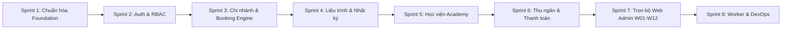

# 📋 KẾ HOẠCH TRIỂN KHAI & ĐẶC TẢ NGHIỆP VỤ BACKEND CORE API
**Dự án:** MLD Healthcare & Vocational Training Platform (Vietnam)  
**Tài liệu tham chiếu:** [`database/schema.sql`](../database/schema.sql) | [`database/shared_types.ts`](../database/shared_types.ts) | [`docs/01_TECH_STACK_ARCHITECTURE.md`](01_TECH_STACK_ARCHITECTURE.md) | [`docs/02_APP_SPECIFICATIONS_AND_LOGIC.md`](02_APP_SPECIFICATIONS_AND_LOGIC.md)  
**Phạm vi phụ trách:** Toàn bộ hệ thống API trung tâm phục vụ đồng bộ cho 3 nền tảng: **Web Admin (React)**, **Mobile App (Flutter)** và **Zalo Mini App (React + ZMP SDK)**.

--

## MỤC LỤC
1. [PHẦN I: BÁO CÁO ĐÁNH GIÁ HIỆN TRẠNG & CÁC SAI LỆCH CẦN XÓA BỎ](#phần-i-báo-cáo-đánh-giá-hiện-trạng--các-sai-lệch-cần-xóa-bỏ)
2. [PHẦN II: TẠI SAO BACKEND DỰ ÁN NÀY KHÔNG PHẢI CHỈ LÀ CRUD ĐƠN THUẦN?](#phần-ii-tại-sao-backend-dự-án-này-không-phải-chỉ-là-crud-đơn-thuần)
3. [PHẦN III: BẢNG ĐẶC TẢ CHI TIẾT NGHIỆP VỤ BẮT BUỘC THEO TỪNG PHÂN HỆ](#phần-iii-bảng-đặc-tả-chi-tiết-nghiệp-vụ-bắt-buộc-theo-từng-phân-hệ)
4. [PHẦN IV: BẢNG PHÂN RÃ CÔNG VIỆC THEO 8 SPRINT (WORK BREAKDOWN STRUCTURE - WBS)](#phần-iv-bảng-phân-rã-công-việc-theo-8-sprint-work-breakdown-structure---wbs)
5. [PHẦN V: KIẾN TRÚC MÃ NGUỒN ĐỀ XUẤT (DOMAIN-DRIVEN DESIGN TRONG NESTJS)](#phần-v-kiến-trúc-mã-nguồn-đề-xuất-domain-driven-design-trong-nestjs)

---

# PHẦN I: BÁO CÁO ĐÁNH GIÁ HIỆN TRẠNG & CÁC SAI LỆCH CẦN XÓA BỎ

Thư mục `backend/` ban đầu được sinh ra từ một template y tế phòng khám chung chung, **không khớp với Cơ sở dữ liệu và yêu cầu nghiệp vụ thực tế của MLD**:

1. **Lệch pha cấu trúc Database (Critical Schema Mismatch):**
   * Code cũ gọi vào bảng không tồn tại: `doctors`, `doctor_slots`, `appointments`, `specialities`.
   * Gán cứng `role: 'PATIENT'` (trong khi database quy định enum `user_role` gồm 9 vai trò: `CUSTOMER`, `STUDENT`, `TECHNICIAN`, `INSTRUCTOR`, `CASHIER`, `RECEPTIONIST`, `BRANCH_MANAGER`, `ADMIN`, `SUPER_ADMIN`).
   * **Cần làm:** Xóa bỏ toàn bộ các module `appointments`, `doctors`, `specialities` trong `src/modules/`.
2. **Thiếu hụt các phân hệ trọng yếu:**
   * Hoàn toàn thiếu phân hệ **Học viện Đào tạo nghề y khoa / spa (Academy)** (`courses`, `course_batches`, `course_enrollments`, `instructors`, `course_lessons`, `quiz`).
   * Thiếu phân hệ **Gói liệu trình & Nhật ký trị liệu** (`treatment_packages`, `user_packages`, `treatment_journal`, `consultation_surveys`).
   * Thiếu phân hệ **Chi nhánh & Phòng dịch vụ** (`branches`, `branch_rooms`).
   * Thiếu phân hệ **Thu ngân POS, Hóa đơn & Quét mã QR check-in** (`invoices`, `payment_transactions`).
   * Thiếu phân hệ **Tích hợp Zalo Mini App** (`/api/v1/auth/zalo` giải mã `phoneToken`).
3. **Thống nhất Gateway:**
   * Trong repo có thư mục `minizalo/backend/` (chạy Express API tạm thời). Toàn bộ nghiệp vụ phải được quy tụ về **Root Backend NestJS (`/backend`)** duy nhất.

---

# PHẦN II: TẠI SAO BACKEND DỰ ÁN NÀY KHÔNG PHẢI CHỈ LÀ CRUD ĐƠN THUẦN?

Nhiều lập trình viên nhầm tưởng Backend chỉ là "Thêm - Sửa - Xóa" (CRUD): Nhận dữ liệu từ form $\rightarrow$ `INSERT/UPDATE` vào database $\rightarrow$ Trả kết quả. **Nếu làm như vậy trong dự án MLD, hệ thống sẽ gặp các sự cố nghiêm trọng sau:**

1. **Nguy cơ gian lận tiền bạc (Không bao giờ tin Client):**
   * Nếu để App tự tính tiền hoặc tự gửi số tiền cần thanh toán: Hacker có thể dùng công cụ can thiệp mạng (Charles Proxy, Postman) sửa giá từ `500.000 đ` thành `1.000 đ`, hoặc tự cộng 100.000 điểm tích lũy.
   * **Quy tắc:** Backend phải tự tính giá từ Database, tự kiểm tra hạng thành viên, tự xác thực hạn sử dụng của voucher.
2. **Nguy cơ trùng lịch khám (Double-Booking / Race Condition):**
   * Khi 2 khách hàng (1 người trên Mobile App, 1 người trên Zalo Mini App) cùng bấm đặt 1 kỹ thuật viên vào lúc 9:00 sáng.
   * Nếu không có cơ chế **Redis Distributed Lock** và **Database Lock (`SELECT FOR UPDATE`)**, cả 2 máy đều báo "Đặt thành công" $\rightarrow$ 2 khách đến cùng đòi 1 kỹ thuật viên phục vụ.
3. **Nguy cơ lộ mã bí mật ngân hàng (Secret Keys):**
   * Mã kết nối VNPay, MoMo, Zalo App Secret **tuyệt đối không được để trên App/Mini App**. Chỉ Backend mới được giữ mã này và nhận thông báo tiền về qua Webhook IPN.
4. **Vận hành ngầm 24/7 (Background Worker):**
   * App trên điện thoại khi tắt màn hình sẽ bị hệ điều hành tắt ngấm (Sleep/Kill). Chỉ Backend mới có thể chạy ngầm để quét hủy các slot giữ chỗ quá 10 phút và tự động gửi tin nhắn ZNS/FCM nhắc lịch trước 24 giờ và 2 giờ.

---

# PHẦN III: BẢNG ĐẶC TẢ CHI TIẾT NGHIỆP VỤ BẮT BUỘC THEO TỪNG PHÂN HỆ

### 1. Phân hệ Đặt lịch & Chống trùng lịch (Booking Engine)
* **Bảng dữ liệu:** `technicians`, `technician_slots`, `bookings`, `booking_items`.
* **Quy tắc Backend bắt buộc:**
  * **Giữ chỗ 10 phút (Hold Slot):** Dùng Redis `SET lock:slot:{slotId} {userId} EX 600 NX`. Cập nhật slot trong DB sang `HOLD` và ghi nhận `hold_expires_at`.
  * **Chống trùng lịch (Concurrency Lock):** Dùng PostgreSQL Transaction `SELECT ... FOR UPDATE SKIP LOCKED` trên bảng `technician_slots` và kiểm tra trùng ca `[start_time, end_time]` trong bảng `bookings`.
  * **Tính giá an toàn:** Server tự truy vấn giá dịch vụ gốc, áp dụng chiết khấu hạng thẻ (`SILVER, GOLD, PLATINUM, DIAMOND`) và kiểm tra điều kiện áp mã `coupons`.
  * **Sinh mã QR:** Tự động tạo `booking_code` và chuỗi token QR để phục vụ việc quét tiếp đón tại quầy Lễ tân.

### 2. Phân hệ Gói liệu trình & Nhật ký chăm sóc (Treatment Packages & Care Journal)
* **Bảng dữ liệu:** `treatment_packages`, `user_packages`, `treatment_journal`, `consultation_surveys`.
* **Quy tắc Backend bắt buộc:**
  * **Quản lý vòng đời gói (State Machine):** `ACTIVE` $\rightarrow$ `PAUSED` $\rightarrow$ `COMPLETED` / `EXPIRED`.
  * **Trừ buổi nguyên tử (Atomic Session Deduction):** Mỗi lần khách đến làm dịch vụ, Backend kiểm tra `sessions_completed < total_sessions`, trừ số buổi khả dụng. Khi thực hiện đủ 100% số buổi, tự động đóng gói sang `COMPLETED`.
  * **Đóng băng hồ sơ nhật ký (Medical Audit Trail):** Kỹ thuật viên nhập đánh giá phác đồ và ảnh liệu trình sau buổi khám $\rightarrow$ Backend lưu vết và khóa bản ghi (không cho sửa đổi tùy tiện).
  * **Khảo sát tiền dịch vụ (Pre-screening checklist):** Kiểm tra chống chỉ định (huyết áp, tim mạch, mang thai). Tự động cảnh báo kỹ thuật viên trên Web Admin.

### 3. Phân hệ Xác thực Đa Nền Tảng (Multi-Platform Auth & Unified Identity)
* **Bảng dữ liệu:** `users`, `user_roles`, `user_settings`.
* **Quy tắc Backend bắt buộc:**
  * **Zalo Mini App Native Login:** Nhận `phoneToken` từ Zalo SDK $\rightarrow$ Backend bí mật gọi Zalo Graph API kèm `ZALO_APP_SECRET` $\rightarrow$ Giải mã ra SĐT chuẩn $\rightarrow$ Map vào tài khoản dùng chung (UUID `users`).
  * **Mobile App OTP:** Sinh mã OTP 6 số, lưu vào Redis TTL 120s, giới hạn tối đa 3 lần gửi/10 phút để chống spam SMS.
  * **Web Admin RBAC:** Phân quyền nghiêm ngặt 9 vai trò thông qua JWT payload (`sub`, `role`) và `@Roles(...)` Guard.

### 4. Phân hệ Thu ngân, Hóa đơn & Thanh toán (Cashier POS & Payments)
* **Bảng dữ liệu:** `invoices`, `payment_transactions`, `point_transactions`.
* **Quy tắc Backend bắt buộc:**
  * **Quét QR tiếp đón:** Giải mã mã QR từ app khách hàng, kiểm tra đúng ngày và đúng chi nhánh $\rightarrow$ Chuyển trạng thái sang `CHECKED_IN` $\rightarrow$ Bắn thông báo cho kỹ thuật viên.
  * **Thanh toán tách nhỏ (Split Payment):** Hỗ trợ hóa đơn trả bằng: Tiền mặt + Điểm thưởng + Voucher. Toàn bộ quá trình trừ điểm, hủy voucher, ghi nhận hóa đơn phải nằm trong **1 Transaction duy nhất**.
  * **Cổng thanh toán & Webhook (Idempotent IPN):** Xử lý callback từ VNPay, MoMo. Bắt buộc có cơ chế Idempotency chống cộng tiền hoặc xác nhận đơn 2 lần.
  * **Tích điểm tự động & Nâng hạng:** Tính điểm thưởng sau khi thanh toán thành công, cập nhật `total_spent` và tự động thăng hạng thành viên.

### 5. Phân hệ Học viện Đào tạo Nghề (Academy Engine)
* **Bảng dữ liệu:** `courses`, `course_batches`, `course_enrollments`, `course_lessons`, `user_lesson_progress`.
* **Quy tắc Backend bắt buộc:**
  * **Chặn tuyển sinh khi lớp đã đủ sĩ số:** So khớp `current_students < max_students` trước khi cho đăng ký.
  * **Mở khóa bài giảng tuần tự:** Học viên bắt buộc phải hoàn thành bài học trước mới được mở bài học tiếp theo.
  * **Chấm điểm trắc nghiệm (Automated Quiz):** Client chỉ gửi đáp án, Backend tự đối chiếu, tính điểm %, xác định Đạt/Không đạt và điều kiện cấp chứng chỉ.

### 6. Phân hệ Tác vụ ngầm 24/7 (Background Workers via BullMQ)
* **Auto-release expired slots:** Mỗi 1 phút quét giải phóng các slot `HOLD` quá 10 phút mà chưa thanh toán.
* **Auto-remind notifications:** Mỗi 15 phút quét các lịch hẹn sắp diễn ra trong 24 giờ và 2 giờ tới $\rightarrow$ Gửi Push Notification (FCM) và Zalo ZNS.

---

# PHẦN IV: BẢNG PHÂN RÃ CÔNG VIỆC THEO 8 SPRINT (WORK BREAKDOWN STRUCTURE - WBS)



| Sprint | Phân hệ trọng tâm | Danh sách API & Nghiệp vụ cốt lõi | Đối tượng tích hợp |
|:---:|:---|:---|:---:|
| **Sprint 1** | **Foundation & Database** | - Dọn dẹp code `doctors` cũ.<br>- Cấu hình Database Client (Prisma / Kysely) kết nối PostgreSQL hỗ trợ ACID Transaction.<br>- Cấu hình Redis (Distributed Lock & Caching).<br>- Chuẩn hóa Response Envelope `{ success, statusCode, message, data }`.<br>- Cấu hình Swagger OpenAPI tại `/api/docs`. | Toàn hệ thống |
| **Sprint 2** | **Xác thực (Auth) & RBAC** | - `POST /api/v1/auth/send-otp` & `verify-otp` (Mobile App).<br>- `POST /api/v1/auth/zalo` (Giải mã SĐT qua Zalo Graph API).<br>- `POST /api/v1/auth/admin/login` (Admin/Nhân viên).<br>- `GET /api/v1/auth/me` & `PUT /profile`.<br>- Xây dựng `@Roles(...)` Guard kiểm soát 9 vai trò. | Mobile, Zalo, Web Admin |
| **Sprint 3** | **Chi nhánh & Booking Engine** | - `GET /api/v1/branches`, `GET /branches/:id/rooms`.<br>- `GET /api/v1/categories`, `GET /services`.<br>- `GET /api/v1/technicians`, `GET /technicians/:id/slots`.<br>- `POST /api/v1/bookings/hold-slot` (Khóa slot 10p Redis).<br>- `POST /api/v1/bookings` (Tạo lịch, Transaction check trùng).<br>- `PATCH /bookings/:id/reschedule`, `cancel`. | Mobile, Zalo, Web Admin |
| **Sprint 4** | **Gói Liệu trình & Nhật ký** | - `GET /api/v1/packages`, `GET /packages/my`.<br>- `GET /api/v1/packages/:id/journal` & `POST /journal` (Upload ảnh trước/sau).<br>- `POST /api/v1/consultations/survey` (Sàng lọc tiền dịch vụ).<br>- `POST /api/v1/reviews` (Chấm điểm kỹ thuật viên & cơ sở).<br>- `GET /api/v1/guidelines` (Cẩm nang chăm sóc tại nhà). | Mobile App, Web Admin |
| **Sprint 5** | **Học viện Đào tạo (Academy)** | - `GET /api/v1/courses`, `GET /courses/:id`.<br>- `GET /api/v1/courses/:id/batches` (Lớp tuyển sinh).<br>- `POST /api/v1/academy/enroll` (Đăng ký nhập học & cọc học phí).<br>- `GET /api/v1/courses/:id/learning` (Danh sách bài giảng).<br>- `POST /api/v1/academy/quiz/submit` (Chấm điểm trắc nghiệm). | Mobile App, Zalo Mini App |
| **Sprint 6** | **Thu ngân & Cổng Thanh toán** | - `GET /api/v1/membership/card` (Hạng thẻ, mã QR thành viên).<br>- `GET /points`, `POST /points/redeem` (Điểm thưởng).<br>- `GET /vouchers/my`, `POST /vouchers/apply` (Kho voucher).<br>- `POST /api/v1/payments/create-url` (VNPay, MoMo).<br>- `POST /api/v1/payments/vnpay-ipn`, `momo-ipn` (Webhook đối soát).<br>- `GET /api/v1/payments/history`, `GET /invoices/:id/pdf`. | Mobile App, Web Admin |
| **Sprint 7** | **Web Admin Dashboard (W01 - W12)** | - **W01:** `GET /admin/dashboard/metrics` (Doanh thu ngày, lịch mới, ca trực).<br>- **W02:** CRUD Chi nhánh, danh mục phòng trị liệu.<br>- **W03 - W04:** CRM Khách hàng 360 độ (hồ sơ bệnh án, lịch sử mua gói).<br>- **W05:** Bảng điều phối ca trực kỹ thuật viên theo tuần.<br>- **W06:** Cấu hình Gói trị liệu và phác đồ mẫu.<br>- **W07:** Màn hình POS Thu ngân, quét QR check-in, xuất hóa đơn.<br>- **W08 - W11:** Quản lý giảng viên, lớp học, điểm danh, cấp chứng chỉ.<br>- **W12:** Báo cáo doanh thu đa chiều, export Excel/CSV. | Web Admin Portal |
| **Sprint 8** | **Worker, Thông báo & DevOps** | - BullMQ Worker: Quét nhả slot quá hạn 10p, quét nhắc lịch 24h & 2h.<br>- Tích hợp Push Notification (FCM) & Zalo ZNS.<br>- Module Upload File (`POST /api/v1/upload`) lưu ảnh liệu trình lên S3/Supabase.<br>- Dockerfile, docker-compose (NestJS + Redis), Health check `/health`. | DevOps & Vận hành |

---

# PHẦN V: KIẾN TRÚC MÃ NGUỒN ĐỀ XUẤT (DOMAIN-DRIVEN DESIGN TRONG NESTJS)

```
backend/src/
├── common/                     # Tiện ích dùng chung
│   ├── decorators/             # @CurrentUser, @Roles, @Public
│   ├── filters/                # AllExceptionsFilter, HttpExceptionFilter
│   ├── guards/                 # JwtAuthGuard, RolesGuard
│   ├── interceptors/           # TransformInterceptor (Chuẩn hóa Response)
│   └── pipes/                  # Custom Validation Pipes
├── config/                     # Cấu hình biến môi trường (.env validation)
├── database/                   # Kết nối cơ sở dữ liệu PostgreSQL & Redis Pool
├── modules/                    # Các module tính năng độc lập
│   ├── auth/                   # Mobile OTP, Zalo Auth, Admin Auth, JWT Service
│   ├── branches/               # Chi nhánh, Phòng trị liệu & Cơ sở vật chất
│   ├── services/               # Danh mục dịch vụ spa & Bảng giá
│   ├── technicians/            # Kỹ thuật viên, Lịch ca trực, Quản lý slot
│   ├── bookings/               # Đặt lịch, Giữ slot Redis, Check-in QR, Hủy/Đổi lịch
│   ├── treatment/              # Gói liệu trình, Nhật ký chăm sóc, Khảo sát, Đánh giá
│   ├── academy/                # Khóa học đào tạo, Tuyển sinh, Bài giảng, Giảng viên
│   ├── membership/             # Thẻ hội viên, Tích điểm, Voucher, Giới thiệu bạn bè
│   ├── cashier/                # Quầy thu ngân, Thanh toán POS, In hóa đơn
│   ├── payments/               # Tích hợp VNPay, MoMo, Webhook IPN
│   ├── admin-dashboard/        # Thống kê & Báo cáo doanh thu W01 & W12
│   └── notifications/          # FCM Push Notification & Zalo ZNS Worker
└── main.ts                     # Entry point khởi chạy server & Swagger OpenAPI
```

