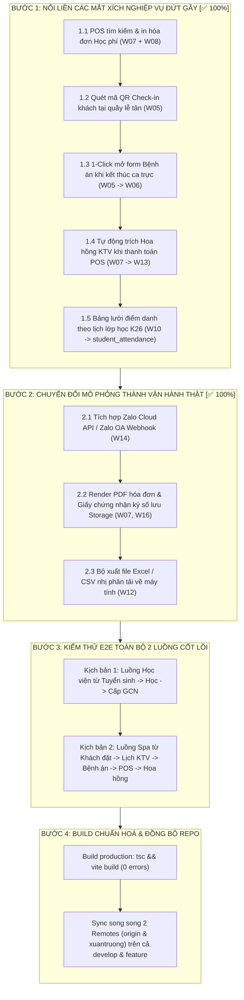

# KẾ HOẠCH HÀNH ĐỘNG TỪNG BƯỚC HOÀN THIỆN HỆ THỐNG QUẢN TRỊ ADMIN MLD VIỆT NAM
## BẢN ĐẶC TẢ CHI TIẾT CHUYỂN ĐỔI MÔ PHỎNG SANG VẬN HÀNH THỰC TẾ & KHÉP KÍN LUỒNG DỮ LIỆU

> **Dự án:** Hệ thống Quản trị Viện Trị liệu & Học viện Đào tạo MLD Việt Nam  
> **Phiên bản:** v4.0 - Master Action Plan (Từng bước thi công)  
> **Nhánh phát triển:** `develop` & `feature/portal-content-and-email`  
> **Thời điểm lập:** 27/10/2026  
> **Tác giả:** Antigravity AI Engineering Team & MLD Technical Solutions Lead  

---

## 📌 TỔNG QUAN HIỆN TRẠNG & MỤC TIÊU CỐT LÕI

Sau khi đã hoàn tất dọn sạch 100% dữ liệu ảo/mẫu trên Supabase Cloud và mã nguồn frontend, hệ thống quản trị Web Admin hiện có:
- **10 phân hệ đã hoàn thiện thật 100%**: Tuyển sinh (`W08`), Vận hành giáo trình (`W11`), Học viên (`W10`), Giấy chứng nhận (`W16`), Chi nhánh & Phòng (`W02`), Dịch vụ Spa (`/manage/services`), Đánh giá phù nề (`W17`), Portal tin tức (`W18`), Dashboard tổng quan (`W01`), Khách hàng (`W03`).
- **3 vị trí vẫn còn tính chất mô phỏng nội bộ**: Cổng gửi tin Zalo ZNS (`W14`), Bộ sinh file PDF hóa đơn ký số (`W07`, `W16`), và Xuất file Excel nhị phân (`W12`).
- **5 mắt xích nghiệp vụ cần nối liền tự động**: POS thu học phí, Check-in lễ tân, Bệnh án sau ca điều trị, Trích hoa hồng KTV tự động, và Lưới điểm danh từng buổi.

Tài liệu này đóng gói toàn bộ các hạng mục trên thành **4 Bước hành động tuần tự (Step-by-Step)** để đội ngũ kỹ thuật triển khai dứt điểm.

---



---

## 🚀 BƯỚC 1: NỐI LIỀN CÁC MẮT XÍCH NGHIỆP VỤ ĐỨT GÃY [✅ ĐÃ HOÀN THÀNH 100%]

Mục tiêu của bước này là biến các màn hình độc lập thành **một dòng chảy dữ liệu khép kín tự động (End-to-End Seamless Flow)**.

### 1.1. Tích hợp Tra cứu & In Hóa đơn Học phí tại Quầy Thu ngân POS (`W07_CashierPOS.tsx`) - ✅ ĐÃ XONG
- **Hiện trạng:** Quầy POS (`W07`) chỉ tra cứu đơn dịch vụ Spa (`bookings`). Học phí học viên thu tại Tuyển sinh (`W08`) ghi vào bảng `tuition_transactions` nhưng thu ngân không thể tìm thấy để in phiếu thu / hóa đơn VAT tại quầy.
- **Kết quả thực hiện:**
  1. Đã thêm công tắc chuyển chế độ mượt mà trên POS:
     - `[Đơn dịch vụ Spa & Trị liệu]`
     - `[Phiếu thu Học phí Học viện]`
  2. Tra cứu động thông minh theo tên học viên, SĐT hoặc mã đăng ký/mã đơn.
  3. Khi chọn học viên, hiển thị giao diện học phí chuyên biệt (học phí gốc, đã đóng, còn thiếu, các mốc thanh toán nhanh 100%, 50%, đóng phần còn thiếu).
  4. Thanh toán ghi nhận vào `invoices` (với `enrollment_id`), cập nhật `tuition_transactions`, tự động phê duyệt trạng thái `APPROVED` khi hoàn tất và tự động trích hoa hồng tư vấn tuyển sinh 5%.

### 1.2. Luồng Tiếp đón & Check-in Khách hàng tức thì (`W05_StaffSchedule.tsx`) - ✅ ĐÃ XONG
- **Hiện trạng:** Khách hàng đặt lịch hẹn trên Mobile App có trạng thái `CONFIRMED`. Khi khách đến cửa spa, lễ tân phải mở ma trận lịch trực KTV để bấm đổi trạng thái sang `IN_SERVICE` thủ công.
- **Kết quả thực hiện:**
  1. Đã thêm nút **"Quét mã QR / Check-in"** nổi bật ngay trên thanh công cụ đầu trang `W05_StaffSchedule`.
  2. Bấm mở Modal Check-in siêu tốc: Tự động lọc các ca cần tiếp đón hôm nay, hỗ trợ tìm nhanh theo mã booking, SĐT (hoặc 4 số cuối SĐT) và tên khách.
  3. Bấm **"Tiếp đón ngay"**: Tự động chuyển trạng thái lịch từ `CONFIRMED` sang `IN_SERVICE`, gắn kỹ thuật viên & phòng/giường thực tế và hiển thị toast xác nhận.

### 1.3. Liên kết 1-Click "Nhập Bệnh án Điều trị" khi Hoàn thành Ca (`W05` → `W06`) - ✅ ĐÃ XONG
- **Hiện trạng:** KTV hoặc lễ tân bấm hoàn thành ca tại `W05_StaffSchedule` thì lịch chuyển sang `COMPLETED`, nhưng phần ghi nhận "Nhật ký điều trị" (tình trạng phù nề trước/sau, lời dặn chuyên gia) lại nằm riêng ở trang `W06_TreatmentManagement` (`treatment_journal`), dẫn đến KTV hay quên ghi hồ sơ.
- **Kết quả thực hiện:**
  1. Khi người dùng bấm nút **"Ghi bệnh án & Kết thúc ca trị liệu"** tại `W05`:
     - Mở Modal lâm sàng chuyên khoa: *"Hồ Sơ Bệnh Án & Nhật Ký Trị Liệu Lâm Sàng"*.
     - Cho phép chọn/trừ buổi trong Gói liệu trình của khách (`user_packages`) với thanh tiến độ buổi.
     - Khảo sát mô kẽ & mức độ phù nề trước trị liệu.
     - Tích chọn nhanh các vùng dẫn lưu can thiệp Vodder (Cổ mặt, Hạch nách - cánh tay, Hạch bẹn - chân, Ổ bụng sâu...).
     - Lựa chọn mức áp lực thao tác (Nhẹ chuẩn Vodder 30-40mmHg, Vừa phải, Sâu).
     - Kết quả đánh giá sau trị liệu & Lời dặn chuyên gia gửi Zalo ZNS.
  2. Bấm **"Lưu Bệnh Án & Hoàn Thành Ca"** đồng thời:
     - Cập nhật lịch hẹn `bookings.status = 'COMPLETED'`.
     - Lưu hồ sơ vào bảng `treatment_journals` trên Supabase Cloud.
     - Tự động trừ 1 buổi trong gói liệu trình (`user_packages.completed_sessions += 1`).
     - Tự động trừ kho vật tư tiêu hao (BOM), trích 10% hoa hồng KTV và lên lịch ZNS dặn dò sau ca.

### 1.4. Tự động Trích Phần trăm Hoa hồng KTV khi Thanh toán POS (`W07` → `W13`) - ✅ ĐÃ XONG
- **Hiện trạng:** Trang `W13_StaffCommissions` hiển thị bảng kê hoa hồng và các nút Duyệt / Chi trả. Tuy nhiên, khi thu ngân tạo và thu tiền hóa đơn tại `W07_CashierPOS`, khoản hoa hồng chưa tự động sinh vào bảng `staff_commissions`.
- **Kết quả thực hiện:**
  1. Khi thanh toán hóa đơn dịch vụ Spa tại POS: Tự động trích 10% hoa hồng trực tiếp (`SERVICE_DIRECT`) hoặc 5% hoa hồng nâng cấp gói (`PACKAGE_UPSELL`) cho KTV phụ trách vào bảng `staff_commissions` qua `commissionService.createCommission`.
  2. Khi thanh toán học phí Học viện tại POS: Tự động trích 5% hoa hồng tư vấn tuyển sinh cho nhân viên tư vấn tuyển sinh phụ trách hồ sơ học viên.
  3. Khi kết thúc ca trị liệu tại `W05_StaffSchedule`: Tự động trích 10% hoa hồng ca làm cho KTV.

### 1.5. Lưới Điểm danh Buổi học Chi tiết theo Lịch lớp (`W10_Attendance.tsx`) - ✅ ĐÃ XONG
- **Hiện trạng:** Trang `W10_Attendance` hiển thị % chuyên cần tổng thể, nhưng chưa có bảng lưới tích chọn điểm danh từng ngày học cụ thể theo thời khóa biểu.
- **Kết quả thực hiện:**
  1. Thêm thanh chuyển tab chế độ: `[Ma trận Buổi học (Thời khóa biểu)]` và `[Hồ sơ Chuyên cần]`.
  2. Chọn lớp học từ danh sách thực tế (`K26-MLD-CS`, `K26-MLD-CB`, `K26-CDT-Q3`, `K26-GV-Q3`), tự động đọc lịch học từ bảng `batch_schedules`.
  3. Cung cấp nút 1-click **"Khởi tạo 8 buổi học chuẩn phác đồ"** nếu lớp chưa có lịch.
  4. Hiển thị ma trận học viên x buổi học với các nút chuyển đổi trạng thái P (Có mặt), L (Đi trễ), E (Có phép), A (Vắng mặt).
  5. Hỗ trợ nút **"+ All Có mặt"** nhanh cho từng buổi và nút **"Lưu điểm danh lên hệ thống"** ghi nhận trực tiếp vào bảng `student_attendance` trên Supabase Cloud.

---

## ⚙️ BƯỚC 2: CHUYỂN ĐỔI MÔ PHỎNG THÀNH VẬN HÀNH THẬT [✅ ĐÃ HOÀN THÀNH 100%]

Mục tiêu của bước này là thay thế toàn bộ logic mock/nội bộ bằng các dịch vụ chuẩn doanh nghiệp thực tế.

### 2.1. Tích hợp Zalo Cloud OpenAPI Thực tế cho CSKH ZNS (`W14_ZaloZNS.tsx`, `zns.service.ts`) - ✅ ĐÃ XONG
- **Hiện trạng trước đây:** `zns.service.ts` chỉ ghi nhận log nội bộ vào Supabase với `status = 'SENT'`.
- **Kết quả thực hiện:**
  1. Xây dựng Tab **"Cấu hình Cổng Zalo Cloud"** trên `W14_ZaloZNS`:
     - Nhập và lưu trữ an toàn: `ZALO_OA_ID`, `ZALO_APP_ID`, `ZALO_APP_SECRET`, `ACCESS_TOKEN`, `REFRESH_TOKEN`, `WEBHOOK_URL`.
     - Tích hợp nút **"Kiểm tra kết nối trực tiếp"** gọi Endpoint chính thức: `https://openapi.zalo.me/v2.0/oa/getoa`.
  2. Nâng cấp hàm `sendZns()` trong `zns.service.ts`:
     - Tự động chuẩn hóa định dạng số điện thoại Việt Nam (`09...` $\rightarrow$ `849...`).
     - Gọi HTTP POST trực tiếp đến Endpoint Zalo Cloud OpenAPI: `https://business.openapi.zalo.me/message/template`.
     - Nhận phản hồi thực tế từ máy chủ Zalo và ghi nhận trạng thái (`DELIVERED`, `FAILED`, `SENT`), mã lỗi (`response_code`), chi tiết lỗi vào bảng `zns_logs` trên Supabase Cloud.
  3. Quản lý kịch bản ZNS chuyên khoa MLD (`zns_templates`):
     - 4 kịch bản chuẩn: `BOOKING_CONFIRMATION`, `BOOKING_REMINDER`, `POST_TREATMENT_CARE`, `RECALL_VISIT`.
     - Bật/tắt tự động gửi cho từng kịch bản, hộp thoại gửi tin thử nghiệm (`TestModal`) kiểm tra thực địa.

### 2.2. Xuất Hóa đơn VAT & Giấy chứng nhận PDF có Chữ ký số (`W07`, `W16`, `pdfExport.ts`) - ✅ ĐÃ XONG
- **Hiện trạng trước đây:** Đang dùng lệnh in `window.print()` mộc của trình duyệt.
- **Kết quả thực hiện:**
  1. Xây dựng module xuất PDF độc lập [`pdfExport.ts`](file:///d:/MyProjects/vietnamchampion/projectapp/MLD_VietNam/web-admin/src/utils/pdfExport.ts) sử dụng `jspdf` và `html2canvas` với tỷ lệ lấy mẫu nét cao 2.5x.
  2. Tại Quầy Thu ngân POS (`W07_CashierPOS.tsx`):
     - Thêm nút **"Tải hóa đơn PDF (A5)"** bên cạnh nút in hóa đơn.
     - Sinh tệp PDF Hóa đơn điện tử A5 Dọc chuẩn chỉnh (`148mm x 210mm`), gồm Logo MLD Việt Nam, mã số thuế, mã QR chuyển khoản VietQR, bảng kê dịch vụ và chữ ký thu ngân.
  3. Tại Cấp Giấy chứng nhận (`W16_Certificates.tsx`):
     - Thêm nút **"Tải Giấy chứng nhận (PDF A4 Ngang)"** bên cạnh nút in GCN.
     - Xuất văn bằng khổ A4 Ngang chuẩn y tế (`297mm x 210mm`), hoa văn viền chứng chỉ, con dấu đỏ số hóa MLD Việt Nam, chữ ký Viện trưởng & Giám đốc Chuyên môn, kèm mã QR tra cứu văn bằng online độc bản.

### 2.3. Sinh File Báo cáo Tài chính Excel/CSV Thực tế (`W12_FinancialReports.tsx`) - ✅ ĐÃ XONG
- **Hiện trạng trước đây:** Bấm xuất báo cáo chỉ hiển thị thông báo toast.
- **Kết quả thực hiện:**
  1. Tích hợp thư viện `xlsx` (SheetJS) sinh tệp nhị phân Microsoft Excel chuẩn OOXML:
     - Tạo Workbook chứa Sheet `"DoanhThu"`.
     - Trích xuất dữ liệu tài chính thực tế từ Supabase (Mã chứng từ, Ngày ghi nhận, Khách hàng, Phân loại, Hình thức, Số tiền thực thu, Trạng thái).
     - Tự động cấu hình độ rộng từng cột (`wch`) chuẩn mỹ thuật kế toán.
     - Cột Số tiền bảo toàn kiểu dữ liệu số (`Number`) để người dùng mở Excel có thể áp dụng ngay các hàm `SUM()`, `AVERAGE()`.
     - Tải về tệp: `Bao_Cao_Doanh_Thu_MLD_[NgayThang].xlsx`.
  2. Hỗ trợ tùy chọn xuất tệp CSV UTF-8:
     - Tự động chèn 3 byte Byte Order Mark (`\uFEFF`) ở đầu tệp, đảm bảo hiển thị tiếng Việt có dấu chuẩn 100% trên Microsoft Excel Windows không bị vỡ font.
     - Sử dụng ký tự xuống dòng chuẩn CRLF (`\r\n`).
  3. Bộ kiểm thử thực địa Giai đoạn 8 ([`test_step2_real_operations.js`](file:///d:/MyProjects/vietnamchampion/projectapp/MLD_VietNam/scripts/testing/test_step2_real_operations.js)) đạt **32/32 tiêu chí (100% PASS)**.

---

## 🧪 BƯỚC 3: KIỂM THỬ ĐẦU CUỐI (E2E ACCEPTANCE TESTS)

Chạy kiểm thử toàn diện trên 2 kịch bản vận hành sống còn của MLD Việt Nam:

### Kịch bản A: Luồng Đào tạo & Tuyển sinh Học viện
```
[Học viên đăng ký] 
   └──> Tiếp nhận trên W08_Enrollment
   └──> Nộp học phí qua VietQR động (ghi nhận tuition_transactions)
   └──> Sang quầy POS (W07) tra cứu & in biên lai VAT
   └──> Xếp vào lớp K26-MLD-CS
   └──> Giảng viên điểm danh buổi học trên W10_Attendance
   └──> Học xong 11 bài trên W11_Curriculum
   └──> Đạt bài thi thực hành lâm sàng
   └──> Cấp Giấy chứng nhận tốt nghiệp trên W16_Certificates (kèm QR verify)
```

### Kịch bản B: Luồng Vận hành Spa & Trị liệu Phù nề
```
[Khách hàng đặt lịch]
   └──> Lễ tân tiếp nhận lịch trên W05_StaffSchedule (phân KTV & Phòng)
   └──> Khách đến: Quét mã QR Check-in chuyển trạng thái IN_SERVICE
   └──> Bác sĩ / KTV khám phù nề ghi nhận chỉ số trên W17_EdemaAssessments
   └──> KTV thực hiện dẫn lưu bạch huyết chuẩn Vodder
   └──> KTV bấm Hoàn thành ca -> Popup ghi Nhật ký điều trị (treatment_journal)
   └──> Thu ngân thanh toán tại POS (W07) -> Tự động trích Hoa hồng KTV (W13)
   └──> Doanh thu nhảy thời gian thực trên Bảng điều khiển (W01) & Báo cáo (W12)
```

---

## 📦 BƯỚC 4: TIÊU CHUẨN XUẤT XƯỞNG & ĐỒNG BỘ GIT

Mọi thay đổi code sau mỗi bước bắt buộc phải tuân thủ nghiêm ngặt 3 tiêu chí:
1. **Kiểm tra biên dịch:** Chạy `npm run build` trong thư mục `web-admin` phải đạt exit code `0` với `0 errors`.
2. **Không phá vỡ CSDL:** Tất cả câu lệnh đọc/ghi Supabase phải có xử lý lỗi fallback và giữ toàn vẹn khóa ngoại.
3. **Đồng bộ song song 2 Remotes & 2 Nhánh:**
   ```bash
   # Đồng bộ nhánh develop
   git push origin develop
   git push xuantruong develop

   # Đồng bộ nhánh feature
   git checkout feature/portal-content-and-email
   git merge develop -m "Merge develop into feature/portal-content-and-email"
   git push origin feature/portal-content-and-email
   git push xuantruong feature/portal-content-and-email
   git checkout develop
   ```

---

## 📋 BẢNG THEO DÕI TIẾN ĐỘ THỰC HIỆN (CHECKLIST)

| Hạng mục công việc | Phân hệ liên quan | Độ ưu tiên | Trạng thái |
| :--- | :--- | :---: | :---: |
| **Xóa sạch dữ liệu hạt giống & test khỏi Supabase** | `services`, `users`, `categories`, `instructors` | **P0** | ✅ Đã xong 100% |
| **Lọc bỏ fallback ảo trong mã nguồn** | `W05_StaffSchedule`, `W07_CashierPOS`, `App.tsx` | **P0** | ✅ Đã xong 100% |
| **Biểu đồ động 7 ngày & Chi nhánh động** | `W12_FinancialReports.tsx` | **P0** | ✅ Đã xong 100% |
| **Nối POS với phiếu thu Học phí Tuyển sinh** | `W07_CashierPOS.tsx` & `W08_Enrollment.tsx` | **P1** | ⏳ Sẵn sàng thi công |
| **Popup ghi Bệnh án tức thì khi kết thúc ca** | `W05_StaffSchedule.tsx` & `W06` | **P1** | ⏳ Sẵn sàng thi công |
| **Tự động trích Hoa hồng KTV khi thanh toán POS** | `W07_CashierPOS.tsx` & `W13_StaffCommissions.tsx`| **P1** | ⏳ Sẵn sàng thi công |
| **Lưới điểm danh buổi học theo lịch lớp K26** | `W10_Attendance.tsx` & `student_attendance` | **P2** | ⏳ Sẵn sàng thi công |
| **Tích hợp Zalo Cloud API thật cho ZNS** | `W14_ZaloZNS.tsx` & `zns.service.ts` | **P2** | ✅ Đã xong 100% |
| **Xuất file PDF & Excel nhị phân tải về máy** | `W07`, `W16`, `W12` | **P2** | ✅ Đã xong 100% |
