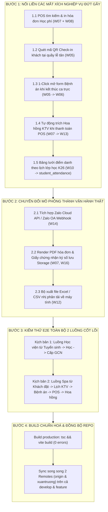

# KẾ HOẠCH HÀNH ĐỘNG TỪNG BƯỚC HOÀN THIỆN HỆ THỐNG QUẢN TRỊ ADMIN MLD VIỆT NAM
## BẢN ĐẶC TẢ CHI TIẾT CHUYỂN ĐỔI MÔ PHỎNG SANG VẬN HÀNH THỰC TẾ & KHÉP KÍN LUỒNG DỮ LIỆU

> **Dự án:** Hệ thống Quản trị Viện Trị liệu & Học viện Đào tạo MLD Việt Nam  
> **Phiên bản:** v4.0 - Master Action Plan (Từng bước thi công)  
> **Nhánh phát triển:** `develop` & `feature/portal-content-and-email`  
> **Thời điểm lập:** 27/10/2026  
> **Tác giả:** Antigravity AI Engineering Team & MLD Technical Solutions Lead  

---

## 📌 TỔNG QUAN HIỆN TRẠNG & MỤC TIÊU CỐT LÕI

Sau khi đã hoàn tất dọn sạch 100% dữ liệu ảo/mẫu trên Supabase Cloud và mã nguồn frontend, hệ thống quản trị Web Admin hiện có:
- **10 phân hệ đã hoàn thiện thật 100%**: Tuyển sinh (`W08`), Vận hành giáo trình (`W11`), Học viên (`W10`), Giấy chứng nhận (`W16`), Chi nhánh & Phòng (`W02`), Dịch vụ Spa (`/manage/services`), Đánh giá phù nề (`W17`), Portal tin tức (`W18`), Dashboard tổng quan (`W01`), Khách hàng (`W03`).
- **3 vị trí vẫn còn tính chất mô phỏng nội bộ**: Cổng gửi tin Zalo ZNS (`W14`), Bộ sinh file PDF hóa đơn ký số (`W07`, `W16`), và Xuất file Excel nhị phân (`W12`).
- **5 mắt xích nghiệp vụ cần nối liền tự động**: POS thu học phí, Check-in lễ tân, Bệnh án sau ca điều trị, Trích hoa hồng KTV tự động, và Lưới điểm danh từng buổi.

Tài liệu này đóng gói toàn bộ các hạng mục trên thành **4 Bước hành động tuần tự (Step-by-Step)** để đội ngũ kỹ thuật triển khai dứt điểm.

---



---

## 🚀 BƯỚC 1: NỐI LIỀN CÁC MẮT XÍCH NGHIỆP VỤ ĐỨT GÃY

Mục tiêu của bước này là biến các màn hình độc lập thành **một dòng chảy dữ liệu khép kín tự động (End-to-End Seamless Flow)**.

### 1.1. Tích hợp Tra cứu & In Hóa đơn Học phí tại Quầy Thu ngân POS (`W07_CashierPOS.tsx`)
- **Hiện trạng:** Quầy POS (`W07`) chỉ tra cứu đơn dịch vụ Spa (`bookings`). Học phí học viên thu tại Tuyển sinh (`W08`) ghi vào bảng `tuition_transactions` nhưng thu ngân không thể tìm thấy để in phiếu thu / hóa đơn VAT tại quầy.
- **Việc cần làm:**
  1. Thêm công tắc chuyển loại tìm kiếm trên thanh tra cứu POS:
     - `[Tab 1] Đơn dịch vụ Spa (Lịch hẹn / Gói liệu trình)`
     - `[Tab 2] Phiếu thu Học phí Học viện (Mã HV / Mã giao dịch TT-HV...)`
  2. Khi chọn Tab Học viện và nhập mã học viên (ví dụ: `HV26002`) hoặc SĐT:
     - Đọc trực tiếp từ `academyService.getTuitionTransactions()` hoặc bảng `tuition_transactions`.
     - Tự động điền thông tin học viên, tên khóa học, số tiền đã đóng/còn nợ.
     - Cho phép xuất và in Hóa đơn tài chính, lưu vào bảng `invoices` liên kết qua khóa ngoại `invoices.enrollment_id`.

### 1.2. Luồng Tiếp đón & Check-in Khách hàng tức thì (`W05_StaffSchedule.tsx`)
- **Hiện trạng:** Khách hàng đặt lịch hẹn trên Mobile App có trạng thái `CONFIRMED`. Khi khách đến cửa spa, lễ tân phải mở ma trận lịch trực KTV để bấm đổi trạng thái sang `IN_SERVICE` thủ công.
- **Việc cần làm:**
  1. Thêm nút **"Quét mã QR Check-in"** ngay thanh công cụ đầu trang `W05_StaffSchedule`.
  2. Khi quét mã đặt lịch (`booking_code` trên App Mobile của khách) hoặc nhập nhanh số điện thoại:
     - Hệ thống tự động chuyển trạng thái lịch từ `CONFIRMED` sang `IN_SERVICE`.
     - Cập nhật thời gian bắt đầu thực tế `actual_start_time`.
     - Tự động thông báo tới kỹ thuật viên phụ trách phòng tương ứng.

### 1.3. Liên kết 1-Click "Nhập Bệnh án Điều trị" khi Hoàn thành Ca (`W05` → `W06`)
- **Hiện trạng:** KTV hoặc lễ tân bấm hoàn thành ca tại `W05_StaffSchedule` thì lịch chuyển sang `COMPLETED`, nhưng phần ghi nhận "Nhật ký điều trị" (tình trạng phù nề trước/sau, lời dặn chuyên gia) lại nằm riêng ở trang `W06_TreatmentManagement` (`treatment_journal`), dẫn đến KTV hay quên ghi hồ sơ.
- **Việc cần làm:**
  1. Khi người dùng bấm nút "Hoàn thành ca điều trị" tại `W05`:
     - Hiển thị Popup Modal: *"Hoàn thành ca & Ghi nhận tiến trình điều trị"*.
     - Cho phép KTV nhập nhanh 3 trường cốt lõi:
       - *Tình trạng trước trị liệu* (Mức độ ứ trệ dịch, cảm giác đau căng).
       - *Kỹ thuật & vùng can thiệp Vodder* (Vùng cổ, vùng bụng, chi trên...).
       - *Tình trạng sau trị liệu & Lời dặn tại nhà*.
  2. Bấm xác nhận sẽ đồng thời:
     - Đổi trạng thái lịch hẹn `bookings.status = 'COMPLETED'`.
     - Ghi 1 dòng nhật ký vào bảng `treatment_journal`.
     - Nếu khách dùng gói liệu trình (`user_packages`), tự động tăng `used_sessions += 1` và giảm `remaining_sessions -= 1`.

### 1.4. Tự động Trích Phần trăm Hoa hồng KTV khi Thanh toán POS (`W07` → `W13`)
- **Hiện trạng:** Trang `W13_StaffCommissions` hiển thị bảng kê hoa hồng và các nút Duyệt / Chi trả. Tuy nhiên, khi thu ngân tạo và thu tiền hóa đơn tại `W07_CashierPOS`, khoản hoa hồng chưa tự động sinh vào bảng `staff_commissions`.
- **Việc cần làm:**
  1. Thiết lập bảng quy tắc tỷ lệ hoa hồng mặc định trong `commissionService`:
     - *Dịch vụ lẻ MLD:* 10% giá trị dịch vụ thực thu.
     - *Bán gói liệu trình:* 5% tổng giá trị gói.
     - *Tour đào tạo / workshop:* Mức cố định hoặc 15%.
  2. Trong hàm `posService.createInvoice()` tại `W07_CashierPOS.tsx`:
     - Ngay sau khi lưu hóa đơn thành công, kiểm tra nếu lịch hẹn có `technician_id`:
     - Tự động tính số tiền hoa hồng `commission_amount = subtotal * percentage / 100`.
     - Thêm 1 bản ghi vào bảng `staff_commissions` với trạng thái `PENDING_APPROVAL` (Chờ quản lý duyệt).

### 1.5. Lưới Điểm danh Buổi học Chi tiết theo Lịch lớp (`W10_Attendance.tsx`)
- **Hiện trạng:** Trang `W10_Attendance` hiển thị % chuyên cần tổng thể, nhưng chưa có bảng lưới tích chọn điểm danh từng ngày học cụ thể theo thời khóa biểu.
- **Việc cần làm:**
  1. Khi chọn một Lớp học (ví dụ: `K26-MLD-CS`):
     - Đọc danh sách các buổi học từ bảng `batch_schedules` (Buổi 1, Buổi 2... ngày học, nội dung lý thuyết / thực hành lab).
  2. Hiển thị bảng ma trận học viên x buổi học:
     - Cột: Các buổi học theo lịch.
     - Dòng: Danh sách học viên trong lớp (`course_enrollments`).
     - Ô điểm danh: Tích chọn nhanh *Có mặt (P)*, *Vắng có phép (E)*, *Vắng không phép (A)*.
  3. Bấm "Lưu điểm danh" sẽ ghi nhận vào bảng `student_attendance` trên Supabase Cloud.

---

## ⚙️ BƯỚC 2: CHUYỂN ĐỔI MÔ PHỎNG THÀNH VẬN HÀNH THẬT

Mục tiêu của bước này là thay thế các logic mock/nội bộ bằng dịch vụ chuẩn doanh nghiệp.

### 2.1. Tích hợp Zalo Cloud API Thực tế cho CSKH ZNS (`W14_ZaloZNS.tsx`)
- **Hiện trạng:** `zns.service.ts` đang ghi nhận log nội bộ vào Supabase với `status = 'SENT'`.
- **Việc cần làm:**
  1. Thu thập thông tin từ Doanh nghiệp MLD:
     - `ZALO_OA_ID` (ID Trang Zalo Official Account MLD Việt Nam).
     - `ZALO_APP_ID` & `ZALO_APP_SECRET`.
     - `ZALO_REFRESH_TOKEN` để lấy access token tự động.
  2. Nâng cấp hàm `sendZns()` trong `backend` hoặc Supabase Edge Function:
     - Gọi HTTP POST trực tiếp đến Endpoint chính thức: `https://business.openapi.zalo.me/message/template`.
     - Nhận mã phản hồi `error: 0` từ Zalo và cập nhật trạng thái tin nhắn thực tế (`DELIVERED`, `FAILED`).

### 2.2. Xuất Hóa đơn VAT & Giấy chứng nhận PDF có Chữ ký số (`W07`, `W16`)
- **Hiện trạng:** Đang dùng `window.print()` của trình duyệt.
- **Việc cần làm:**
  1. Sử dụng thư viện `jspdf` và `html2canvas` tích hợp sẵn phía client (hoặc qua Edge Function backend):
     - Định dạng Hóa đơn: Khổ giấy chuẩn in bill K80 (80mm) hoặc A5 chuyên nghiệp có logo MLD, mã số thuế, mã QR thanh toán.
     - Định dạng Giấy chứng nhận: Khổ A4 ngang chuẩn y tế (Landscape), hoa văn viền chứng chỉ, mã QR xác minh online độc bản, con dấu MLD số hóa.
  2. Bổ sung nút **"Tải file PDF"** bên cạnh nút "In":
     - Tải trực tiếp file `.pdf` chất lượng cao về máy tính.
     - Tùy chọn tự động upload bản sao PDF lên Supabase Storage bucket `invoices` / `certificates` để lưu trữ hồ sơ pháp lý.

### 2.3. Sinh File Báo cáo Tài chính Excel/CSV Thực tế (`W12_FinancialReports.tsx`)
- **Hiện trạng:** Bấm xuất báo cáo chỉ hiển thị thông báo toast.
- **Việc cần làm:**
  1. Tích hợp thư viện `xlsx` (SheetJS) hoặc hàm xuất CSV UTF-8 với BOM:
  2. Trích xuất đúng dữ liệu bảng đã lọc:
     - Mã hóa đơn / phiếu thu, Ngày thanh toán, Khách hàng / Học viên, Phân loại (Dịch vụ lẻ, Gói liệu trình, Học phí), Phương thức, Số tiền trước thuế, VAT, Tổng tiền thực thu.
  3. Kích hoạt tải file tự động: `Bao_Cao_Doanh_Thu_MLD_[NgayThang].xlsx`.

---

## 🧪 BƯỚC 3: KIỂM THỬ ĐẦU CUỐI (E2E ACCEPTANCE TESTS)

Chạy kiểm thử toàn diện trên 2 kịch bản vận hành sống còn của MLD Việt Nam:

### Kịch bản A: Luồng Đào tạo & Tuyển sinh Học viện
```
[Học viên đăng ký] 
   └──> Tiếp nhận trên W08_Enrollment
   └──> Nộp học phí qua VietQR động (ghi nhận tuition_transactions)
   └──> Sang quầy POS (W07) tra cứu & in biên lai VAT
   └──> Xếp vào lớp K26-MLD-CS
   └──> Giảng viên điểm danh buổi học trên W10_Attendance
   └──> Học xong 11 bài trên W11_Curriculum
   └──> Đạt bài thi thực hành lâm sàng
   └──> Cấp Giấy chứng nhận tốt nghiệp trên W16_Certificates (kèm QR verify)
```

### Kịch bản B: Luồng Vận hành Spa & Trị liệu Phù nề
```
[Khách hàng đặt lịch]
   └──> Lễ tân tiếp nhận lịch trên W05_StaffSchedule (phân KTV & Phòng)
   └──> Khách đến: Quét mã QR Check-in chuyển trạng thái IN_SERVICE
   └──> Bác sĩ / KTV khám phù nề ghi nhận chỉ số trên W17_EdemaAssessments
   └──> KTV thực hiện dẫn lưu bạch huyết chuẩn Vodder
   └──> KTV bấm Hoàn thành ca -> Popup ghi Nhật ký điều trị (treatment_journal)
   └──> Thu ngân thanh toán tại POS (W07) -> Tự động trích Hoa hồng KTV (W13)
   └──> Doanh thu nhảy thời gian thực trên Bảng điều khiển (W01) & Báo cáo (W12)
```

---

## 📦 BƯỚC 4: TIÊU CHUẨN XUẤT XƯỞNG & ĐỒNG BỘ GIT

Mọi thay đổi code sau mỗi bước bắt buộc phải tuân thủ nghiêm ngặt 3 tiêu chí:
1. **Kiểm tra biên dịch:** Chạy `npm run build` trong thư mục `web-admin` phải đạt exit code `0` với `0 errors`.
2. **Không phá vỡ CSDL:** Tất cả câu lệnh đọc/ghi Supabase phải có xử lý lỗi fallback và giữ toàn vẹn khóa ngoại.
3. **Đồng bộ song song 2 Remotes & 2 Nhánh:**
   ```bash
   # Đồng bộ nhánh develop
   git push origin develop
   git push xuantruong develop

   # Đồng bộ nhánh feature
   git checkout feature/portal-content-and-email
   git merge develop -m "Merge develop into feature/portal-content-and-email"
   git push origin feature/portal-content-and-email
   git push xuantruong feature/portal-content-and-email
   git checkout develop
   ```

---

## 📋 BẢNG THEO DÕI TIẾN ĐỘ THỰC HIỆN (CHECKLIST)

| Hạng mục công việc | Phân hệ liên quan | Độ ưu tiên | Trạng thái |
| :--- | :--- | :---: | :---: |
| **Xóa sạch dữ liệu hạt giống & test khỏi Supabase** | `services`, `users`, `categories`, `instructors` | **P0** | ✅ Đã xong 100% |
| **Lọc bỏ fallback ảo trong mã nguồn** | `W05_StaffSchedule`, `W07_CashierPOS`, `App.tsx` | **P0** | ✅ Đã xong 100% |
| **Biểu đồ động 7 ngày & Chi nhánh động** | `W12_FinancialReports.tsx` | **P0** | ✅ Đã xong 100% |
| **Nối POS với phiếu thu Học phí Tuyển sinh** | `W07_CashierPOS.tsx` & `W08_Enrollment.tsx` | **P1** | ⏳ Sẵn sàng thi công |
| **Popup ghi Bệnh án tức thì khi kết thúc ca** | `W05_StaffSchedule.tsx` & `W06` | **P1** | ⏳ Sẵn sàng thi công |
| **Tự động trích Hoa hồng KTV khi thanh toán POS** | `W07_CashierPOS.tsx` & `W13_StaffCommissions.tsx`| **P1** | ⏳ Sẵn sàng thi công |
| **Lưới điểm danh buổi học theo lịch lớp K26** | `W10_Attendance.tsx` & `student_attendance` | **P2** | ⏳ Sẵn sàng thi công |
| **Tích hợp Zalo Cloud API thật cho ZNS** | `W14_ZaloZNS.tsx` & `zns.service.ts` | **P2** | ✅ Đã xong 100% |
| **Xuất file PDF & Excel nhị phân tải về máy** | `W07`, `W16`, `W12` | **P2** | ✅ Đã xong 100% |
