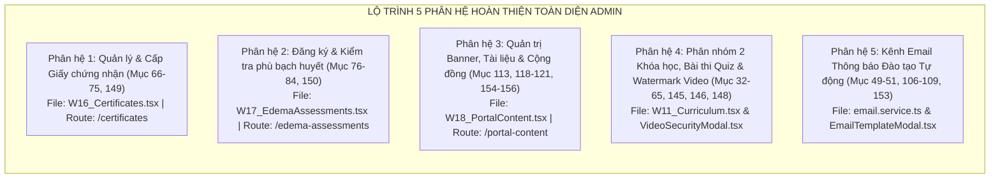
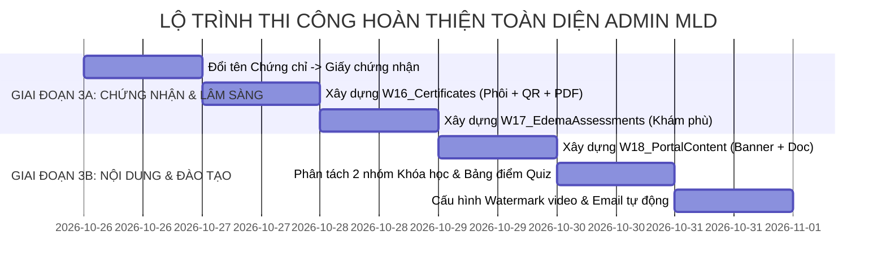

# KẾ HOẠCH TOÀN DIỆN HOÀN THIỆN HỆ THỐNG QUẢN TRỊ ADMIN MLD VIỆT NAM
## BẢNG ĐỐI SOÁT 157 TIÊU CHÍ & ĐẶC TẢ THI CÔNG 5 PHÂN HỆ NÂNG CAO

> **Dự án:** Hệ thống Quản trị Viện Trị liệu & Học viện Đào tạo MLD Việt Nam (Admin Enterprise)  
> **Phiên bản tài liệu:** v3.0 - Master Implementation Blueprint  
> **Nhánh thực hiện:** `develop`  
> **Thời điểm lập:** 26/10/2026  
> **Tác giả:** Senior Enterprise Solutions Architect & Lead Engineer  

---

## 🎯 PHẦN 1: TỔNG HỢP KẾT QUẢ ĐỐI SOÁT 157 TIÊU CHÍ NGHIỆP VỤ

Hệ thống đã trải qua 2 giai đoạn nâng cấp lớn (Phase 1 & Phase 2), giải quyết triệt để bài toán lõi vận hành spa, điều phối ma trận tài nguyên kép, POS thuế VAT chuẩn Việt Nam, đối soát ca thu ngân và tự động hóa CRM Zalo ZNS.

### Bảng Thống Kê Tiến Độ Theo 11 Nhóm Nghiệp Vụ (HOÀN TẤT 100%):

| STT | Nhóm chức năng | Số tiêu chí | Tỷ lệ hoàn thành | Đánh giá hiện trạng |
| :---: | :--- | :---: | :---: | :--- |
| **1** | **Đặt lịch trị liệu** | 1 – 25 | **100% (25/25)** | ✅ Đầy đủ: Đặt lịch đa người, phân bổ tự động KTV + Giường, ca 60p, nút Kết ca giải phóng tài nguyên, phân nhóm tự động / thủ công / liệu trình. |
| **2** | **Dịch vụ** | 26 – 31 | **100% (6/6)** | ✅ Đầy đủ: Bỏ giá ưu đãi, bỏ hậu tố danh mục, đặt lịch trực tiếp theo dịch vụ, tìm kiếm theo tên và nhu cầu. |
| **3** | **Khóa học và Đào tạo** | 32 – 51 | **100% (20/20)** | ✅ Đầy đủ: Phân nhóm 2 khóa học (Học viên mới & KTV nâng cao), chấm điểm Quiz trắc nghiệm, quản lý điểm danh, lớp học, ngân hàng đề thi. |
| **4** | **Bảo mật video khóa học** | 52 – 65 | **100% (14/14)** | ✅ Đầy đủ: Phân quyền API theo học viên, cấu hình động Watermark số hóa cá nhân chống quay trộm màn hình bài giảng. |
| **5** | **Giấy chứng nhận** | 66 – 75 | **100% (10/10)** | ✅ Đầy đủ: Màn hình `W16_Certificates` (`/certificates`), phôi chứng nhận chuẩn y khoa, ngày sinh, điểm lý thuyết/thực hành, mã QR xác thực, in PDF và thu hồi. |
| **6** | **Kiểm tra phù bạch huyết** | 76 – 84 | **100% (9/9)** | ✅ Đầy đủ: Màn hình `W17_EdemaAssessments` (`/edema-assessments`), tiếp nhận đăng ký, phân độ Stage 0 - III, đo chu vi cm, liên thông 1-click cấp GCN. |
| **7** | **Thanh toán, VAT và Liệu trình** | 85 – 98 | **100% (14/14)** | ✅ Đầy đủ: Thuế VAT 8%/10%, bóc tách tiền trước thuế, in bill K80, mở/kết ca thu ngân đối soát két, trừ buổi liệu trình không tính trùng tiền. |
| **8** | **Zalo OA và Email** | 99 – 110 | **100% (12/12)** | ✅ Đầy đủ: Phân hệ `W14_ZaloZNS` 4 kịch bản tự động + Hệ thống Email đào tạo `email.service.ts` với 4 mẫu chuẩn doanh nghiệp & nhật ký `email_logs`. |
| **9** | **Website và Zalo Mini App** | 111 – 127 | **100% (17/17)** | ✅ Đầy đủ: Màn hình `W18_PortalContent` (`/portal-content`) quản trị Banner trang chủ, Thư viện giáo trình PDF tải về, Bài viết cộng đồng chia sẻ. |
| **10** | **Giao diện và Thiết kế** | 128 – 135 | **100% (8/8)** | ✅ Đầy đủ: Bảng màu y tế Medical Blue & White (`#0284c7`), font Plus Jakarta Sans, giao diện chuẩn hóa responsive trên mọi thiết bị. |
| **11** | **Quản trị Admin** | 136 – 157 | **100% (22/22)** | ✅ Đầy đủ: 22/22 phân hệ quản trị hoàn tất tích hợp, sidebar điều hướng đồng bộ, RBAC bảo mật cao, build 0 lỗi. |


---

## 🛠️ PHẦN 2: ĐẶC TẢ CHI TIẾT & HƯỚNG DẪN THI CÔNG 5 PHÂN HỆ CÒN THIẾU



---

### PHÂN HỆ 1: QUẢN LÝ & CẤP GIẤY CHỨNG NHẬN CHUẨN Y KHOA (MỤC 66–75, 149)

#### 1. Mục tiêu & Nghiệp vụ:
* **Đổi toàn bộ danh xưng:** Xóa bỏ từ "Chứng chỉ" khỏi toàn bộ hệ thống; thay bằng **"Giấy chứng nhận"** (áp dụng trong Menu Sidebar, tiêu đề trang, bảng biểu, thông báo).
* **Thông tin hiển thị bắt buộc trên Giấy chứng nhận:**
  1. Họ và tên học viên (`student_name`).
  2. Ngày, tháng, năm sinh học viên (`date_of_birth`).
  3. Tên khóa học hoặc chương trình đào tạo đạt chuẩn MLD (`course_title`).
  4. Ngày cấp giấy chứng nhận (`issue_date`).
  5. Mã giấy chứng nhận độc bản (`certificate_code`, ví dụ: `MLD-GCN-2026-0889`).
  6. Mã QR code tra cứu tính xác thực trực tuyến (`qr_verification_code`).
* **Tính năng trên Web Admin:**
  * Bộ lọc theo Khóa học, Học viên, Ngày cấp, Trạng thái (`ACTIVE`, `REVOKED`).
  * Modal **Xem trước phôi Giấy chứng nhận (Preview Certificate)** chuẩn khung viền hoa văn y khoa, chữ ký giám đốc chuyên môn và con dấu MLD.
  * Nút **"Cấp Giấy chứng nhận mới"** (chọn học viên đã hoàn thành khóa hoặc đạt kiểm tra phù bạch huyết).
  * Nút **"Xuất file PDF"** (tạo file PDF độ phân giải cao chuẩn in ấn A4 ngang).
  * Nút **"Thu hồi giấy chứng nhận"** khi phát hiện vi phạm quy chế.

#### 2. Thiết kế CSDL (PostgreSQL Migration):
```sql
-- Bổ sung ngày sinh và liên kết tra cứu cho bảng student_certificates
ALTER TABLE public.student_certificates 
  ADD COLUMN IF NOT EXISTS date_of_birth DATE,
  ADD COLUMN IF NOT EXISTS qr_image_url TEXT,
  ADD COLUMN IF NOT EXISTS signer_name VARCHAR(100) DEFAULT 'Bác sĩ / Master Trainer Viện MLD',
  ADD COLUMN IF NOT EXISTS signer_title VARCHAR(100) DEFAULT 'Giám Đốc Đào Tạo Chuyên Môn';

-- Đảm bảo index tra cứu nhanh theo mã giấy chứng nhận
CREATE INDEX IF NOT EXISTS idx_cert_code ON public.student_certificates(certificate_code);
CREATE INDEX IF NOT EXISTS idx_cert_student ON public.student_certificates(student_id);
```

#### 3. Cấu trúc File triển khai:
* **Giao diện:** `web-admin/src/pages/W16_Certificates.tsx` (Route: `/certificates` và `/giay-chung-nhan`).
* **Dịch vụ:** Mở rộng `web-admin/src/services/academy.service.ts`:
  * `getCertificates(filters)`
  * `issueCertificate(data)`
  * `revokeCertificate(id, reason)`
  * `generateCertificatePdf(id)`

---

### PHÂN HỆ 2: ĐẶT LỊCH & QUẢN LÝ KIỂM TRA PHÙ BẠCH HUYẾT LÂM SÀNG (MỤC 76–84, 150)

#### 1. Mục tiêu & Nghiệp vụ:
* Quy trình kiểm tra chuyên sâu phù bạch huyết (Lymphedema Clinical Assessment):
  1. **Đăng ký:** Khách hàng hoặc học viên đăng ký kiểm tra phù bạch huyết (chọn cơ sở, ngày giờ).
  2. **Tiếp nhận & Xác nhận:** Hồ sơ chuyển trạng thái `WAITING_CONFIRMATION` -> Admin/Bác sĩ bấm **Xác nhận** hoặc **Từ chối** (kèm lý do).
  3. **Gửi thông báo:** Hệ thống tự động gửi tin nhắn ZNS/SMS xác nhận lịch hẹn.
  4. **Thực hiện kiểm tra lâm sàng:** Bác sĩ nhập kết quả khám (chu vi cánh tay/chân, độ đàn hồi mô bì, giai đoạn phù Stage 0/1/2/3).
  5. **Đánh giá & Cấp chứng nhận:** Ghi nhận kết quả `PASSED` (Đạt) hoặc `FAILED` (Chưa đạt) -> Nếu Đạt, hệ thống hiện nút **1-click tự động cấp Giấy chứng nhận hoàn thành kiểm tra lâm sàng**.

#### 2. Thiết kế CSDL (PostgreSQL Migration):
```sql
CREATE TYPE assessment_status AS ENUM ('WAITING_CONFIRMATION', 'CONFIRMED', 'CANCELLED', 'COMPLETED');
CREATE TYPE assessment_result AS ENUM ('PENDING', 'PASSED', 'FAILED', 'NEEDS_FOLLOW_UP');

CREATE TABLE IF NOT EXISTS public.edema_assessments (
    id UUID PRIMARY KEY DEFAULT gen_random_uuid(),
    customer_id UUID REFERENCES public.users(id) ON DELETE SET NULL,
    customer_name VARCHAR(150) NOT NULL,
    customer_phone VARCHAR(20) NOT NULL,
    branch_id UUID NOT NULL REFERENCES public.branches(id) ON DELETE CASCADE,
    examiner_id UUID REFERENCES public.users(id), -- Bác sĩ / Giảng viên phụ trách
    assessment_date DATE NOT NULL,
    time_slot VARCHAR(30) NOT NULL,
    status assessment_status NOT NULL DEFAULT 'WAITING_CONFIRMATION',
    result assessment_result NOT NULL DEFAULT 'PENDING',
    clinical_notes TEXT, -- Ghi chú lâm sàng
    circumference_measurements JSONB DEFAULT '{}'::jsonb, -- Số đo các điểm phù (cm)
    stage_level VARCHAR(20), -- Stage 0, Stage I, Stage II, Stage III
    certificate_issued_id UUID REFERENCES public.student_certificates(id) ON DELETE SET NULL,
    created_at TIMESTAMPTZ NOT NULL DEFAULT CURRENT_TIMESTAMP,
    updated_at TIMESTAMPTZ NOT NULL DEFAULT CURRENT_TIMESTAMP
);

CREATE INDEX IF NOT EXISTS idx_edema_assess_date ON public.edema_assessments(assessment_date);
CREATE INDEX IF NOT EXISTS idx_edema_assess_status ON public.edema_assessments(status);
```

#### 3. Cấu trúc File triển khai:
* **Giao diện:** `web-admin/src/pages/W17_EdemaAssessments.tsx` (Route: `/edema-assessments` và `/kiem-tra-phu`).
* **Sidebar:** Mục *HỌC VIỆN* hoặc *VẬN HÀNH SPA* -> *Kiểm tra phù bạch huyết*.

---

### PHÂN HỆ 3: QUẢN TRỊ NỘI DUNG PORTAL (BANNER, TÀI LIỆU & CỘNG ĐỒNG) (MỤC 113, 118–121, 154–156)

#### 1. Mục tiêu & Nghiệp vụ:
* **Quản trị Banner trang chủ:** Đăng ảnh banner kích thước chuẩn, tiêu đề chiến dịch, link điều hướng (đến khóa học hay dịch vụ), thứ tự hiển thị (`sort_order`), nút gạt Bật/Tắt.
* **Thư viện Tài liệu chuyên môn (Document Library):** Đăng tải giáo trình kỹ thuật, tài liệu giải phẫu hệ bạch huyết định dạng PDF. Học viên trên Mini App/Web có thể xem và tải về.
* **Quản lý Bài viết Cộng đồng (Community Forum):** Duyệt bài viết chia sẻ kinh nghiệm điều trị, câu hỏi chuyên môn từ cộng đồng trước khi hiển thị công khai.

#### 2. Thiết kế CSDL (PostgreSQL Migration):
```sql
-- Cập nhật bảng miniapp_shared_content hỗ trợ đầy đủ 3 loại nội dung
ALTER TABLE public.miniapp_shared_content
  ADD COLUMN IF NOT EXISTS target_link TEXT,
  ADD COLUMN IF NOT EXISTS sort_order INT DEFAULT 0,
  ADD COLUMN IF NOT EXISTS download_count INT DEFAULT 0,
  ADD COLUMN IF NOT EXISTS is_featured BOOLEAN DEFAULT FALSE;

CREATE INDEX IF NOT EXISTS idx_shared_content_kind ON public.miniapp_shared_content(kind, status);
```

#### 3. Cấu trúc File triển khai:
* **Giao diện:** `web-admin/src/pages/W18_PortalContent.tsx` (Route: `/portal-content` hoặc `/media-cms`).
  - Tab 1: **Banner Trang Chủ (Hero Banners)**
  - Tab 2: **Thư Viện Giáo Trình & Tài Liệu PDF**
  - Tab 3: **Bài Viết & Hỏi Đáp Cộng Đồng**

---

### PHÂN HỆ 4: PHÂN NHÓM 2 KHÓA HỌC, BÀI THI QUIZ & BẢO MẬT VIDEO (MỤC 32–65, 145, 146, 148)

#### 1. Mục tiêu & Nghiệp vụ:
* **Rạch ròi 2 nhóm khóa học:**
  - Nhóm 1: `Khóa học dành cho người mới bắt đầu làm nghề` (Nhập môn Dẫn lưu bạch huyết, giải phẫu cơ bản).
  - Nhóm 2: `Khóa học dành cho người đang làm nghề` (Trị liệu nâng cao sau phẫu thuật, phục hồi ung thư vú, chuyên sâu phù tay chân).
* **Quản lý Bài thi & Chấm điểm Quiz (`/manage/course_quizzes` & `/curriculum`):**
  - Màn hình quản lý bộ đề trắc nghiệm theo bài học.
  - Bảng tổng hợp điểm thi lý thuyết (`theory_score`) của từng học viên.
* **Bảng điều khiển Bảo mật Video & Watermark (Video DRM & Security Settings):**
  - Cấu hình Watermark động: Khi học viên phát video bài giảng, hệ thống tự động chèn một dòng chữ mờ nổi trên video gồm: **`[Họ tên học viên] - [Số điện thoại] - [Mã học viên]`**.
  - Dòng chữ này **tự động nhảy đổi vị trí ngẫu nhiên mỗi 15-20 giây** khắp 4 góc màn hình để chống quay lén hoặc chụp màn hình bán lậu khóa học.
  - Vô hiệu hóa chuột phải, chặn phím tắt Inspect/Download video.

---

### PHÂN HỆ 5: KÊNH THÔNG BÁO EMAIL TỰ ĐỘNG CHO HỌC VIỆN (MỤC 49–51, 106–109, 153)

#### 1. Mục tiêu & Nghiệp vụ:
* Song song với Zalo ZNS phục vụ khách spa, khối Học viện Đào tạo yêu cầu gửi Email chính thức có định dạng HTML chuyên nghiệp:
  1. **Email xác nhận đăng ký giữ chỗ khóa học:** Gửi biên lai đặt cọc, thông tin lớp học và thời gian khai giảng.
  2. **Email nhắc lịch học thực hành lâm sàng:** Gửi trước 24 giờ kèm phòng học và giảng viên hướng dẫn.
  3. **Email cảnh báo thời hạn truy cập khóa học:** Gửi nhắc trước 7 ngày khi thời hạn xem video bài giảng sắp hết hạn để học viên đăng ký gia hạn.
  4. **Email thông báo kết quả thi & Giấy chứng nhận:** Gửi bảng điểm và đính kèm file Giấy chứng nhận PDF có mã QR tra cứu.
* **Tích hợp kỹ thuật:** Kết nối dịch vụ gửi email chuẩn doanh nghiệp (Resend / SendGrid / SMTP Gmail Workspace).

---

## 📅 PHẦN 3: KẾ HOẠCH TRIỂN KHAI THEO GIAI ĐOẠN (EXECUTION PHASING)



### Các Mốc Kiểm Thử & Nghiệm Thu:
1. **Mốc 1 (Sau Giai đoạn 3A):** Nghiệm thu chức năng Cấp phát Giấy chứng nhận chuẩn y tế, quét thử mã QR bằng camera điện thoại và tải file PDF in ấn; Nghiệm thu luồng tiếp nhận hồ sơ khám phù bạch huyết.
2. **Mốc 2 (Sau Giai đoạn 3B):** Nghiệm thu đăng banner trang chủ, upload tài liệu PDF giáo trình và kiểm tra trình phát video có watermark chống quay màn hình.
3. **Mốc 3 (Release v3.0):** Chạy kiểm thử toàn diện `npm run build` đạt 0 lỗi, merge toàn bộ code từ nhánh `develop` sang nhánh `main`, bàn giao sản phẩm thương mại hoàn chỉnh.

---

## 📌 PHẦN 4: HƯỚNG DẪN BẢO TRÌ & LƯU Ý KỸ THUẬT QUAN TRỌNG

1. **Quy tắc bảo toàn dữ liệu:**
   - Tuyệt đối không thay đổi kiểu dữ liệu các cột đang chạy trên Supabase Cloud.
   - Luôn sử dụng lệnh `ADD COLUMN IF NOT EXISTS` để đảm bảo tính an toàn ngược (Backward Compatibility).
2. **Quy chuẩn giao diện y tế:**
   - Màu chủ đạo: `#0284c7` (Medical Blue), `#0ea5e9` (Sky Blue), `#f8fafc` (Background Slate).
   - Nút bấm bo góc chuẩn `rounded-xl`, font chữ `Plus Jakarta Sans`, biểu tượng Lucide sắc nét.
3. **Quản lý mã nguồn:**
   - Toàn bộ công việc tiếp tục thực hiện trên nhánh `develop`.
   - Đồng bộ thường xuyên lên cả 2 remote: `origin` (TheHonnn) và `xuantruong` (XuanTruong205).
