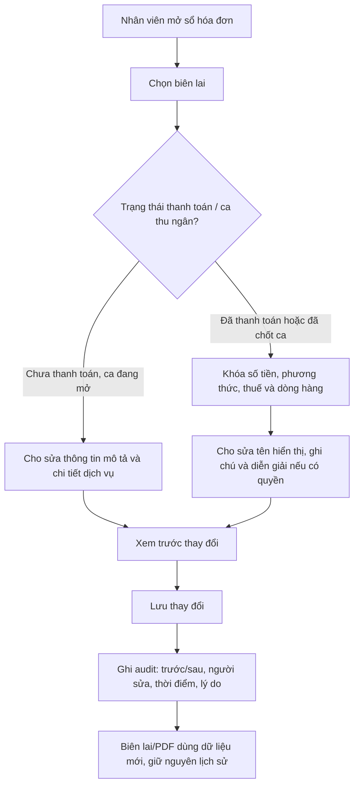
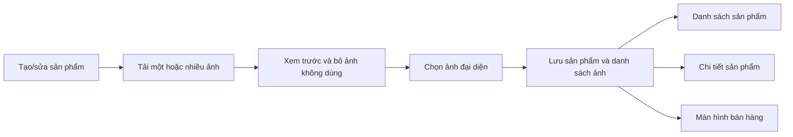
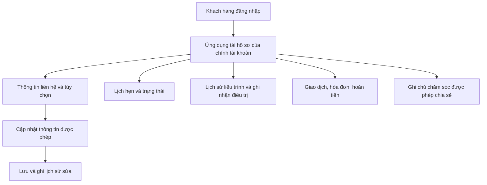
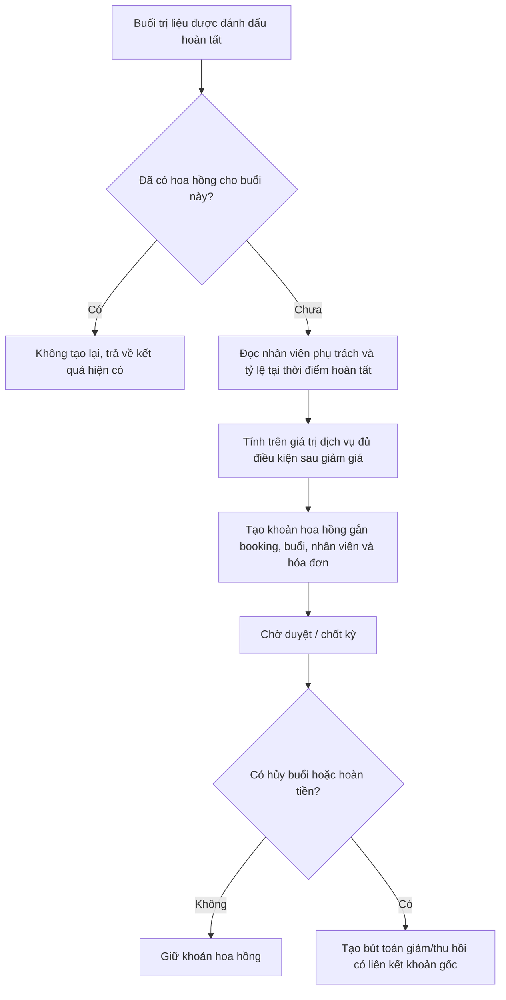
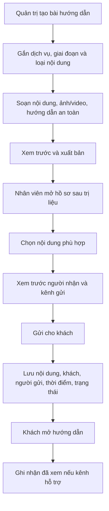
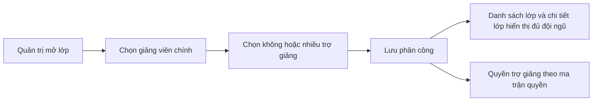
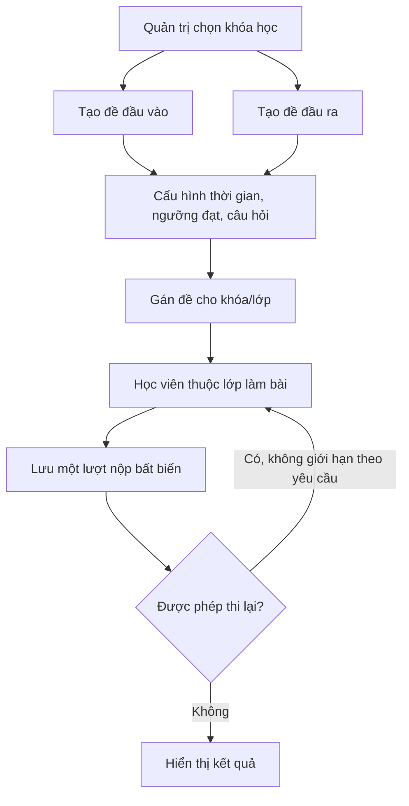
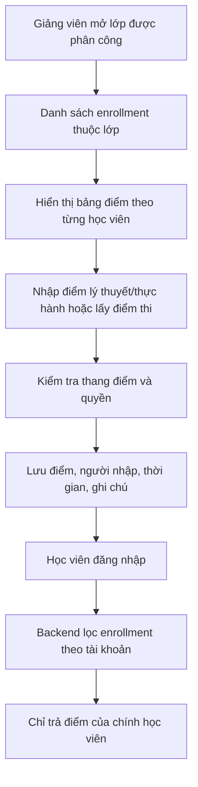

# Luồng xử lý yêu cầu Admin sau họp khách hàng

Tài liệu này mô tả luồng nghiệp vụ mục tiêu, quyền thao tác, dữ liệu cần lưu và các quy tắc chống sai lệch. Các giả định đề xuất được đánh dấu để xác nhận trước khi bật trên môi trường thật.

## 1. Quy tắc xuyên suốt

- Ghi nhật ký cho thao tác sửa/xóa dữ liệu tài chính, điểm số, hồ sơ khách hàng và nội dung đã gửi.
- Các khoản tiền, điểm, hóa đơn và lượt thi đã phát sinh không bị ghi đè âm thầm; dùng lịch sử thay đổi hoặc bút toán điều chỉnh.
- Backend và cơ sở dữ liệu kiểm tra quyền. Ẩn nút trên giao diện không được xem là phân quyền.
- Lưu thời điểm theo UTC, hiển thị theo múi giờ Việt Nam; lưu người thao tác và mã bản ghi liên quan.
- Hành động gửi tin, phát sinh hoa hồng hoặc nộp bài phải có khóa chống lặp để thao tác lại không tạo bản ghi trùng.

## 2. Sửa biên lai

**Trường đề xuất được sửa sau thanh toán:** tên người nhận trên biên lai, ghi chú, diễn giải dịch vụ. Không cho sửa tổng tiền, VAT, chiết khấu, phương thức thanh toán hoặc người thu. Sai số tài chính xử lý bằng hoàn tiền/điều chỉnh và lập chứng từ mới. Bắt buộc nhập lý do sửa. Nếu ca đã chốt, chỉ quản lý được sửa trường mô tả.

## 3. Ảnh sản phẩm bổ trợ

Ảnh đại diện phải luôn thuộc danh sách ảnh của sản phẩm. Khi xóa ảnh đại diện, yêu cầu chọn ảnh thay thế nếu còn ảnh khác. Khi không có ảnh, giao diện dùng ảnh mặc định. Giữ trường `image_url` hiện có làm ảnh đại diện tương thích các màn hình cũ; danh sách ảnh là dữ liệu mở rộng.

## 4. Hồ sơ khách hàng trên ứng dụng

**Giả định đề xuất:** “giống như web” nghĩa là tương đương cả dữ liệu và khả năng xem/thao tác phù hợp trên ứng dụng; không bắt buộc sao chép từng pixel giao diện web.

Khách chỉ xem hồ sơ của mình. Ghi chú nội bộ, dữ liệu y tế nhạy cảm và ghi chú phân công nhân viên không hiển thị trên ứng dụng nếu chưa được đánh dấu chia sẻ.

## 5. Hoa hồng theo từng buổi trị liệu

Mỗi khoản cần lưu tỷ lệ và số tiền đã chốt để thay đổi tỷ lệ nhân viên sau này không làm đổi lịch sử. Khóa duy nhất đề xuất là `(treatment_session_id, staff_id, commission_type)`. Hoa hồng từng buổi được tách khỏi hoa hồng bán gói/upsell. Không xóa khoản đã chốt; hoàn tiền tạo bút toán đảo.

## 6. Nội dung chăm sóc tại nhà

Nội dung kiến thức phải do người được phân quyền duyệt trước khi xuất bản. Bài hướng dẫn có thể gắn nhiều dịch vụ; lịch sử gửi giữ bản chụp tiêu đề/nội dung đã gửi để sửa bài gốc không làm đổi lịch sử.

## 7. Bộ phận và trợ giảng

### Bộ phận

**Giả định đề xuất:** nút “Thêm bộ phận” nằm trong quản lý nhân sự và danh mục này dùng để phân loại hồ sơ nhân viên. Bộ phận được tạo gồm tên, mã, trạng thái và thứ tự hiển thị; không xóa cứng bộ phận đã có nhân viên mà chuyển sang ngừng sử dụng.

### Trợ giảng

**Quyền đề xuất:** trợ giảng được xem danh sách học viên, điểm danh và nhập điểm lớp được phân công; không được sửa học phí, xóa lớp, cấp chứng nhận hoặc xem lớp khác. Việc nhập điểm cần audit như giảng viên chính.

## 8. Lịch buổi học, đề thi và lượt thi

Không xóa bảng hoặc dữ liệu lịch dùng chung khi chưa xác nhận vì lịch có thể cấp dữ liệu cho điểm danh, lịch thi và lịch sử học viên. **Giả định tạm thời:** ẩn phần chi tiết lịch buổi học khỏi màn hình đang được khách nhắc tới; giữ dữ liệu và màn hình quản trị lịch/điểm danh hiện tại.

Mỗi lượt lưu đề, câu trả lời, điểm, thời điểm, thời lượng và trạng thái. **Quy tắc đề xuất:** hiển thị lượt gần nhất và điểm cao nhất; dùng điểm cao nhất để xét đạt đầu ra. Nhân viên được xem toàn bộ lịch sử lượt thi, học viên chỉ xem lượt và kết quả của chính mình.

## 9. Bảng điểm và quyền xem

Mỗi điểm thủ công lưu điểm cũ/mới, người sửa, thời điểm và lý do sửa. Điểm thi tự động không bị ghi đè bởi điểm tay; nếu cần điều chỉnh thì lưu điểm điều chỉnh riêng và liên kết lượt thi gốc. Giảng viên/trợ giảng chỉ xem lớp được phân công; quản trị viên được xem toàn hệ thống theo quyền.

## 10. Ma trận quyền đề xuất

| Vai trò | Biên lai | Hồ sơ khách | Hướng dẫn | Lớp/đề thi | Điểm |
|---|---|---|---|---|---|
| Thu ngân | Sửa mô tả theo trạng thái; không sửa số tiền sau thanh toán | Thông tin cần cho giao dịch | Xem/gửi nội dung được duyệt | Không mặc định có quyền | Không |
| Chuyên viên trị liệu | Xem giao dịch liên quan | Hồ sơ chăm sóc theo phân công | Chọn/gửi hướng dẫn | Không | Không |
| Giảng viên chính | Không mặc định | Học viên lớp phụ trách | Có thể xem hướng dẫn | Quản lý lớp, đề thi | Xem/nhập/sửa điểm lớp |
| Trợ giảng | Không | Học viên lớp phụ trách | Có thể xem hướng dẫn | Xem lớp được phân công | Điểm danh và nhập điểm lớp được phân công |
| Học viên/khách hàng | Xem biên lai của mình | Hồ sơ của chính mình | Xem nội dung đã gửi cho mình | Chỉ lớp/đề được gán | Chỉ xem kết quả của chính mình |
| Quản trị viên | Quản lý và xem lịch sử | Theo quyền quản trị | Soạn, duyệt, xuất bản | Quản lý toàn hệ thống | Xem và điều chỉnh có audit |

## 11. Tiêu chí nghiệm thu tối thiểu

- Không thể đọc/sửa dữ liệu khách hàng hoặc điểm của tài khoản khác bằng cách đổi ID trên request.
- Sửa biên lai đã thanh toán không làm thay đổi số tiền, VAT hoặc phương thức thu; có lý do và lịch sử trước/sau.
- Gửi lại cùng hướng dẫn hoặc xác nhận buổi trị liệu lặp không sinh bản ghi trùng.
- Hủy buổi/hoàn tiền tạo khoản điều chỉnh hoa hồng liên kết khoản ban đầu.
- Ảnh đại diện hiển thị nhất quán trong danh sách, chi tiết và nơi bán hàng; xóa ảnh không làm vỡ ảnh đại diện.
- Bài thi lưu được nhiều lượt, từng lượt giữ nguyên; điểm cao nhất và gần nhất thể hiện đúng quy tắc.
- Giảng viên/trợ giảng không xem được lớp chưa được phân công; học viên không nhận dữ liệu bạn học.
- Chạy kiểm thử với lịch buổi học hiện có để xác nhận ẩn giao diện không làm hỏng điểm danh/lịch thi.

## 12. Các quyết định cần chốt trước khi mở rộng production

1. Xác nhận vị trí màn hình của “Thêm bộ phận” và bộ phận có chỉ phục vụ nhân sự hay còn quy trình khác.
2. Xác nhận trợ giảng được điểm danh, nhập điểm hay chỉ xem; mặc định tài liệu này đề xuất cho điểm danh và nhập điểm lớp được phân công.
3. Xác nhận “bỏ lịch” là ẩn khỏi một màn hình hay gỡ toàn bộ tính năng; mặc định giữ schema và dữ liệu.
4. Xác nhận điểm thi lại dùng điểm cao nhất để xét đạt; mặc định lưu và hiển thị cả điểm gần nhất lẫn cao nhất.
5. Xác nhận tỷ lệ/căn cứ tính hoa hồng theo buổi và cách phân bổ khi có nhiều nhân viên cùng phụ trách.
