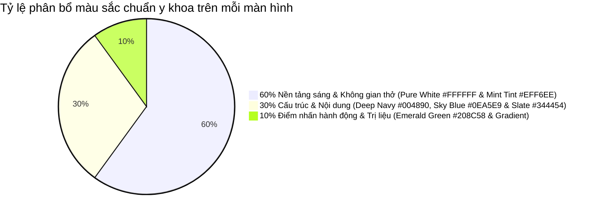

# TÀI LIỆU TỔNG HỢP & PHÂN TÍCH YÊU CẦU CẢI TIẾN TOÀN DIỆN APP MLD VIỆT NAM
> **Mã tài liệu:** `MLD-DOC-APP-REVAMP-V2`  
> **Phiên bản:** 2.1 (Bản tổng hợp Master chính thức)  
> **Ngày cập nhật:** 06/11/2026  
> **Trạng thái:** Đã tổng hợp toàn diện & Sẵn sàng triển khai  
> **Mục tiêu cốt lõi:** Chuyển đổi toàn diện ứng dụng MLD Việt Nam từ giao diện mang tính "chèo kéo bán hàng / tư vấn" sang ứng dụng **Y tế & Trị liệu chuyên sâu, Đẳng cấp, Tinh tế, Khoa học**, đồng bộ 100% với website chính thức `hebachhuyet.vn` và bộ nhận diện thương hiệu của Viện/Trung tâm.

---

## 📌 I. BỐI CẢNH DỰ ÁN & VẤN ĐỀ HIỆN TẠI

Dựa trên phản hồi trực tiếp từ khách hàng và khảo sát trải nghiệm người dùng thực tế:
1. **Giao diện bị nặng tính "chốt sale / bán hàng":** Xuất hiện form điền thông tin tư vấn nhanh 30 giây ngay giữa trang chủ, các nút bấm to bản màu đỏ cam giục giã gọi điện thoại tạo cảm giác không an tâm cho bệnh nhân.
2. **Hệ thống điều hướng bị chiếm dụng:** Thanh chân app (Bottom Navigation Bar) bị gán 2 nút con nhộng to `[Gọi ngay]` và `[Tư vấn]` thay vì các tab tính năng cốt lõi của một ứng dụng y tế.
3. **Màu sắc và phông chữ chưa đạt chuẩn y khoa cao cấp:**
   - Tone màu cũ (xanh mòng két / teal pha đỏ cam) chưa toát lên tính chuẩn mực của cơ sở y khoa hàng đầu.
   - Phông chữ hệ thống cũ thô cứng, hiển thị dấu tiếng Việt chưa thanh thoát, gây mỏi mắt cho người lớn tuổi.
4. **Trang chủ bị rác bởi thông tin thừa:** Xuất hiện các câu hỏi không cần thiết ("Bạn muốn tìm gì?"), các số điện thoại và cụm 4 icon mạng xã hội dán dày đặc ở chân trang.
5. **Chưa đồng bộ với website chính thức `hebachhuyet.vn`:** Thông tin nhu cầu điều trị, đối tượng bệnh nhân, cơ sở địa chỉ và 3 gói dịch vụ cốt lõi chưa phản ánh đúng thực tế vận hành.
6. **Thiếu cơ chế ghi nhận "Người giới thiệu" (Attribution):** Khách hàng trị liệu bạch huyết thường đến từ sự giới thiệu của Bác sĩ chỉ định, Kỹ thuật viên chăm sóc hoặc người thân cùng bệnh, nhưng app chưa có nơi ghi nhận và hiển thị rõ ràng.
7. **Kênh "Kết nối với chúng tôi" chưa được định vị văn minh:** Các kênh liên hệ bị thả nổi rải rác dưới chân trang chủ thay vì được tổ chức thành một phân hệ hỗ trợ chuyên nghiệp, trang trọng.

---

## 📋 II. BẢNG TỔNG HỢP TOÀN BỘ YÊU CẦU CẢI TIẾN

| STT | Yêu cầu của khách hàng | Phân tích bản chất nghiệp vụ & UX | Hạng mục kỹ thuật | Vị trí codebase ảnh hưởng | Giải pháp thực hiện chi tiết |
|:---:|:---|:---|:---|:---|:---|
| **1** | **Màu sắc:** Xanh dương chính, xanh da trời là phụ | Chuyển đổi sang tone màu y tế chuẩn mực. Xanh dương tạo độ tin cậy khoa học, xanh da trời mang lại sự tươi mát, nhẹ nhàng cho người bệnh. | Design System / Palette | `app_colors.dart`<br>`app_theme.dart` | • **Xanh dương chính (Primary):** `#004890` (Medical Deep Navy).<br>• **Xanh da trời phụ (Secondary):** `#0EA5E9` / `#38BDF8` (Sky Blue) & Ice Blue `#DEEAF6`.<br>• Điểm nhấn bạch huyết: `#208C58` (Lymphatic Emerald).<br>• Nền khối mềm: `#EFF6EE` (Sage Mint) & White `#FFFFFF`.<br>• Chữ đọc: `#344454` (Slate). |
| **2** | **Phông chữ của giao diện xấu** | Phông hiện tại thô cứng, dấu tiếng Việt bị lệch dòng, thiếu sự tinh tế của ứng dụng chăm sóc sức khỏe cao cấp. | Typography System | `pubspec.yaml`<br>`app_theme.dart` | Tích hợp font **Be Vietnam Pro** (hoặc **Plus Jakarta Sans**) từ Google Fonts. Tối ưu 100% hiển thị tiếng Việt, nét tròn đều, thanh lịch, dễ đọc cho bệnh nhân lớn tuổi. |
| **3** | **Chuyển "Truy cập nhanh" thành icon ở dưới chân app** | Giải phóng chân app khỏi 2 nút gọi/tư vấn. Biến chân app thành hệ thống điều hướng 5 tab chuẩn mực của mobile app. | Navigation Architecture | `main_layout_screen.dart` | Bỏ 2 nút capsule `[Gọi ngay]`, `[Tư vấn]`. Thay bằng BottomNavigationBar 5 Tab Icon: **Trang chủ · Dịch vụ · Đào tạo · Kiến thức · Cá nhân**. |
| **4** | **Chỗ bác sĩ hẹn tư vấn bỏ & Xóa form đăng ký nhanh** | Gỡ bỏ cảm giác "chèo kéo / bán hàng". Người bệnh sẽ chủ động đặt lịch khám/trị liệu qua nút bấm Hero Banner hoặc tab Dịch vụ. | Feature Removal | `b01_home_screen.dart` | Xóa bỏ hoàn toàn widget `_buildConsultationLeadCard()` ("ĐĂNG KÝ TRONG 30 GIÂY - Bác sĩ gọi lại tư vấn miễn phí", form họ tên, SĐT). |
| **5** | **Bỏ câu "Bạn muốn tìm gì?"** | Câu hỏi thừa thãi, chiếm dụng diện tích thị giác đầu khối chức năng. | UI Content Clean-up | `b01_home_screen.dart` | Xóa bỏ dòng Text `'Bạn muốn tìm gì?'` tại phần đầu khối truy cập. |
| **6** | **Bỏ phần cuối có SĐT & Xóa SĐT, icon MXH nhanh ở dưới cùng trang chủ** | Loại bỏ khối chân trang dày đặc số điện thoại và icon MXH làm bẩn giao diện trang chủ. | Footer Clean-up | `b01_home_screen.dart` | Xóa bỏ widget `_buildMldHealthFooter()` và các nút liên kết MXH nhanh ở cuối trang chủ. |
| **7** | **Đổi "Nhắn tin trực tiếp" thành "Kết nối với chúng tôi" tại Trang chủ** | Giữ nguyên các kênh liên hệ MXH (Zalo, Facebook, TikTok, Messenger) bên dưới công cụ tìm kiếm tại Trang chủ, đổi tiêu đề thành "Kết nối với chúng tôi" và thiết kế lại chuẩn mực. Không đưa vào trang Cá nhân. | UI Refactor | `b01_home_screen.dart` | Đổi tiêu đề widget thành "Kết nối với chúng tôi", giữ nguyên icon MXH bên dưới công cụ tìm kiếm. |
| **8** | **Đổi "Tài liệu" thành "Kiến thức"** | "Tài liệu" mang tính hành chính/khô khan. "Kiến thức" mang tính giáo dục sức khỏe, cẩm nang phục hồi và giá trị cho người bệnh. | Naming & Taxonomy | Navigation, Home, Document screens | Đổi toàn bộ nhãn, route và tiêu đề từ "Tài liệu" thành **"Kiến thức"** (Cẩm nang y khoa, bài tập phục hồi, video chuyên gia). |
| **9** | **Cấu trúc 4 trụ cột: Đào tạo, Dịch vụ, Sản phẩm, Kiến thức** | Giữ nguyên các phân hệ chức năng cốt lõi, chỉ đổi tên Tài liệu thành Kiến thức. | Naming & Structure | Tabs, Navigation | Giữ nguyên logic và phân hệ, chỉ đổi tên nhãn "Tài liệu" thành "Kiến thức". |
| **10** | **Đồng bộ thông tin cơ sở chuẩn** | Cập nhật địa chỉ cơ sở chuẩn: Số 260, Ngõ 271 Bùi Xương Trạch, Thanh Xuân, Hà Nội, bỏ chữ "Gần bạn hơn". | Branch Info | `b01_home_screen.dart` | Cập nhật địa chỉ và kiểm tra trạng thái mở/đóng cửa theo thời gian thực. |
| **11** | **Thêm mục "Người giới thiệu" hoặc "Ai đã giới thiệu"** | Ghi nhận công lao chỉ định của Bác sĩ / KTV và kích hoạt quyền lợi tích điểm / ưu đãi hội viên. | Referral & Attribution | `membership_repository.dart`<br>`f01_profile_dashboard_screen.dart` | Hiển thị thông tin Bác sĩ / KTV đã giới thiệu khách hàng. Cung cấp ô nhập mã giới thiệu nếu chưa có và mã chia sẻ cá nhân. |

---

## 🔍 III. PHÂN TÍCH CHUYÊN SÂU TỪNG HẠNG MỤC

### 1. Hệ thống Màu sắc & Căn chỉnh Hài hòa (Màu Xanh Dương Chính, Xanh Da Trời Phụ)

#### A. Cảm thức thương hiệu & Phối màu y khoa
* **Màu Xanh Dương Chính (Primary - Deep Medical Navy):** Đại diện cho học thuật y khoa, sự chuẩn mực, tính chính xác và an tâm tuyệt đối của cơ sở chuyên môn.
* **Màu Xanh Da Trời Phụ (Secondary - Sky Blue & Soft Ice Tint):** Đại diện cho sự nhẹ nhàng, thanh thoát, giảm áp lực tâm lý, đem lại hy vọng và cảm giác tươi mát cho bệnh nhân phù nề.
* **Màu Xanh Lá Bạch Huyết Điểm Nhấn (Accent - Lymphatic Emerald):** Đại diện cho dòng chảy sinh học bạch huyết, sự thanh lọc độc tố và khả năng tự chữa lành tự nhiên.

#### B. Bảng mã màu chuẩn trích xuất từ nhận diện MLD Việt Nam
| Tên thành phần màu | Mã HEX | Ứng dụng cụ thể trong App |
| :--- | :--- | :--- |
| **Primary (Xanh dương chính)** | `#004890` *(hoặc `#1A56DB`)* | Header App Bar, Tiêu đề màn hình (H1), Icon Tab điều hướng active. |
| **Secondary (Xanh da trời phụ)** | `#0EA5E9` *(hoặc `#38BDF8`)* | Nút phụ, Icon trang trí, Thanh tiến trình, Vạch phân đoạn. |
| **Lymphatic Emerald (Điểm nhấn)** | `#208C58` | Nút hành động chính (CTA Đặt lịch, Đăng ký), Trạng thái mở cửa, Huy hiệu thành công. |
| **Ice Blue Tint (Nền Tag/Badge)** | `#DEEAF6` | Nền thẻ danh mục, Badge hạng thành viên, Chip chọn ngày giờ (Chữ bên trong: `#144874`). |
| **Sage Mint Tint (Nền khối Card)** | `#EFF6EE` | Nền thẻ trích dẫn y khoa, Hộp lưu ý bệnh học, Card ưu đãi đặc biệt. |
| **Body Text (Chữ đọc chính)** | `#344454` *(Slate Charcoal)* | Nội dung văn bản đọc chính, dịu mắt hơn hẳn màu đen kịt `#000000`. |
| **Caption & Subtle (Chữ phụ)** | `#607080` | Ngày giờ, phụ đề, placeholder ô nhập liệu. |
| **Scaffold Background (Nền app)** | `#FFFFFF` | Nền trang tổng thể, tạo cảm giác vô trùng, sáng sủa và sạch sẽ chuẩn y tế. |

#### C. Nguyên tắc phối màu hài hòa 60 - 30 - 10


#### D. Quy chuẩn căn chỉnh & Phân cấp thị giác 4 tầng
1. **Tầng 1 (Tag định vị)**: Badge dạng viên thuốc bo tròn 20px, nhỏ gọn, nền `#DEEAF6`, chữ `#144874`.
2. **Tầng 2 (Tiêu đề chính H1)**: Font Bold, màu `#004890`, kích thước nổi bật (20 - 22px).
3. **Tầng 3 (Tiêu đề phụ / Slogan H2)**: Font Semi-bold, màu `#208C58` (hoặc `#0EA5E9`), cách tiêu đề chính 4 - 6px.
4. **Tầng 4 (Khối thông tin nổi bật / Callout Card)**: Card bo góc 14 - 16px, lề 2 bên 16px, nền `#EFF6EE`, bên trái có icon tròn xanh lá làm điểm neo thị giác.

---

### 2. Hệ thống Phông chữ (Khắc phục triệt để "Phông chữ giao diện xấu")

* **Nguyên nhân phông chữ cũ bị đánh giá xấu:**
  - Font hệ thống mặc định hoặc Montserrat khi hiển thị dấu tiếng Việt (ắ, ằ, ặ, ấ, ầ, ậ, ơ, ư) thường bị lệch baseline, nét chữ không đều, các ký tự đậm bị bết dính.
  - Mang hơi hướng ứng dụng kỹ thuật số chung chung, thiếu sự mềm mại, ân cần của môi trường y tế & chăm sóc sức khỏe.
* **Giải pháp thay thế cao cấp:**
  - Tích hợp font **Be Vietnam Pro** (thiết kế bởi các nhà thiết kế Việt Nam chuẩn Google Fonts).
  - Tối ưu 100% cho dấu thanh tiếng Việt, đường cong tròn đều, thanh lịch, trang trọng và cực kỳ dễ đọc đối với cả bệnh nhân lớn tuổi.
* **Quy chuẩn TextTheme phân cấp trong App:**
  - `headlineLarge`: 22px - Bold 700 - Color `#004890` (Tiêu đề trang).
  - `headlineMedium`: 18px - SemiBold 600 - Color `#004890` (Tiêu đề phần).
  - `titleMedium`: 15px - SemiBold 600 - Color `#004890` / `#208C58` (Tiêu đề thẻ).
  - `bodyLarge`: 14px - Regular 400 - Color `#344454` (Nội dung quan trọng).
  - `bodyMedium`: 13px - Regular 400 - Color `#344454` (Nội dung mô tả đọc thông thường).
  - `bodySmall`: 11.5px - Regular 400 - Color `#607080` (Ghi chú, ngày giờ).

---

### 3. Tái cấu trúc Chân App (Chuyển "Truy cập nhanh" thành Icon ở chân app)

* **Vấn đề trước đây:**
  - Chân app bị gắn 2 nút bấm to `[Gọi ngay]` (màu đỏ cam) và `[Tư vấn]` (màu teal). Điều này phá vỡ hoàn toàn nguyên lý thiết kế ứng dụng di động chuẩn, tạo cảm giác người dùng đang vào một trang "Landing Page chạy quảng cáo chốt đơn" thay vì một ứng dụng y tế chuyên nghiệp.
* **Giải pháp mới:**
  - Gỡ bỏ hoàn toàn 2 nút capsule này.
  - Chuyển toàn bộ các trụ cột chức năng của mục **Truy cập nhanh** xuống thanh Bottom Navigation Bar với 5 Tab Icon chuẩn mực:
    1. 🏠 **Trang chủ (Home):** Nhu cầu điều trị, Dịch vụ cốt lõi, Khóa đào tạo, Kiến thức y khoa, Sản phẩm hỗ trợ.
    2. 🩺 **Dịch vụ (Services):** Danh mục 3 chương trình chăm sóc (Khu trú, Mở rộng, Toàn diện), dịch vụ sau mổ K vú, bảng giá và đặt lịch hẹn.
    3. 🎓 **Đào tạo (Academy):** Các khóa học MLD chuyên sâu, chứng chỉ nghề, lịch khai giảng và form đăng ký học.
    4. 📖 **Kiến thức (Knowledge):** Cẩm nang y khoa về hệ bạch huyết, video hướng dẫn bài tập phục hồi tại nhà, chế độ dinh dưỡng (Đổi tên từ "Tài liệu").
    5. 👤 **Cá nhân (Profile):** Hồ sơ hội viên, Người giới thiệu bạn, Lịch sử trị liệu, Gói liệu trình, Khóa học.

---

### 4. Dọn dẹp & Tinh gọn Trang chủ (Home Screen Clean-up)

* **1. Xóa form đăng ký nhanh / Chỗ bác sĩ hẹn tư vấn bỏ:**
  - Cắt bỏ hoàn toàn widget `_buildConsultationLeadCard()` ("ĐĂNG KÝ TRONG 30 GIÂY - Bác sĩ gọi lại tư vấn miễn phí", form nhập họ tên và SĐT).
  - Người bệnh có nhu cầu sẽ chủ động bấm nút `[ 📅 Đặt lịch trị liệu ]` tại Hero Banner hoặc trực tiếp chọn dịch vụ trong Tab Dịch vụ.
* **2. Bỏ câu "Bạn muốn tìm gì?":**
  - Xóa bỏ câu text câu hỏi tìm kiếm thừa thãi ở đầu khối tiện ích, giúp giao diện gọn gàng, vào thẳng nội dung giá trị.
* **3. Bỏ phần cuối có SĐT & Xóa SĐT, icon MXH nhanh ở chân trang chủ:**
  - Cắt bỏ hoàn toàn widget `_buildMldHealthFooter()` (Hotline và dàn nút mạng xã hội Zalo, Facebook, TikTok, Messenger rải rác ở chân trang).
  - Trang chủ sẽ kết thúc bằng khối **Kiến thức y khoa bổ ích** hoặc **Thông tin cơ sở chuẩn mực**, mang lại cảm giác trang nhã, đẳng cấp.

---

### 5. Phân tích & Tái định vị yêu cầu "Kết nối với chúng tôi"
đổi nhắn tin trực tiếp thành kết nối với chúg tôi, giữ nguyên icon mxh của họ  bên dưới công cụ tìm kiếm, và thiết kế lại theo chuẩn 
---

### 6. Cấu trúc 4 Trụ cột Nội dung (Đào tạo, Dịch vụ, Sản phẩm, Kiến thức)
giữ nguyên, chỉ đổi tên

---

### 7. Bổ sung mục "Người giới thiệu / Ai đã giới thiệu" (Referral & Attribution)

* **Ý nghĩa thực tế:**
  - Bệnh nhân phù bạch huyết thường được Bác sĩ chuyên khoa ung bướu/thẩm mỹ chỉ định, hoặc do Kỹ thuật viên chăm sóc giới thiệu.
  - Việc ghi nhận rõ ràng người giới thiệu giúp đảm bảo tính y đức, liên lạc trao đổi tình trạng bệnh án giữa Bác sĩ và MLD Việt Nam, đồng thời minh bạch quyền lợi tích điểm hội viên.
* **Thiết kế tính năng:**
  - Trong **Màn hình Cá nhân (Profile)** & **Thẻ thông tin Trang chủ**:
    - *Đã có người giới thiệu:* Hiển thị rõ: **"Bác sĩ/Người giới thiệu bạn: ThS.BS Lâm Xuân Trường"** hoặc **"KTV Lan Anh (MLD-001)"**.
    - *Chưa có người giới thiệu:* Hiển thị nút **"Nhập mã người giới thiệu"** kèm popup nhập mã để nhận gói quà chào mừng.
    - *Mã giới thiệu của tôi:* Hiển thị mã hội viên của khách hàng để họ dễ dàng chia sẻ cho người khác cùng hoàn cảnh.

---

## 📱 IV. BẢN VẼ BỐ CỤC WIREFRAME MỚI HOÀN CHỈNH

```
giữ nguyên header, banner, nút, lọc tìm kiếm
xóa đăng kí nhanh
-------------------------------------------------------------------
🎯giữ nguyên tìm kiếm và lọc như cũ
-------------------------------------------------------------------
giữ nguyên các icon mxh chỉ sửa theo yêu cầu 5
-------------------------------------------------------------------
giữ nguyên hệ thống cơ sở.
xóa icon mxh, tt liên hệ cuối
===================================================================
(ĐÃ LOẠI BỎ TOÀN BỘ FORM ĐĂNG KÝ TƯ VẤN, SĐT VÀ DÀN ICON MXH Ở CUỐI TRANG)
===================================================================

===================================================================
🧭 THANH ĐIỀU HƯỚNG CHÂN APP MỚI (BOTTOM NAVIGATION BAR - 5 TABS)
===================================================================
┌─────────────────────────────────────────────────────────────────┐
│     🏠           🩺           🎓           📖           👤     │
│  Trang chủ    Dịch vụ      Đào tạo      Kiến thức    Cá nhân    │
└─────────────────────────────────────────────────────────────────┘
(ĐÃ LOẠI BỎ 2 NÚT CAPSULE [GỌI NGAY] VÀ [TƯ VẤN] THÔ CỨNG)
```

```
===================================================================
👤 MÀN HÌNH CÁ NHÂN (PROFILE SCREEN) — TÍCH HỢP MỤC "NGƯỜI GIỚI THIỆU"
chỉ thêm tính năng Người giới thiệu, gán hiển thị với user người đã giới thiệu. tạo form hiển thị và chờ admin hoàn thiện tính năng giới thiệu (Không thêm mục hỗ trợ kết nối)
===================================================================
```

---

## 🚀 V. LỘ TRÌNH KỸ THUẬT TRIỂN KHAI THEO TỪNG BƯỚC

### Giai đoạn 1: Chuẩn hóa Design System (Colors & Typography)
1. Cập nhật `AppColors` trong `mobile/lib/core/constants/app_colors.dart`:
   - `primary = Color(0xFF004890)` (Medical Deep Navy - Xanh dương chính)
   - `secondary = Color(0xFF0EA5E9)` (Sky Blue - Xanh da trời phụ)
   - `accent = Color(0xFF208C58)` (Lymphatic Emerald - Xanh bạch huyết điểm nhấn)
   - `primaryLight = Color(0xFFEFF6EE)` (Sage Mint Tint - Nền card mềm mại)
   - `textHeading = Color(0xFF004890)` (Tiêu đề uy tín y khoa)
   - `textPrimary = Color(0xFF344454)` (Slate Charcoal - Chữ đọc chống mỏi mắt)
   - `textSecondary = Color(0xFF607080)` (Muted Steel Gray)
2. Tích hợp font **Be Vietnam Pro** vào `mobile/pubspec.yaml` và áp dụng cấu hình phân cấp TextTheme trong `mobile/lib/core/theme/app_theme.dart`.

### Giai đoạn 2: Tái cấu trúc Chân App (Bottom Navigation Bar)
1. Chỉnh sửa `mobile/lib/features/home/presentation/screens/main_layout_screen.dart`:
   - Xóa bỏ 2 nút con nhộng `[Gọi ngay]` (đỏ cam) và `[Tư vấn]` (teal).
   - Tái cấu trúc danh sách 5 màn hình tương ứng với 5 tabs:
     - Tab 0: `B01HomeScreen` (Trang chủ)
     - Tab 1: `B02ServiceListingScreen` (Dịch vụ)
     - Tab 2: `D01CourseListScreen` (Đào tạo)
     - Tab 3: `D09DocumentsScreen` -> đổi nhãn hiển thị thành `Kiến thức`
     - Tab 4: `F01ProfileDashboardScreen` (Cá nhân)

### Giai đoạn 3: Dọn dẹp & Tái cấu trúc Trang chủ (Home Clean-up)
1. Chỉnh sửa `mobile/lib/features/home/presentation/screens/b01_home_screen.dart`:
   - Cắt bỏ widget `_buildConsultationLeadCard()` (Form tư vấn 30 giây).
   - Cắt bỏ câu hỏi `Bạn muốn tìm gì?` ở phần truy cập nhanh.
   - Khôi phục nguyên vẹn Cụm Tìm kiếm & Bộ lọc (`_buildSearchTabsCard`) với màu sắc mới và font Be Vietnam Pro.
   - Giữ nguyên Cụm Kênh mạng xã hội / Video ở giữa (`_buildDirectMessagingSection`).
   - Cắt bỏ widget `_buildMldHealthFooter()` (Hotline và dàn icon MXH ở cuối).
   - Giữ nguyên Hệ thống cơ sở với hiển thị mở/đóng cửa thời gian thực và xóa chữ "Gần bạn hơn".

### Giai đoạn 4: Tích hợp Tính năng "Người giới thiệu" & Đổi tên "Kiến thức"
1. Đổi toàn bộ nhãn hiển thị từ **"Tài liệu"** thành **"Kiến thức"**.
2. Bổ sung card **"Người giới thiệu"** trong `f01_profile_dashboard_screen.dart` và liên kết với cơ sở dữ liệu Supabase (`users.referred_by_id`, `users.referral_code`).
3. Đổi tiêu đề khối mạng xã hội dưới thanh tìm kiếm Trang chủ thành **"Kết nối với chúng tôi"**.

---

*Tài liệu Master này được lưu trữ chính thức tại: [`docs/PHAN_TICH_YEU_CAU_CHINH_SUA_APP_MLD.md`](file:///d:/VN_Champion/MLD_VietNam/docs/PHAN_TICH_YEU_CAU_CHINH_SUA_APP_MLD.md)*
