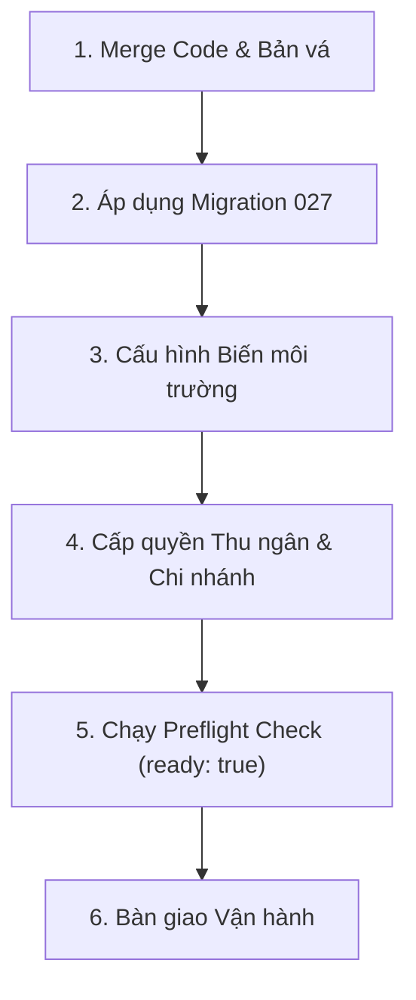

# Hướng Dẫn Các Thay Đổi Sau Kiểm Thử (Post-Verification Deployment Guide)

Tài liệu này tổng hợp toàn bộ các thay đổi và cấu hình kỹ thuật cần thực hiện sau khi hoàn tất kiểm thử cục bộ để đưa phân hệ Quản trị Admin MLD Việt Nam vào hoạt động trên môi trường Staging / Production.

---

## 1. Trạng Thái Hoàn Thành Kiểm Thử Cục Bộ (Verification Baseline)

Trước khi tiến hành thay đổi trên môi trường thực tế, toàn bộ hệ thống đã được kiểm chứng 100% đạt chuẩn:
* **Frontend Tests (`web-admin`):** 16/16 test đạt (bao gồm kiểm thử lỗi HTTP, hủy request, khóa submit đúp, phân quyền menu).
* **Backend Tests (`backend`):** 51/51 test đạt qua 10 test suites (bao gồm transaction, thu tiền chống trùng, chuỗi học viện, phân quyền chi nhánh, phép chiếu thực thu học phí).
* **Kiểm thử Trình duyệt Toàn diện (`admin-browser.cjs`):** 51/51 tài nguyên quản trị (44 generic CRUD + 7 dedicated screens) render sạch, 0 lỗi JavaScript, xác thực JWT, phân quyền chi nhánh và đối soát ca POS đạt 100%.
* **Đồng bộ Thẩm mỹ Spa MLD:** Đã chuẩn hóa toàn bộ tone màu Spa MLD (`#8A4F23`, `#FAF0E4`, `#EFE4D9`, `#2C241E`) cho toàn bộ các trang, bao gồm cả `W13_StaffCommissions.tsx` (Hoa hồng KTV) và `W14_ZaloZNS.tsx` (Zalo CRM).

---

## 2. Danh Mục Các Thay Đổi Cần Thực Hiện Theo Thứ Tự



### Bước 1: Merge Code và Bản vá
* Toàn bộ mã nguồn cải tiến độ tin cậy được lưu tại worktree `admin-reliability`.
* Áp dụng các thay đổi vào nhánh chính hoặc merge Pull Request:
  * Transaction và advisory lock chống thu tiền trùng trong `admin.service.ts`.
  * Bộ lọc chi nhánh an toàn không lộ `password_hash` trong `posWorkspace`.
  * Hook bảo vệ biểu mẫu chống mất dữ liệu `useDialogGuard.ts`.
  * Giao diện chuẩn MLD Spa ấm áp cho `W13_StaffCommissions.tsx` và `W14_ZaloZNS.tsx`.

### Bước 2: Áp dụng Migration Cơ sở Dữ liệu
Chạy tệp migration sau trên CSDL PostgreSQL thật:
* **Tệp migration:** `database/migrations/027_admin_reliability.sql`
* **Nội dung thực thi:**
  1. Tạo bảng sổ cái yêu cầu thanh toán `admin_payment_requests` với khóa chính `(actor_id, request_id)` để chống duplicate payments.
  2. Bật Row Level Security (RLS) và thu hồi toàn bộ quyền từ `anon, authenticated` (chỉ backend service_role mới có quyền truy cập).
  3. Thêm cột `assigned_staff_id UUID REFERENCES users(id)` vào bảng `course_enrollments` để lưu vết nhân sự tư vấn tuyển sinh hưởng hoa hồng.

### Bước 3: Cấu hình Biến Môi Trường (Environment Variables)

#### Phía Web Admin (`web-admin/.env` hoặc Vercel / Cloudflare Pages):
```env
# Kích hoạt chế độ đọc ghi qua Backend an toàn thay vì ghi trực tiếp bằng Supabase SDK client
VITE_ADMIN_DATA_SOURCE=backend
VITE_API_BASE_URL=https://<api-domain>/api/v1
```

#### Phía Backend API (`backend/.env` hoặc Docker / VPS):
```env
ADMIN_DATABASE_URL=postgresql://<user>:<PASS>@<host>:5432/<database>
JWT_SECRET=<chuỗi-bí-mật-jwt-tối-thiểu-32-ký-tự>
```

### Bước 4: Cấp Quyền Phân Hệ & Gắn Chi Nhánh (Roles & Permissions)
1. Thêm 2 quyền mới vào bảng `permissions` và gán cho các vai trò Thu ngân / Tiếp đón trong `role_permissions`:
   * `cashier.shifts`: Quyền mở ca, đóng ca và đối soát tiền mặt cuối ca.
   * `cashier.collect`: Quyền thực hiện thu tiền hóa đơn POS, cọc dịch vụ và thu học phí.
2. Gắn đúng `branch_id` cho từng nhân viên/thu ngân trong bảng `user_roles`. Backend sẽ tự động giới hạn phạm vi dữ liệu theo đúng chi nhánh được cấp. Quản trị viên cấp cao (`ADMIN`, `SUPER_ADMIN`) giữ phạm vi toàn hệ thống.

### Bước 5: Chạy Kiểm Tra Xác Nhận Trước Khi Mở Hệ Thống (Preflight Check)
Từ thư mục `backend`, chạy lệnh:

```powershell
npm run check:admin-schema
```

> [!IMPORTANT]
> Lệnh này chỉ thực hiện truy vấn `SELECT` cấu trúc CSDL và so khớp với định nghĩa TypeScript. Kết quả bắt buộc phải trả về:
> ```json
> {
>   "ready": true,
>   "missing": []
> }
> ```
> Nếu `ready: false`, tuyệt đối không mở hệ thống cho nhân viên mà cần kiểm tra lại các bước chạy migration.

---

## 3. Lưu Ý Nghiệp Vụ & Đối Soát Dữ Liệu Lịch Sử

1. **Dữ liệu Học phí Cũ:** Hệ thống mới sử dụng read-model `projectTuitionReceipts` để hiển thị phiếu thu học phí trong POS mà không sao chép sang bảng `invoices`. **Không tự ý xóa hay gộp dữ liệu lịch sử** dựa trên ước đoán để tránh sai lệch báo cáo kế toán.
2. **Hoa hồng Nhân sự:** Hoa hồng tư vấn (`PACKAGE_UPSELL`, `SERVICE_DIRECT`) tự động tính trên giá trước thuế sau chiết khấu (`preTax`), đảm bảo không chi vượt ngân sách thực thu.
3. **Chính sách Supabase RLS:** Trước khi mở cho toàn bộ người dùng, hãy kiểm tra xác thực phân quyền thực tế trên môi trường Staging với các tài khoản thử nghiệm của từng vai trò (Kỹ thuật viên, Thu ngân, Quản lý chi nhánh).

---

## 4. Chuẩn Hóa Vận Hành Thu Ngân POS 4 Nguồn Thu & Chống Trùng (Hoàn tất 10/11/2026)

Hệ thống POS Thu ngân được tối ưu theo 4 luồng nguồn thu nghiệp vụ độc lập, tự động nhận diện và dẫn dắt thu ngân đúng quy trình:

### 4.1. Bốn Nguồn Thu Nghiệp Vụ Riêng Biệt
1. **Bán tại quầy (Walk-in Direct Sales):** Cho phép bán tự do các dịch vụ lẻ và sản phẩm bổ trợ cho cả khách vãng lai (`GUEST`) hoặc khách thành viên có tích điểm/hạng thẻ. Tự động tính VAT (0%, 8%, 10%) và hỗ trợ 3 hình thức thanh toán (Tiền mặt, VietQR động, Quẹt thẻ POS).
2. **Quyết toán Lịch hẹn (Booking Checkout Queue):**
   - Danh sách hàng chờ thông minh tự động ưu tiên các ca đã hoàn tất chuyên môn lên đầu (`★ CHUYÊN MÔN HOÀN TẤT`).
   - Nạp vào quầy tự động chuyển POS sang đúng chi nhánh của lịch hẹn.
   - Khóa cố định thông tin khách hàng, dịch vụ và đơn giá theo đúng lịch hẹn gốc để tránh thu ngân sửa đổi sai lệch.
   - Chặn tuyệt đối thanh toán trùng: Backend kiểm tra `SELECT id FROM invoices WHERE booking_id = $1 AND payment_status = 'PAID'` trước khi ghi nhận hóa đơn mới.
   - Tự động hoàn tất lịch hẹn và giải phóng tài nguyên (giường & KTV) ngay khi thanh toán thành công.
3. **Bán Gói Liệu Trình (Package Registration):**
   - Bắt buộc khách hàng định danh: Chặn không cho phép khách vãng lai mua gói nhằm đảm bảo quyền lợi theo dõi hồ sơ điều trị cá nhân.
   - Cấm áp dụng chiết khấu tùy tiện nếu gói liệu trình đã có cấu hình giá ưu đãi niêm yết sẵn (`discounted_price`).
   - Sau khi thanh toán thành công, cung cấp tùy chọn dẫn trực tiếp sang "Đặt buổi đầu tiên ngay" để tăng tốc phục vụ.
4. **Thu Học Phí (Tuition Collection):**
   - Thu ngân chọn chi nhánh cụ thể để mở phiếu thu học phí (chặn thu nếu đang chọn chế độ 'Tất cả chi nhánh').
   - Kiểm tra chặt chẽ số tiền nộp: Không cho phép thu vượt quá số dư nợ còn lại (`amount <= due`).
   - Tự động lưu vết nhân viên tuyển sinh hưởng hoa hồng trong cùng giao dịch.

### 4.2. Khóa Bảo Vệ Ca Làm Việc & Toàn Vẹn Dữ Liệu (Shift Lock & Integrity)
- **Bắt buộc mở ca:** Nút thanh toán POS và thu học phí tự động khóa (`disabled`) khi chưa có ca mở (`!currentShift`), hiển thị chỉ dẫn rõ ràng cho thu ngân.
- **Loại bỏ hoàn toàn fallback client:** Việc mở ca chỉ thực hiện qua API Backend (`posService.openShift`) với kiểm tra phân quyền chi nhánh chặt chẽ, loại bỏ hoàn toàn việc gọi trực tiếp Supabase SDK từ trình duyệt.
- **Đối soát kết ca nghiêm ngặt:** Nếu có chênh lệch tiền mặt kiểm đếm so với hệ thống tính toán (`closingCash !== systemCash`), thu ngân bắt buộc phải nhập lý do giải trình (tối thiểu 5 ký tự) trước khi được xác nhận kết ca.

### 4.3. Bằng Chứng Kiểm Thử Đạt Chuẩn 100%
- **Backend Tests:** 55/55 tests passed (11 test suites bao gồm `admin.workflows.spec.ts`, `admin.service.spec.ts`, `admin.access.spec.ts`).
- **Frontend Tests (`web-admin`):** 16/16 tests passed.
- **Biên dịch TypeScript & Build:** `web-admin` (Vite) và `backend` (NestJS) biên dịch hoàn tất với exit code 0.
- **Security Secret Audit:** Quét 0 bí mật rò rỉ (`npm run check:secrets` [OK]).
- **E2E Acceptance Tests:** 16/16 giai đoạn kiểm thử tích hợp đạt 100%.
